# HEPLab

**Start with the [engineering handbook](docs/engineering/README.md):** the complete
target architecture, physics algorithms, contracts, traceable requirements, validation
strategy, diagrams and an explicit implementation/defect inventory. The existing
code is an early prototype; the handbook marks planned capabilities separately.

**Reproducible LHC analysis and simulation on [CERN Open Data](https://opendata.cern.ch) — one tool for real data and your own Monte Carlo.**

> Status: **early implementation** · v0.1.0.dev0 · Apache-2.0 · [Project sketch](docs/PROJECT.md) · [Architecture](docs/ARCHITECTURE.md) · [ADRs](docs/adr/README.md)

```mermaid
flowchart TD
    ROOT["HEPLab monorepo"]

    subgraph SRC["src/heplab — Python 3.12 core"]
        direction TB
        SCHEMA["schema/ — event model v1<br/>(keystone, ADR-0003)"]
        IO["io/ — fetch · cache · provenance"]
        READERS["readers/ — nanoaod · aod · delphes"]
        PROC["processors/ — coffea + numba"]
        ANALYSES["analyses/ — dimuon A1 · …"]
        STATS["stats/ — zfit · iminuit · JAX"]
        SIM["sim/ — PYTHIA8 · DELPHES glue"]
        SERVER["server/ — FastAPI dashboard"]
        CLI["cli.py"]
    end

    K["kernels/ — Rust · PyO3 · maturin (Tier 1, ADR-0010)"]
    M["manifests/ — dataset catalog · YAML"]
    T["tests/ — pytest (stdlib-only in P0)"]
    DEP["deploy/ — Dockerfile · heplab-base"]
    CI[".github/workflows/ — CI · YAML"]
    NB["notebooks/ — Jupyter gallery"]
    DOC["docs/ — Markdown · mermaid · 10 ADRs"]

    ROOT --> SRC
    ROOT --> K & M & T & DEP & CI & NB & DOC

    classDef python fill:#3776ab,stroke:#1d4f7c,color:#fff;
    classDef pythonStub fill:#3776ab,stroke:#1d4f7c,color:#fff,stroke-dasharray:5 5;
    classDef rust fill:#dea584,stroke:#b3551d,color:#3b2107;
    classDef yaml fill:#6b8e23,stroke:#4f6a19,color:#fff;
    classDef docker fill:#1d63ed,stroke:#0f3d99,color:#fff;
    classDef md fill:#8a8f98,stroke:#5c6066,color:#fff;

    class SCHEMA,IO,CLI python
    class READERS,PROC,ANALYSES,STATS,SIM,SERVER pythonStub
    class K rust
    class M,CI yaml
    class DEP docker
    class DOC md
```



See [docs/SKELETON.md](docs/SKELETON.md) for implementation status and planned components.

## Quickstart

```bash
# install core, then the optional scientific stack for ROOT input and fitting
pip install -e .
pip install -e '.[analysis]'

heplab version              # → heplab 0.1.0.dev0
heplab catalog list         # browse manifests/datasets/
heplab run dimuon --input events.json --output artifacts/dimuon.json
heplab plot artifacts/dimuon.json

pytest
```

`heplab run dimuon --input` accepts a JSON list of schema-v1 events (or
`{"events": [...]}`) and a NanoAOD ROOT file. Results include cutflows,
histogram bins, selected pair masses, and provenance. `heplab plot` writes a
PNG; `heplab fit` uses the optional iminuit CPU backend. Cached events use
Parquet when pyarrow is installed, under `~/.cache/heplab` by default (override
with `HEPLAB_CACHE_DIR`).

The repository catalog now contains verified metadata for `Run2016G_DoubleMuon`
([record 30522](https://opendata.cern.ch/record/30522)). A 100-event sample was
read over HTTPS. The current pipeline applies pinned certification, separates
exact source ranges in cache v2, preserves signed weights and writes immutable
artifacts. The canonical manifest and compatibility alias ship in the wheel.
The checked Rust numerical core and PyO3 binding compile in Linux/WSL and match
the reference on 507 cases each. See the [implementation report](docs/engineering/implementation.md)
and [native engine guide](kernels/README.md). Detector calibration, a built
PYTHIA8/DELPHES image, CMS AOD and a browser dashboard remain release work.

Documentation checks: `python tools/check_handbook.py`.
Numerical reference checks: `python -m pytest tests/test_physics_reference.py -q`.
With `pip install -e '.[docs]'`, build the handbook using `mkdocs build --strict`
or read the linked Markdown directly.

## The language stack in one line

Python 3.12 shell (API/CLI/processors/stats) · **Rust** kernels via PyO3 (Tier 1, profile-first) · **JAX** GPU fitting behind zfit/iminuit (Tier 2) · **C++** simulators (PYTHIA8/DELPHES) in containers · **Mojo** pilot lane · YAML manifests/configs · Docker images. Details and governance rules: [ADR-0010](docs/adr/0010-polyglot-compute-strategy.md).

## Roadmap

P0 Foundations (this skeleton) → P1 Data Foundation → P2 First Analyses → P3 Simulation Chain → P4 Dashboard & DX → P5 Release. Exit criteria: [docs/PROJECT.md §7](docs/PROJECT.md).

## License

Apache-2.0 — see [LICENSE](LICENSE). CERN Open Data is consumed per-record terms (predominantly CC0/public domain), always cited via DOI.

## Simulator workspace

Install `pip install -e '.[analysis,serve]'`, then run `heplab gui --open-browser`.
The local application provides numeric properties, a model tree, linked particle
inspection, XY/XZ/3D views, event navigation, Run/Stop controls, and result export.
On this Windows/WSL checkout, `.\tools\start_workbench.ps1` configures the installed
Rust and native simulation runtimes before opening the GUI.

See the [runtime installation and native acceptance guide](docs/engineering/sim-runtime.md),
[material model domains](docs/engineering/material-response.md), and
[GUI interaction design and source review](docs/engineering/gui-design.md).
Event displays export as vendor-neutral OpenUSD stages
(`heplab export-usd`, viewable in usdview/Blender on any GPU and RTX-renderable
in Omniverse on NVIDIA machines) — see [USD event display export](docs/engineering/usd-export.md).

## Open-source website and application architecture

The public project guide is built from `web/` with Astro and Starlight. Run it locally with `pnpm --dir web dev`; the Workbench is a separate local application available through the desktop app or `heplab gui`.
The reference and Rust bench are educational; the native collision backend is
smoke-tested and remains uncalibrated and independently unvalidated.

The latest [geometry and calibration increment](docs/engineering/geometry-calibration.md)
adds sourced original-CMS pixel surfaces, ideal-solenoid trajectories and crossing
inspection, a held-out-tested PDG silicon loss fit, and an optional coarse DELPHES
muon-response transfer model. Experimental CMS calibration remains pending.
