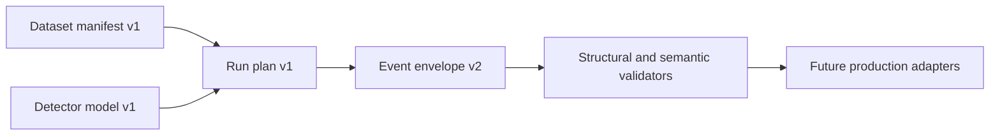

# Target interchange contracts

Status: proposed target contracts. These JSON Schemas are not the current Python dictionary/Parquet schema and are not accepted by the legacy CLI without a migration adapter. `dataset.schema.json` describes manifest v1; `event-chunk.schema.json` describes event envelope v2; detector and run plan are new v1 contracts.

`examples/` contains synthetic educational fixtures. All-zero hashes are visible placeholders for illustrative structure, not real source/model checksums or validation evidence. They must never appear as real-data provenance. No example claims to be a CERN detector geometry or calibrated model. The example envelope supports the first dimuon milestone; the handbook describes richer optional collections whose strict machine contracts must be added and reviewed before those capabilities ship.

JSON Schema validates shape/types; semantic checks enforce increasing intervals, nonoverlapping source ranges, identity consistency and model domains. It cannot prove scientific validity, calibrated coefficients or honest source attribution. The `.invalid` `$id` hostname names a local schema namespace and is deliberately non-resolvable; validators load these local files without network.

Run `python tools/check_handbook.py` to validate the checked-in examples. Full target semantics and future Arrow equivalence are defined by the [event contracts](../docs/engineering/03-event-contracts.md), [data pipeline](../docs/engineering/02-data-supply.md) and [execution](../docs/engineering/11-execution.md) chapters.
