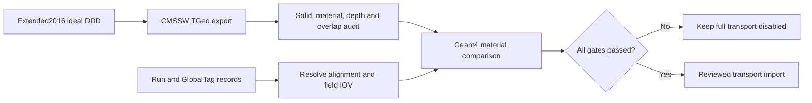

# CMS geometry and material export

The pinned CMSSW image has exported and reference-navigated the ideal
Extended2016 geometry. This is not the aligned reconstruction geometry, and
the existing iSpy outlines are still not transport solids.

Use the [official Open Data CMSSW image and instructions](https://opendata.cern.ch/docs/cms-guide-docker),
`cmsopendata/cmssw_10_6_30-slc7_amd64_gcc700`.

The reproducible export configuration is
`deploy/cms/export_geometry_2016_cfg.py`. The completed run and evidence are
preserved under `artifacts/cms/geometry/export-2016-retry1/`. It contains the
ROOT geometry, the 108-ray material reference, logs, and the pinned image and
artifact identities in `run.json`.

The completed ROOT 6.14/09 TGeo scan at 0.01 cm produced 146 candidates (73
extrusions and 73 overlaps). These are not automatically physical errors or
benign geometry constructs. The classification and volume pairs are in
`overlap-audit-classified.json`; review them before enabling full transport.
Source-aware triage is in `overlap-review.json`, and ROOT placement transforms
and shape classes are in `overlap-placement-details.json`. In particular, the
pinned CSC DDD source confirms several daughters extend outside their mother
solids. Their intended semantics and Geant4 navigation impact remain
unresolved; no overlap candidate is cleared for transport. An independent
Geant4/DDD navigation comparison is required next. Material equivalence and
material/process transport are also not yet validated.

To reproduce the export with the initialized image:

```sh
cmsRun /workspace/deploy/cms/export_geometry_2016_cfg.py > geometry-export.log 2>&1
```

The configuration explicitly loads the ideal **Extended2016** DDD description,
then uses upstream `TGeoMgrFromDdd` and `DumpSimGeometry`. The depth limit is 100,
not the upstream display default of 14. Save the ROOT output, complete logs,
CMSSW release, container digest, configuration SHA256 and source XML inventory.
Reject any unconverted solid, missing material or truncated hierarchy before
using the output for material navigation. TGeo derives radiation/interaction
lengths from composition; compare these with Geant4 material values before
declaring transport equivalence. Overlap and boundary tests remain required.

**This is an ideal geometry export, not the aligned reconstruction conditions.**
Record 30522's NanoAOD processing used `106X_dataRun2_v35`; its RECO stage used
`106X_dataRun2_v27`. Do not replace the former with the latter or attach either
GlobalTag to an XML export as if it had resolved the associated records.
Run2016G covers runs 278820–280385. An EventSetup probe under
`106X_dataRun2_v35` retrieved `MagneticField` at runs 278820–278822, but this
does not establish the payload tag or IOV coverage. The image's `conddb list`
is blocked by the missing Python 2 Frontier SQLAlchemy dialect. Resolve
geometry, alignment, field current/scaling and their IOVs from conditions
together before enabling a full conditions-backed transport mode.

The official field files are fetched separately by
`python tools/fetch_cms_field.py` into `artifacts/cms/field/`. Their inventory
pins every URL and SHA256. `merged.bin`/`merged.index` need their compatible CMS
volume-aware reader and geometry; they are **not** a regular Cartesian grid.
The source repository revision and the CMSSW configuration revision are separately
pinned; binary compatibility and Run2016G condition selection are unverified.


