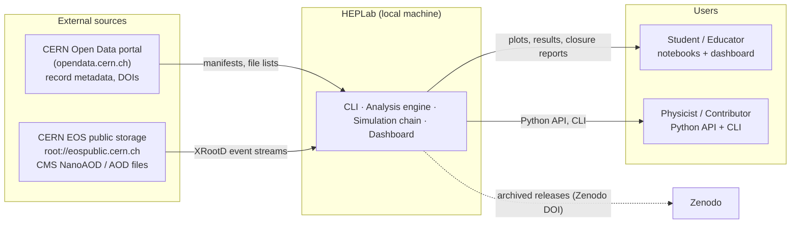
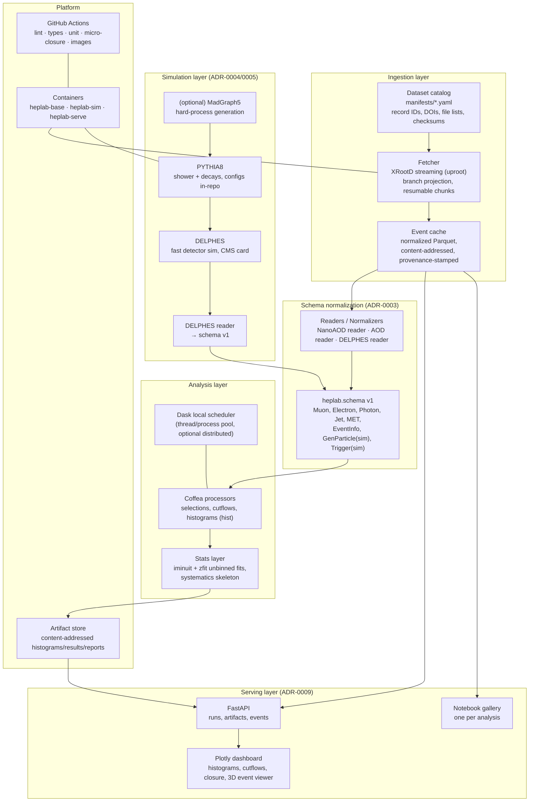

# HEPLab — System Design Architecture

> Historical architecture sketch. Use the [engineering architecture](engineering/01-architecture.md)
> and [current implementation ledger](engineering/17-delivery-plan.md) for the
> authoritative target and gaps. The diagrams below include planned features.

> Status: Draft sketch v0.1 · 2026-10-26 · Decisions referenced as ADR-xxxx (see [adr/README.md](adr/README.md))

---

## 1. Guiding principles

1. **One code path for data and simulation.** The keystone of the design (ADR-0003): a versioned internal event schema that both real CMS data and locally simulated events are normalized into. Analyses never know their source. This is what makes closure tests natural.
2. **Columnar everything.** Events are awkward arrays; parallelism is chunk-level (coffea/Dask); caches are parquet (ADR-0001, ADR-0006).
3. **Stream, don't hoard.** Read ROOT files remotely via XRootD, project only needed branches, cache derived columns (ADR-0002).
4. **Provenance or it didn't happen.** Every artifact carries a provenance stamp (git SHA, config hash, dataset manifest hash, container digest, schema version) (ADR-0008).
5. **Laptop-first.** Everything runs locally; scale-out (Dask distributed) is optional, never required.

## 2. System context (C4 level 1)



## 3. Component architecture (C4 level 2)



## 4. The keystone: unified event schema

All three readers (CMS NanoAOD, CMS AOD, DELPHES) normalize into `heplab.schema.v1`:

```python
# Sketch of the internal model (awkward-array record collections)
EventChunk:
    EventInfo:  run, luminosityBlock, event, is_data, weight (sim only)
    Muon:       pt, eta, phi, mass, charge, iso, quality_flags
    Electron:   pt, eta, phi, mass, charge, iso, quality_flags
    Photon:     pt, eta, phi, mass, iso, has_pixel_seed
    Jet:        pt, eta, phi, mass, btag
    MET:        pt, phi
    GenParticle: pdg_id, status, pt, eta, phi, mass, parent_idx   # sim only
    Trigger:    names[], fired[]                                  # sim: emulated
```

Branch mapping lives in reader plugins, e.g.

| Schema field | CMS NanoAOD | DELPHES |
|---|---|---|
| `Muon.pt / eta / phi` | `Muon_pt / Muon_eta / Muon_phi` | `Muon.PT / Muon.Eta / Muon.Phi` |
| `Muon.charge` | `Muon_charge` | `Muon.Charge` |
| `Muon.iso` | `Muon_pfRelIso04_all` | computed from `Muon.IsolationVar` |
| `Photon.iso` | `Photon_pfRelIso03_all` | `Photon.IsolationVar` |
| `MET.pt / phi` | `MET_pt / MET_phi` | `MissingET.MET / MissingET.Phi` |
| `GenParticle.*` | `GenPart_*` (flat, packed) | `Particle` (full truth tree) |

Each mapping is unit-tested against small golden files committed to the repo. Information lost in mapping (e.g. DELPHES isolation granularity) is documented per collection.

## 5. Key flows

### 5.1 Real-data flow
```
manifest → fetch (XRootD stream, branch projection, N-event chunks)
         → normalize → schema v1 → parquet cache (content-addressed)
         → coffea processor (selection → cutflow → histograms)
         → fit (zfit/iminuit) → artifact (histogram, result, provenance stamp)
         → dashboard / notebook
```

### 5.2 Simulation flow
```
generator config (repo) → PYTHIA8 (shower) → DELPHES (CMS card) → ROOT file
                        → DELPHES reader → schema v1 → (same cache/processor path as 5.1)
```

### 5.3 Closure flow — the differentiating feature
```
same analysis module ──┬── run on cached DATA    → histograms_data
                       └── run on cached SIM     → histograms_sim
                            → closure report: spectra overlay,
                              efficiency vs pT/η, resolution maps,
                              documented model-fidelity caveats
```
CI runs a **micro-closure** (10k sim events) on every pull request so analysis code and schema changes cannot silently break the data/sim contract.

## 6. Interfaces

### 6.1 CLI
| Command | Purpose |
|---|---|
| `heplab catalog list\|info <ds>` | Browse manifest catalog (record IDs, sizes, DOIs) |
| `heplab fetch <ds> [--sample 1GB]` | Stream + normalize + cache |
| `heplab run <analysis> --config c.yaml` | Execute analysis on data (and/or sim) |
| `heplab sim generate\|simulate` | PYTHIA8 / DELPHES runs in the sim container |
| `heplab closure <analysis>` | Data-vs-sim closure report |
| `heplab plot <artifact>` / `heplab serve` | Render / launch dashboard |

### 6.2 REST (dashboard backend, localhost)
| Endpoint | Purpose |
|---|---|
| `GET /api/datasets` | Catalog listing |
| `POST /api/runs` | Launch an analysis run (async, job status) |
| `GET /api/runs/{id}` | Status, logs, cutflow |
| `GET /api/runs/{id}/artifacts` | Histograms, fit results |
| `GET /api/events/{ds}?n=1` | Random event (from cache) for the 3D viewer |
| `GET /api/closure/{runA}/{runB}` | Closure comparison |

### 6.3 Python API
```python
from heplab import catalog, analyses
from heplab.schema import load_chunks   # yields schema-v1 chunks (data or sim)

ds = catalog.get("Run2016_DoubleMuon")
for chunk in load_chunks(ds, branches="muons"):
    ...   # or use coffea processor for parallel runs
result = analyses.dimuon.run(ds, config="configs/dimuon.yaml")
```

## 7. Technology stack

| Layer | Choice | Rationale / ADR |
|---|---|---|
| Language | Python 3.12 | ecosystem + teaching (ADR-0001) |
| Kernel layer *(proposed)* | numba baseline; Rust via PyO3 for profiled hot paths | safe parallel kernels, invisible to users (ADR-0010) |
| GPU/autodiff *(proposed)* | JAX backend behind zfit/iminuit API | GPU fits + toy-MC systematics ensembles (ADR-0010) |
| Event I/O | uproot + awkward-array | pure-Python ROOT reading (ADR-0001) |
| Parallelism | coffea processors + Dask | columnar chunk processing (ADR-0006) |
| Pipelines | Snakemake | DAGs with provenance, pip-native (ADR-0006) |
| Data access | XRootD + parquet cache | stream, don't hoard (ADR-0002) |
| Detector sim | DELPHES (CMS card) | fast, configurable (ADR-0004) |
| Generator | PYTHIA8 (+ LHAPDF); MadGraph5 optional | standard shower; hard processes (ADR-0005) |
| Statistics | iminuit + zfit; pyhf later | unbinned fits, templates (ADR-0007) |
| Plots | hist + mplhep | HEP-styled, artifact-ready (ADR-0001) |
| Serving | FastAPI + Plotly + three.js viewer | light, local (ADR-0009) |
| Packaging | uv, Docker multi-stage, ghcr images | reproducibility (ADR-0008) |
| CI/CD | GitHub Actions | lint, types, tests, micro-closure (ADR-0008) |

## 8. Repository layout (monorepo)

```
heplab/
├── pyproject.toml               # uv-managed, locked
├── src/heplab/
│   ├── schema/                  # v1 event model, version registry
│   ├── io/                      # xrootd fetcher, parquet cache, provenance
│   ├── readers/                 # nanoaod.py, aod.py, delphes.py
│   ├── processors/              # shared coffea processors (selection, histos)
│   ├── analyses/                # dimuon/, diphoton/, ... + configs + golden tests
│   ├── sim/                     # pythia configs, delphes cards, runners
│   ├── stats/                   # fits, systematics
│   ├── server/                  # FastAPI app
│   └── cli.py
├── manifests/datasets/*.yaml    # catalog: record IDs, DOIs, files, checksums
├── notebooks/                   # gallery + masterclass versions
├── tests/                       # unit, golden-file, micro-closure
├── docs/                        # mkdocs site (this sketch lives here)
├── deploy/                      # Dockerfiles, compose, CI workflows
└── .github/workflows/
```

## 9. Scaling & performance notes

- **Chunking:** process in ~100k-event chunks; embarrassingly parallel across files/chunks (Dask threads → processes → distributed as needed).
- **Cache economics:** a dataset is streamed once; subsequent runs hit parquet cache (typically 10–100× smaller than source after projection).
- **Sim throughput:** PYTHIA8+DELPHES runs at ~10²–10³ events/s/core for Z→μμ-class processes; 1M events ≈ minutes–hours on a laptop, parallelizable across cores.
- **Optional scale-out:** `dask distributed` to a lab server or cloud bucket; no architectural change (ADR-0006).

## 10. Provenance & licensing

- **Provenance stamp** attached to every artifact: `{schema_version, git_sha, config_sha256, dataset_manifest_hash, file_checksums, container_digest, dask_notes}`. Artifacts are content-addressed; two identical stamps ⇒ identical physics content.
- **Licensing:** code Apache-2.0 (ADR-0008); CERN Open Data consumed per-record terms (predominantly CC0/public domain with attribution courtesy); derived plots cite dataset DOIs + portal record IDs automatically in captions.
- **Security:** local-only tool, no auth; outbound connections limited to opendata.cern.ch / EOS public endpoints.
