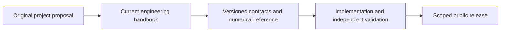

# HEPLab — Project Sketch

> Historical 2026-10-26 proposal. The [engineering handbook](engineering/README.md)
> defines the current target, scoped fidelity and evidence gates. This sketch's
> aspirational features and phase dates are not implementation claims.

> **Codename:** `heplab` (working title, not final)
> **Status:** Draft sketch v0.1 · 2026-10-26
> **Companion docs:** [ARCHITECTURE.md](ARCHITECTURE.md) · [WORKFLOW.md](WORKFLOW.md) · [ADRs](adr/README.md)

---

## 1. The idea in one paragraph

**HEPLab** is an open-source platform for reproducible particle-physics analysis **and** simulation built entirely on [CERN Open Data](https://opendata.cern.ch). A single command — `heplab run dimuon` — streams real CMS collision events directly from CERN's storage servers, runs a modern columnar (Python/awkward-array) analysis, and produces a validated physics result (e.g. the Z boson mass peak). The **same analysis code** also runs on events the user generates and detector-simulates locally (PYTHIA8 → DELPHES), which closes the loop between *what the detector really saw* and *what our simulation predicts* — the core skill of experimental particle physics, made runnable on a laptop.

**One-liner:** *"Run real LHC analyses and your own Monte-Carlo simulation with one tool, and compare them honestly."*

## 2. Motivation

- **The data is open, the barrier is not.** CERN Open Data hosts petabyte-scale CMS datasets (Run 1: 2010–2012 at 7/8 TeV; Run 2: 2016+ at 13 TeV, now including flat **NanoAOD** format). Using them still requires scattered knowledge: XRootD, ROOT files, trigger/selection conventions, detector corrections.
- **The modern stack changed the game.** `uproot` + `awkward-array` + `coffea` make CMS data readable in pure Python with no ROOT/CMSSW installation — but the pieces are not assembled into one coherent, teachable tool.
- **Simulation is half the story and usually missing.** The portal ships official simulated samples, but building *your own* generation chain (generator → parton shower → fast detector simulation) is the best way to understand how an LHC measurement actually works. No open-data tool couples "real data" and "self-made simulation" into one workflow with a built-in closure comparison.
- **Educational gold.** Masterclasses (H→γγ bump hunt, dimuon spectrum) prove the demand; they deserve a maintainable software home.

## 3. Goals / Non-goals

**Goals (v1)**
1. One pip-installable package + CLI (`heplab`) that goes from *dataset catalog → event processing → plots/fits* with one command per step.
2. At least three validated analyses on real CMS open data with cutflows and uncertainties.
3. A local simulation chain (PYTHIA8 + DELPHES) producing events in the **same internal format** as real data.
4. **Closure tooling:** every analysis runs on data and on simulation; a closure report compares efficiencies/resolutions/spectra.
5. Full reproducibility: containers + lockfiles + data manifests; every plot regenerable from one command on a fresh machine.
6. A lightweight local dashboard (histograms, cutflows, closure plots, 3D event display) and a notebook gallery.

**Non-goals (v1)**
- CMS-grade reconstruction or full Geant4/CMSSW detector simulation (DELPHES fast-sim is the model; documented as such).
- Publishing new physics results — this is a *reproduction/education/engineering* platform.
- Multi-user web deployment, authentication, or a hosted service.
- Support for all experiments: **CMS only** in v1 (richest open dataset); ATLAS/ALICE/LHCb later.

## 4. Physics portfolio

| # | Study | Input | Output | Phase |
|---|-------|-------|--------|-------|
| A1 | **Dimuon spectrum** — J/ψ, Υ, Z peaks | Run2016 DoubleMuon NanoAOD (13 TeV); classic 2011 AOD variant | Mass spectrum, peak fits, Z mass & width | P2 |
| A2 | **Z→ℓℓ measurement** w/ selection efficiency | A1 data + simulation | Z yield, acceptance×efficiency, stat/syst breakdown | P2–P3 |
| A3 | **Drell–Yan simulation study** | PYTHIA8 → DELPHES, same selection as A2 | Sim-vs-data spectrum overlay, closure report | P3 |
| A4 | **Diphoton / H→γγ bump hunt** | Run2012 DoublePhoton AOD or Run2016 DoubleEG NanoAOD | m_γγ spectrum, unbinned fit over smooth background | P4–P5 |
| A5 | **Event display** | any cached dataset | Interactive 3D event viewer (tracks, muons, jets, MET) | P4 |

**Simulation studies (P3):** generator-level vs detector-level comparisons; muon efficiency & pT turn-on curves vs η/pT; resolution maps; (optional) MadGraph5 hard-process samples (γγ, ttbar) validated against published cross sections.

## 5. Software deliverables

| Deliverable | Description |
|---|---|
| `heplab` package + CLI | `heplab catalog / fetch / run / sim / closure / plot / serve` |
| Analysis library | `heplab.analyses.dimuon`, `.diphoton`, … — processors + configs + golden tests |
| Simulation containers | `heplab-sim` image: PYTHIA8 + DELPHES + LHAPDF, configs versioned in-repo |
| Unified event schema | Versioned internal event model shared by data & simulation (keystone, see ADR-0003) |
| Dashboard | FastAPI + Plotly: browse datasets, launch runs, view histograms/cutflows/closure, 3D event viewer |
| Notebook gallery | One runnable notebook per analysis + masterclass-style guided versions |
| Docs & closure reports | MkDocs site; auto-generated closure and provenance reports |

## 6. Users

- **Student** — runs notebooks, sees real peaks, tweaks cuts, compares to their own simulation.
- **Educator** — runs a masterclass from one command; uses the dashboard live.
- **Physicist / analyst** — extends the library with a new analysis reusing schema, cache, and stats layers.
- **Open-source contributor** — works on I/O, dashboard, CI; no physics background required.

## 7. Roadmap (phases with exit criteria)

| Phase | Content | Exit criteria |
|---|---|---|
| **P0 Foundations** | Repo, CI, containers, ADRs, schema v0 | `heplab fetch` reads a 1 GB sample via XRootD; hello-world processor passes CI |
| **P1 Data Foundation** | Dataset manifests, AOD + NanoAOD readers, parquet cache, provenance stamps | Cached chunks bit-match source values in golden tests; manifest → cache pipeline documented |
| **P2 First Analyses** | A1 dimuon spectrum, A2 Z measurement, cutflows, fit skeleton | Z peak reconstructed at 91.19 GeV within reported uncertainty; every plot one command away |
| **P3 Simulation Chain** | PYTHIA8+DELPHES containers, DELPHES reader/normalizer, A3 closure | Closure report: muon efficiency & Z resolution within agreed tolerances; sim samples exist for A1–A2 |
| **P4 Dashboard & DX** | FastAPI, dashboard, event display, notebook gallery, docs site | Notebook → result on a laptop in < 10 min; event viewer usable live |
| **P5 Release & Preservation** | A4 diphoton analysis, reproducibility audit, v1.0 | Fresh-machine one-command reproduction passes; release archived (Zenodo DOI) |

## 8. Risks & mitigations

| Risk | Mitigation |
|---|---|
| Datasets are GB–TB; naive reads are slow | Branch projection + chunked streaming + normalized parquet cache; users rarely touch raw ROOT twice |
| DELPHES ≠ CMS reconstruction | Position it honestly as a *model*; document fidelity studies; never mix sim corrections into data results |
| AOD (2011/2012) is nested & awkward to read | NanoAOD-first strategy; AOD support behind the same schema, scoped to what A4/A1-classic need |
| CMSSW-only correction recipes (triggers, energy scale) | Port the small open-data correction snippets; fall back to quoting open-data-recommended ranges as systematics |
| Network flakiness on first run | Resumable fetch, checksums, `--sample` mode for CI and demos |
| Windows dev friction | Docker/WSL2 first-class; pure-Python core so the dashboard/notebooks run anywhere |

## 9. Success metrics

- **Physics correctness:** reconstructed Z mass consistent with PDG within reported uncertainty; closure efficiency agreement within tolerance.
- **Reproducibility:** fresh-machine reproduction succeeds in one command; CI runs a micro-closure (10k sim events) on every PR.
- **Accessibility:** notebook → first physics plot < 10 minutes on a laptop; no ROOT/CMSSW install required.
- **Adoption:** ≥ 3 external contributors or 1 educator using it in a course by v1.0.

## 10. References

- CERN Open Data portal: <https://opendata.cern.ch>
- CMS NanoAOD open-data guide: <https://opendata.cern.ch/docs/cms-getting-started-nanoaod>
- CMS Open Data workshops (columnar analysis lessons): <https://cms-opendata-workshop.github.io>
- IRIS-HEP analysis stack: uproot, awkward-array, coffea, hist, mplhep, zfit, iminuit, pyhf
- DELPHES fast detector simulation: <https://cp3.irmp.ucl.ac.be/projects/delphes>
