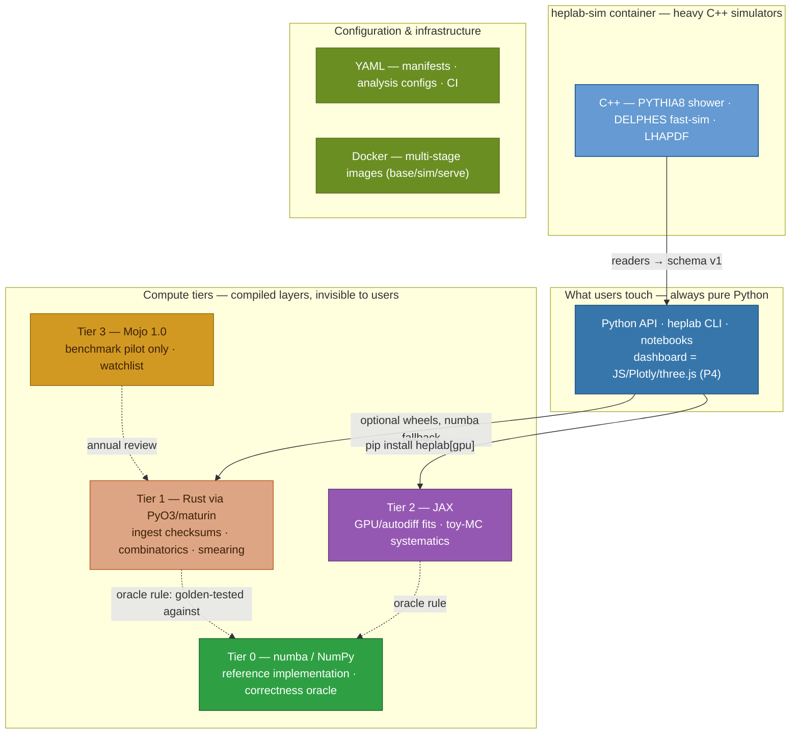

# HEPLab — Implementation Status Guide

> Historical Phase-0 snapshot. This page's pass counts and status diagrams are
> retained as history and do not describe the current checkout. See the
> [current implementation/defect ledger](engineering/17-delivery-plan.md) and
> [engineering handbook](engineering/README.md).

> What is implemented, how the pieces connect, and what remains planned. Status as of 2026-10-27.

---

## 1. Repo map — languages and implementation status

```mermaid
flowchart TD
    ROOT["HEPLab monorepo · v0.1.0.dev0"]

    subgraph SRC["src/heplab — Python 3.12 core package"]
        direction TB
        SCHEMA["schema/<br/>event model v1 · collection specs<br/>✅ real code"]
        IO["io/<br/>xrootd · cache · provenance<br/>✅ real code + Phase-1 stubs"]
        READERS["readers/<br/>nanoaod · aod · delphes<br/>◌ stubs (fixed contracts)"]
        PROC["processors/<br/>coffea processor protocol<br/>◌ stub (Phase 2)"]
        ANALYSES["analyses/dimuon/<br/>config.yaml · PROPOSAL.md<br/>◌ planned (Phase 2)"]
        STATS["stats/<br/>fit backend enum + contract<br/>◌ stub (Phase 2/4)"]
        SIM["sim/<br/>generation/simulation wrappers<br/>◌ stub (Phase 3)"]
        SERVER["server/<br/>FastAPI app factory<br/>◌ stub (Phase 4)"]
        CLI["cli.py<br/>version · catalog · roadmap verbs<br/>✅ real code"]
    end

    K["kernels/ — Rust crate (PyO3 · maturin)<br/>Cargo.toml · lib.rs placeholder kernel"]
    M["manifests/datasets/<br/>YAML — example Run2016 DoubleMuon"]
    T["tests/<br/>schema · provenance · CLI · golden/"]
    DEP["deploy/Dockerfile<br/>heplab-base (2-stage build)"]
    CIC[".github/workflows/ci.yml<br/>lint · type · test · docker"]
    NB["notebooks/<br/>gallery plan"]
    DOC["docs/<br/>PROJECT · ARCHITECTURE · WORKFLOW<br/>10 ADRs · this guide"]

    ROOT --> SRC
    ROOT --> K & M & T & DEP & CIC & NB & DOC

    classDef real fill:#2ea043,stroke:#1a5c27,color:#fff;
    classDef stub fill:#3776ab,stroke:#1d4f7c,color:#fff,stroke-dasharray:5 5;
    classDef rust fill:#dea584,stroke:#b3551d,color:#3b2107;
    classDef yaml fill:#6b8e23,stroke:#4f6a19,color:#fff;
    classDef docker fill:#1d63ed,stroke:#0f3d99,color:#fff;
    classDef md fill:#8a8f98,stroke:#5c6066,color:#fff;

    class SCHEMA,IO,CLI real
    class READERS,PROC,ANALYSES,STATS,SIM,SERVER stub
    class K rust
    class M,CIC yaml
    class DEP docker
    class T,NB,DOC md
```



**Green** = working code · **dashed blue** = contract stubs (raise `NotImplementedError` with phase + ADR) · **orange** = Rust · **olive** = YAML · **blue** = Docker · **gray** = docs/tests/notebooks.

## 2. Language stack — where every language lives (ADR-0010)



Governance (ADR-0010): profile first · every compiled kernel golden-tested against its numba reference · no compiled language visible in the API · benchmarks published per release.

## 3. Dataflow through the skeleton

```mermaid
flowchart LR
    subgraph INPUT["Inputs"]
        MAN["manifests/*.yaml<br/>record ID · DOI · files · checksums"]
        GEN["PYTHIA8 → DELPHES<br/>heplab-sim container (C++)"]
    end

    MAN --> FETCH["io.xrootd<br/>uproot over XRootD<br/>branch projection · chunks"]
    FETCH --> READ["readers/<br/>nanoaod · delphes"]
    GEN --> DELR["readers/delphes"]
    FETCH -.->|"Tier-1 Rust kernels<br/>transcode · checksums"| FETCH

    READ --> SCHEMA["heplab.schema v1<br/>Muon · Photon · Jet · MET<br/>GenParticle(sim)"]
    DELR --> SCHEMA
    SCHEMA --> CACHE["io.cache<br/>content-addressed parquet"]
    CACHE --> PROC["processors (numba)<br/>selection · cutflow · histograms"]
    PROC --> STATS["stats/<br/>zfit · iminuit · JAX GPU"]
    PROC --> CLOS["closure report<br/>data vs sim"]
    STATS --> ART["artifacts<br/>+ provenance stamp"]
    CLOS --> ART
    ART --> SERVE["server/ FastAPI<br/>dashboard · 3D event viewer"]
    ART --> NBK["notebooks"]

    classDef data fill:#6b8e23,stroke:#4f6a19,color:#fff;
    classDef keystone fill:#2ea043,stroke:#1a5c27,color:#fff;
    classDef compute fill:#3776ab,stroke:#1d4f7c,color:#fff;
    classDef rust fill:#dea584,stroke:#b3551d,color:#3b2107;
    classDef cpp fill:#659ad2,stroke:#004482,color:#fff;
    classDef out fill:#8a8f98,stroke:#5c6066,color:#fff;

    class MAN data
    class SCHEMA keystone
    class FETCH,READ,DELR,CACHE,PROC,STATS compute
    class FETCH rust
    class GEN,DELR cpp
    class ART,SERVE,NBK,CLOS out
```



## 4. Component status

| Component | Language | Status | Phase | ADR |
|---|---|---|---|---|
| `schema/` v1 registry | Python | ✅ working + tested | P0 | 0003 |
| `io/provenance.py` stamps | Python | ✅ working + tested | P0 | 0008 |
| `io/cache.py` cache keys | Python | ✅ working (store = P1) | P0→P1 | 0002 |
| `io/xrootd.py` URL builder | Python | ✅ working (fetch = P1) | P0→P1 | 0002 |
| `cli.py` version/catalog/roadmap | Python | ✅ working | P0 | — |
| readers (nanoaod/aod/delphes) | Python | ◌ contracts fixed | P1/P3/P4-5 | 0003 |
| processors + coffea/Dask | Python + numba | ◌ protocol fixed | P2 | 0001/0006 |
| `analyses/dimuon` | Python + YAML | ◌ config + proposal | P2 | — |
| stats (zfit/iminuit + JAX) | Python + JAX | ◌ backend enum | P2/P4 | 0007/0010 |
| sim glue (PYTHIA8/DELPHES) | Python ↔ C++ container | ◌ wrappers | P3 | 0004/0005 |
| `kernels/` Rust crate | Rust (PyO3) | ⚠️ scaffolded, uncompiled (no cargo locally) | P2–P3 | 0010 |
| dashboard | FastAPI + JS/Plotly | ◌ endpoints specified | P4 | 0009 |
| tests (14 cases, stdlib-only) | Python | ✅ passing | P0 | 0008 |
| CI (lint/type/test/docker) | YAML | ✅ defined | P0 | 0008 |
| heplab-base image | Dockerfile | ✅ defined | P0 | 0008 |

## 5. Verify the skeleton locally

```bash
cd D:/CERN
uv run --no-project --with pytest --python 3.12 python -m compileall -q src tests
uv run --no-project --with pytest --python 3.12 python -m pytest tests -q
uv run --no-project --python 3.12 python -c "import sys; sys.path.insert(0,'src'); from heplab.cli import main; main(['catalog','list'])"
```

(The managed Python 3.12 on this machine lives outside PATH; `uv run --python 3.12` reaches it. Inside an activated venv, plain `python`/`pytest` work.)

## 6. What Phase 1 adds

1. NanoAOD reader + golden file (first real event data through schema v1)
2. Parquet cache write/read; `heplab fetch --sample 1GB` end to end
3. Real manifest for Run2016 DoubleMuon from the portal (record ID, DOI, checksums)
4. Full-dependency CI job (uv sync) + first numba kernel with its benchmark
