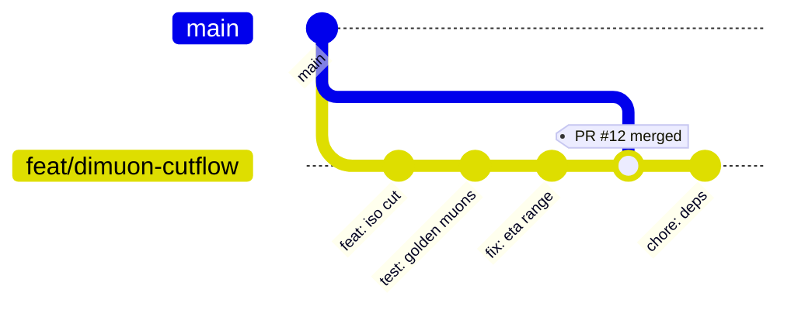

# HEPLab — Workflows

> Historical proposal. The [execution contract](engineering/11-execution.md),
> [verification gates](engineering/14-verification.md) and
> [delivery plan](engineering/17-delivery-plan.md) define the current work.
> No container, closure or publishing job is established merely by this sketch.

> Status: Draft sketch v0.1 · 2026-10-26
> Three loops run at different cadences — **engineering** (daily), **research** (per analysis), **release** (per version) — plus two domain flows (**data**, **simulation**).

---

## 1. Engineering workflow (daily loop)

Trunk-based development, GitHub flow.



1. **Issue → branch** (`feat/…`, `fix/…`, `docs/…`) from `main`.
2. **PR checks (every PR, ~15 min budget):**
   - `ruff` lint + `mypy` types
   - `pytest` unit + **golden-file tests** (tiny committed event samples — no network in CI)
   - **micro-closure test**: run the dimuon processor on 10k committed simulated events; assert schema + histogram contract
   - container build (base image) — published on merge to `main`
3. **Conventional commits** (`feat:`, `fix:`, `docs:`, `sim:`) → automatic versioning & changelog.
4. **Merge to `main`** ⇒ images published to ghcr, mkdocs site redeployed.

Definition of done (code): typed, tested, documented, container-safe, no network-dependent tests.

## 2. Research workflow (adding an analysis)

Every analysis follows the same lifecycle; artifacts in parentheses.

| Step | What happens | Artifact |
|---|---|---|
| R1 Propose | One-pager: physics goal, dataset(s), selection, observables, known pitfalls | `analyses/<name>/PROPOSAL.md` |
| R2 Implement | Coffea processor + YAML config, consuming **only** schema v1 | processor module |
| R3 Validate | Golden-event unit tests; cutflow sanity vs published open-data examples | tests |
| R4 Sim closure | Run on simulated events; efficiency/turn-on curves; model-fidelity notes | closure report |
| R5 Data run | Full run on cached data; fit; systematic skeleton (variations) | result artifact + plots |
| R6 Review | PR with notebook walkthrough reviewed by second person (physics + code) | merged analysis |
| R7 Freeze | Tag `analysis/<name>@vX`; provenance stamp recorded; notebook in gallery | release tag |

**Rule:** R4 precedes R5. An analysis that hasn't demonstrated its behavior on simulation does not get run on data.

## 3. Data workflow

```
manifest (YAML: portal record ID, DOI, file list, sizes, checksums)
   → heplab fetch: XRootD stream, branch projection, resumable chunks
   → checksum verification → schema normalization → parquet cache
   → every artifact downsteam embeds {manifest_hash, file_checksums, config_sha256, git_sha, container_digest}
```

- Manifests are **code-reviewed** like source (they define the physics input).
- Cache is content-addressed by `(dataset, branch-set, schema version)`; deleting the cache never invalidates provenance.
- `--sample` mode (e.g. first N files / 1 GB) exists everywhere for demos and CI.

## 4. Simulation workflow

| Step | Content | Gate |
|---|---|---|
| S1 Configure | PYTHIA8 config / MadGraph card + DELPHES CMS card in `sim/` | reviewed like code |
| S2 Validate | Small run; inclusive cross section vs published value within generator accuracy | validation note |
| S3 Produce | Full generation in `heplab-sim` container, parallelized across cores | artifact + stamp |
| S4 Normalize | DELPHES ROOT → schema v1 → cache | golden tests |
| S5 Closure | Same analysis on sim vs data (efficiency, resolution, spectra) | closure report |

Generator configs are versioned and stamped into outputs, so "which tune/PDF produced this histogram" is always answerable.

## 5. Release workflow

1. `main` green → tag `vX.Y.Z` (semantic; minor = new analysis, patch = fixes).
2. Release checklist: reproducibility audit on a **fresh machine** (one-command reproduction of the three flagship analyses), docs pass, license headers.
3. Publish: images (ghcr), package (PyPI), source+notebooks archived with DOI (Zenodo), changelog auto-generated.
4. Data manifests re-verified against the portal at release time (records occasionally gain errata).

## 6. Definition of done — summary

| Unit | DoD |
|---|---|
| Code change | typed, linted, unit + golden tests, CI green |
| Analysis module | R1–R7 complete, closure report exists, one-command plot |
| Simulation study | S1–S5 complete, cross-section validated, stamp recorded |
| Release | fresh-machine repro passes, images+DOI published, manifests re-verified |

## 7. Tooling summary

| Concern | Tool |
|---|---|
| Packaging/deps | uv (+ lockfile) |
| Lint/types/format | ruff, mypy |
| Tests | pytest (+ golden files, micro-closure job) |
| Pipelines | Snakemake (multi-step DAGs) |
| Parallelism | coffea + Dask |
| Containers | Docker multi-stage → ghcr |
| CI/CD | GitHub Actions |
| Docs | mkdocs-material + notebook gallery |
| Archiving | Zenodo DOI per release |
