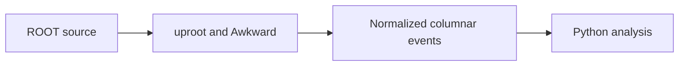

# ADR-0001: Python-first analysis stack with uproot/awkward (no ROOT/CMSSW dependency)

> Historical design proposal. Current scope and implementation evidence are defined
> in the [engineering handbook](../engineering/README.md) and ADR-0011.
> The following diagram describes the proposal, not shipped capability.

- **Status:** Proposed
- **Date:** 2026-10-26

## Context

Analysis code must read CMS open-data ROOT files (NanoAOD, AOD) and be teachable, installable, and testable on ordinary laptops (Windows/macOS/Linux) without CERN-specific infrastructure. The traditional path — ROOT/PyROOT, or CMSSW inside legacy Scientific Linux containers — is heavyweight, hard to install, and hostile to teaching and CI.

## Decision

HEPLab is **Python 3.12-first** and depends on the IRIS-HEP columnar stack:

- `uproot` + `awkward-array` for reading ROOT files into columnar jagged arrays;
- `coffea` processors for analysis structure and parallelism;
- `vector`, `hist`, `mplhep` for Lorentz math, histogramming, HEP-styled plots.

ROOT/CMSSW appear only **inside containers**, and only for simulation tooling (ADR-0004/0005) — never as a user-facing dependency of the analysis path.

## Alternatives considered

| Option | Why not |
|---|---|
| PyROOT as primary I/O | Requires ROOT install everywhere; C++ JIT friction; poor Windows story |
| CMSSW-only analysis | Legacy SL containers, huge images, steep learning curve; overkill for open-data analysis |
| Julia / Rust | Faster in places, but fragmentary HEP ecosystem; fails the teaching goal |

## Consequences

- **Positive:** `pip install heplab` is genuinely the whole install; notebooks, tests, and CI run anywhere; code is reviewable by non-HEP contributors.
- **Negative:** occasional features still live only in ROOT (we route those through containers or reimplement); columnar style has a learning curve for loop-thinking students (mitigated by notebook gallery).
- **Neutral:** performance is adequate for open-data subsets; scale comes from parallelism (ADR-0006), not language speed.

## References

- CMS open-data NanoAOD guide: https://opendata.cern.ch/docs/cms-getting-started-nanoaod
- uproot / awkward / coffea documentation (IRIS-HEP)
