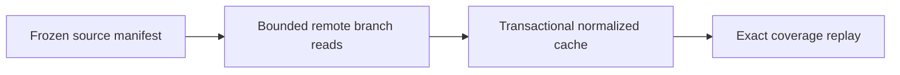

# ADR-0002: Stream data from CERN via XRootD; cache normalized parquet, never mirror raw datasets

> Historical design proposal. Current scope and implementation evidence are defined
> in the [engineering handbook](../engineering/README.md) and ADR-0011.
> The following diagram describes the proposal, not shipped capability.

- **Status:** Proposed
- **Date:** 2026-10-26

## Context

CMS open datasets range from hundreds of MB to TBs, hosted publicly on CERN EOS and reachable anonymously via XRootD (`root://eospublic.cern.ch//eos/opendata/...`) and HTTPS. Users are on laptops with limited disk and unreliable networks. Re-running analyses should not re-read multi-GB ROOT files, but we also cannot ask users to mirror TB-scale raw data.

## Decision

- **Stream remotely** through uproot over XRootD (HTTPS fallback), reading only **projected branches** and processing in resumable N-event chunks.
- After first pass, persist a **normalized parquet cache** keyed by `(dataset, branch-set, schema version)`, content-addressed, with checksums verified on ingest.
- Dataset discovery and integrity come from **in-repo YAML manifests** (portal record ID, DOI, file list, sizes, adler32/sha checksums), maintained like source code; `cernopendata-client` assists manifest generation.

## Alternatives considered

| Option | Why not |
|---|---|
| Full raw download / local mirror | TB-scale storage; slow first run; duplicated maintenance |
| CVMFS mount | Extra client setup friction (esp. Windows); overkill for projected columns |
| S3/HTTP direct only | Works, but XRootD is the portal-supported performant path; keep HTTPS as fallback only |

## Consequences

- **Positive:** low storage footprint; second and later runs are fast and offline; `--sample` mode trivially enables demos and CI; provenance binds cleanly to manifest hashes.
- **Negative:** first run needs network; cache invalidation logic must be correct (mitigated by content-addressing and golden tests); branch projection decisions must be recorded or caches silently diverge (key = branch-set).
- **Neutral:** repeated public reads of small projected columns are a normal, tolerated load on the portal's public endpoints.

## References

- opendata.cern.ch record pages (file lists, checksums per dataset)
- `cernopendata-client`: https://github.com/cernopendata/cernopendata-client
