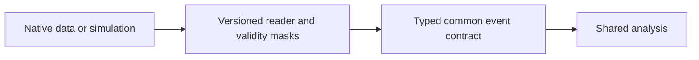

# ADR-0003: One versioned internal event schema for real and simulated events (keystone)

> Historical design proposal. Current scope and implementation evidence are defined
> in the [engineering handbook](../engineering/README.md) and ADR-0011.
> The following diagram describes the proposal, not shipped capability.

- **Status:** Proposed
- **Date:** 2026-10-26

## Context

The project's defining feature is running the *same* analysis code on real CMS data and on locally simulated events (DELPHES) to do closure comparisons. Their native formats differ fundamentally: CMS NanoAOD uses flat `Muon_pt`-style branches; AOD uses nested collections; DELPHES writes its own tree with `Muon.PT`-style members and different isolation/quality conventions. Letting analyses touch raw formats would double the implementation surface and make data/sim drift invisible.

## Decision

Define a **versioned internal event schema** (`heplab.schema.v1`, awkward-array collections: `EventInfo`, `Muon`, `Electron`, `Photon`, `Jet`, `MET`, plus sim-only `GenParticle`, `Trigger`). Reader plugins (**NanoAOD reader, AOD reader, DELPHES reader**) are the only components allowed to know native formats; they normalize into the schema. Analyses consume only schema v1. Every artifact produced from a schema version embeds it in its provenance stamp.

Golden files for each reader (tiny committed event samples) lock the mapping with unit tests. Information lost in mapping (e.g. DELPHES isolation granularity) is documented per collection.

## Alternatives considered

| Option | Why not |
|---|---|
| Per-source analysis variants | Double implementation; drift between data and sim code paths; closure becomes meaningless |
| Make DELPHES *emit* NanoAOD-format branches | Mimicking CMS branch semantics from outside CMSSW is fragile and misleading |
| Generic "raw arrays in, cuts know the source" | Pushes format knowledge into every analysis; no single contract to test |

## Consequences

- **Positive:** closure testing becomes natural (ADR/flow in ARCHITECTURE §5.3); analyses are source-agnostic; schema evolution is explicit and versioned; a clean seam for future formats (Run 3, other experiments).
- **Negative:** reader plugins need maintenance as portal formats evolve; some physics information is dropped or approximated at the boundary — must be documented, never silently.
- **Neutral:** schema changes follow semver; v1 is additive-only within the major version.

## References

- ARCHITECTURE.md §4 (schema + branch mapping table)
- coffea/NanoAOD schema prior art; DELPHES tree structure documentation
