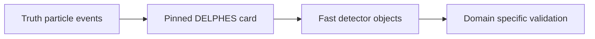

# ADR-0004: DELPHES fast simulation as the default detector model

> Historical design proposal. Current scope and implementation evidence are defined
> in the [engineering handbook](../engineering/README.md) and ADR-0011.
> The following diagram describes the proposal, not shipped capability.

- **Status:** Proposed
- **Date:** 2026-10-26

## Context

The simulation layer needs a detector model between the generator (ADR-0005) and the unified schema (ADR-0003). Full CMS simulation (CMSSW + Geant4) is the ground truth the collaboration uses, but running it requires large specialized container images, substantial CPU per event, and deep reconstruction knowledge — incompatible with laptop-first education and quick iteration. Yet "no detector sim at all" would make data/sim comparisons meaningless.

## Decision

**DELPHES** is the default detector simulation, configured with the standard **CMS card** (`delphes_card_CMS.tcl`, tuned per run era). Its ROOT output is normalized into schema v1 by the DELPHES reader. Additionally, a small **toy-smearing module** (parametrized pT/energy resolution + efficiency functions) lives in the core package for unit tests and notebook demos that need no container at all.

**Explicit non-goal for v1:** CMSSW/Geant4-based full simulation and reconstruction.

## Alternatives considered

| Option | Why not |
|---|---|
| CMSSW full sim containers | Huge images, high CPU/event, legacy-OS friction; wrong tool for teaching and closure on laptops |
| Toy smearing only | Too crude: no tracker/kalman-style structure, no object-level isolation realism; keep as test helper, not the model |
| Custom Geant4 educational app | Scope creep; DELPHES already provides the right abstraction level |

## Consequences

- **Positive:** ~10²–10³ events/s/core → million-event studies in minutes-to-hours; configurable, scriptable, containerized easily; outputs a well-documented tree our reader maps cleanly.
- **Negative:** DELPHES is an *approximation* of CMS reconstruction — resolutions, efficiencies and isolation differ. We mitigate by: (a) always labeling sim outputs as model-based, (b) closure reports including explicit fidelity caveats, (c) documenting where DELPHES is known to deviate (e.g. isolation granularity).
- **Neutral:** official open-data simulated samples (produced with full CMSSW) remain available through the catalog; users can compare all three when curious.

## References

- DELPHES: https://cp3.irmp.ucl.ac.be/projects/delphes
- DELPHES CMS card in the Delphes repository (`cards/delphes_card_CMS.tcl`)
