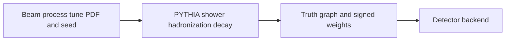

# ADR-0005: PYTHIA8 as primary generator; MadGraph5 optional for hard processes

> Historical design proposal. Current scope and implementation evidence are defined
> in the [engineering handbook](../engineering/README.md) and ADR-0011.
> The following diagram describes the proposal, not shipped capability.

- **Status:** Proposed
- **Date:** 2026-10-26

## Context

The simulation chain (S1–S5 in WORKFLOW.md) starts with an event generator producing showered, decayed particles for DELPHES (ADR-0004). The flagship studies (Drell–Yan → μμ, Z/Υ/Jψ spectroscopy) are pure QCD + electroweak processes that PYTHIA8 handles natively. Some analyses (diphoton spectra, ttbar-associated) benefit from matrix-element generation with extra partons and proper NLO/LO merging.

## Decision

**PYTHIA8** is the primary and default generator, with:

- configurations (tunes, PDFs via LHAPDF, decay selections) as **versioned files in-repo** under `sim/gen/`;
- every output stamped with the exact config + generator build;
- a validation gate (S2): inclusive cross sections checked against published values within stated generator accuracy before any production run.

**MadGraph5_aMC@NLO** is an optional container-based stage for hard-process generation (e.g. γγ, ttbar) feeding its LHE output into PYTHIA8 for showering. It is not installed in the default image.

## Alternatives considered

| Option | Why not |
|---|---|
| PYTHIA6 | Matches the legacy Run-1 open-data simulated samples, but obsolete API; no reason for new generation |
| Herwig7 | Excellent physics, smaller community/tuning ecosystem for our use cases; revisit if needed |
| MadGraph-only (no shower) | Parton-level events unrealistic for detector-level comparisons |

## Consequences

- **Positive:** one well-understood default keeps the teaching narrative clean; config-as-code + stamps make every histogram reproducible; validation gate catches tune/PDF misuse early.
- **Negative:** LO multi-leg processes from plain PYTHIA8 are limited — that's precisely what the optional MadGraph stage covers, at the cost of a heavier image.
- **Neutral:** generator accuracy (tune dependence) is quoted in closure reports, not hidden.

## References

- PYTHIA8 manual (tunes, LHAPDF interface); MadGraph5_aMC@NLO documentation
- CERN Open Data simulated-sample records (for cross-section validation targets)
