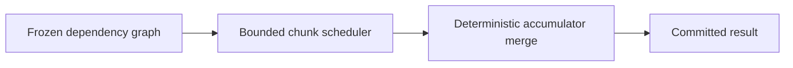

# ADR-0006: Snakemake for pipelines; coffea/Dask for event-level parallelism

> Historical design proposal. Current scope and implementation evidence are defined
> in the [engineering handbook](../engineering/README.md) and ADR-0011.
> The following diagram describes the proposal, not shipped capability.

- **Status:** Proposed
- **Date:** 2026-10-26

## Context

HEPLab has two distinct parallelism needs:

1. **Workflow level** — multi-step DAGs with files as edges: `fetch → normalize → cache → run → plot`, and `generate → shower → simulate → normalize`. Steps must re-run only when inputs/configs change, and provenance must flow along edges.
2. **Event level** — a single analysis step over millions of events, parallelized across chunks/cores.

## Decision

- **Snakemake** owns workflow-level DAGs: rules wrap CLI verbs, files+configs are dependencies, per-rule provenance (input hashes, container digest) feeds the artifact stamp. Pipelines are plain Python-reachable, pip-installable, and readable by students.
- **coffea processors on Dask** own event-level parallelism: local threaded executor by default, process pool for heavy steps, `dask distributed` as an *optional* scale-out to a server — with no analysis-code change.

## Alternatives considered

| Option | Why not |
|---|---|
| Nextflow | Strong at container-centric HPC workflows but JVM-centric; heavier footprint than needed for a laptop-first tool |
| Airflow / Prefect | Ops-oriented scheduling servers; wrong shape for a local scientific pipeline |
| Plain multiprocessing / shell scripts | No DAG, no incremental re-run, no provenance plumbing |

## Consequences

- **Positive:** incremental re-runs (edit a cut → only affected steps run); Snakemake provenance plugs into ADR-0008 stamps; Dask scale-out needs no code changes.
- **Negative:** two systems to learn (mitigated: users touch only processors; DAGs ship pre-written per analysis); Snakemake's metadata store must be excluded from provenance hashes to avoid loops.
- **Neutral:** Dask UI/dashboard is available for curious users but not required.

## References

- Snakemake documentation; coffea processor/dask-executor documentation
