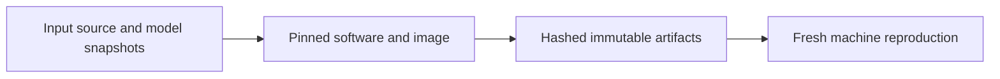

# ADR-0008: Full reproducibility — containers, lockfiles, manifests, provenance stamps, Zenodo

> Historical design proposal. Current scope and implementation evidence are defined
> in the [engineering handbook](../engineering/README.md) and ADR-0011.
> The following diagram describes the proposal, not shipped capability.

- **Status:** Proposed
- **Date:** 2026-10-26

## Context

The project's credibility rests on claims like "this plot is exactly what this code produces from this dataset." CERN Open Data is permanently public, which makes *ours* outputs the moving part. Reproducibility must hold on a fresh machine, months later, including the simulation chain (PYTHIA8/DELPHES builds vary).

## Decision

1. **Containers:** multi-stage Docker images — `heplab-base` (Python stack), `heplab-sim` (PYTHIA8 + DELPHES + LHAPDF), `heplab-serve` (API/dashboard) — published to ghcr by CI on merge.
2. **Lockfiles:** `uv` lock for the core package; pinned builds for simulation tools in their images.
3. **Data manifests:** in-repo YAML per dataset (record ID, DOI, file list, checksums), code-reviewed, re-verified against the portal at each release.
4. **Provenance stamps:** every artifact (histogram, fit result, closure report) embeds `{schema_version, git_sha, config_sha256, dataset_manifest_hash, file_checksums, container_digest}`; artifacts are content-addressed by these fields.
5. **CI (GitHub Actions):** lint → types → unit/golden tests → **micro-closure on 10k committed sim events** → image build → integration smoke (`fetch --sample` on one small dataset).
6. **Releases:** semantic versions, auto-changelog (conventional commits), PyPI package, **Zenodo DOI** for source + notebooks; one-command fresh-machine reproduction is a release-gate checklist item.

## Alternatives considered

| Option | Why not |
|---|---|
| "Just record versions in the README" | Not verifiable; drifts; doesn't cover sim toolchains |
| Nix/guix everywhere | Strong guarantee, steep adoption cost for students/Windows users; containers cover the need |
| AppVeyor/Jenkins | GitHub Actions already where the code lives |

## Consequences

- **Positive:** any plot in any notebook is regenerable bit-for-bit-ish (float determinism within one container) months later; releases are citable (DOI); micro-closure CI keeps the data/sim contract honest.
- **Negative:** images take disk (~GB for `heplab-sim`); CI needs a small network-enabled job for the smoke test (cache/sandbox allowance required); float reproducibility is container-scoped, not CPU-generational.
- **Neutral:** licenses — code Apache-2.0; outputs cite dataset DOIs/record IDs automatically (portal data terms, predominantly CC0/public domain).

## References

- Reproducible-analysis prior art: REANA, analysis preservation (CERN Analysis Preservation), coffea-casa
