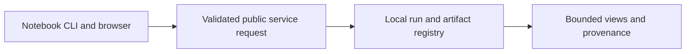

# ADR-0009: Notebooks as primary interface; FastAPI + Plotly dashboard as exploration layer

> Historical design proposal. Current scope and implementation evidence are defined
> in the [engineering handbook](../engineering/README.md) and ADR-0011.
> The following diagram describes the proposal, not shipped capability.

- **Status:** Proposed
- **Date:** 2026-10-26

## Context

Three user types touch results: students (learning, need guidance), educators (live demos, masterclasses), and contributors (development). A full web application is attractive but expensive to build and maintain; a CLI alone undersells the visual, exploratory nature of physics. The event-display idea (interactive 3D viewer of a real collision event) is the single highest-impact demo for engagement.

## Decision

Three interfaces, in priority order:

1. **Jupyter notebooks** are the primary, canonical interface — one gallery notebook per analysis plus masterclass-guided versions; notebooks call the public Python API only (no private internals), so they double as documentation and integration tests.
2. **Local dashboard** (FastAPI backend + lightweight Plotly frontend): browse the dataset catalog, launch/inspect runs, view histograms, cutflows, closure reports, and the **3D event viewer** (three.js rendering of cached schema-v1 events — muons, jets, MET, generator tracks). Binds to localhost only; no auth, no multi-user claims.
3. **CLI** (`heplab …`) for automation, CI, and batch work — same verbs as the REST API.

## Alternatives considered

| Option | Why not |
|---|---|
| Full SPA web app (React-heavy) | Long build time, high maintenance, duplicates what notebooks do for teaching |
| Desktop GUI (Qt/Tk) | Packaging pain across OSes; worse shareability than a browser page |
| CLI-only | Meets none of the visual/exploration needs; kills the event-display payoff |

## Consequences

- **Positive:** notebooks are testable in CI (nbval-style smoke on committed samples); dashboard is a thin read-only layer over artifacts, so it can never diverge from results; event viewer reuses the cache — no new data path.
- **Negative:** two rendering paths for plots (matplotlib in notebooks, Plotly in dashboard) — mitigated by serializing histograms (hist → JSON) and rendering per-frontend; event viewer is limited to cached/committed events in v1 (no random access to remote RAW).
- **Neutral:** REST API is versioned (`/api/v1/…`) from day one to allow future remote deployments without breaking notebooks.

## References

- ARCHITECTURE.md §6 (interfaces); three.js; hist serialization (hist.intervals / plotext-style export)
