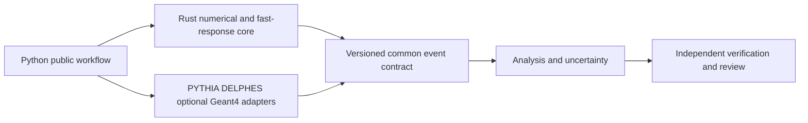

# ADR-0011: Rust fast-simulation engine and verifiable contracts

- Status: Accepted for design baseline; implementation gates remain open
- Date: 2026-10-27
- Extends: ADR-0003, ADR-0004, ADR-0005 and ADR-0010
- Scope: current user request for a detailed custom simulator and complete engineering specification

## Context

The initial repository is a prototype. Existing docs include aspirational interfaces and outdated status claims. A custom engine expands the scope beyond analysis plus a DELPHES wrapper, and needs a clear fidelity/validation boundary. Field names alone cannot make detector definitions equivalent. Neither language choice nor test count establishes physical correctness.

## Decision

Use Rust for newly developed numerical and fast-transport/response components, with Python orchestration and scientific analysis. Keep established C++ event-generation and reference detector frameworks behind controlled adapters. Introduce the [engineering handbook](../engineering/README.md), proposed schema v2, strict input contracts and requirement/evidence register as the target design authority.

Do not replace validated shower/hadronization/material models with an unvalidated custom implementation merely to use one language. The custom engine begins with analytic kinematics, addressed randomness, uniform-field propagation and calibrated object response. Native material transport is a separate validity-gated extension. GPU and experimental languages are deferred until a measured workload and equivalent CPU evidence justify them; the unverified ecosystem claims in ADR-0010 are not dependencies of this decision.

The Python reference is a correctness aid and an explicit scoped deliverable. It is not proof that Rust code compiles or that detector models are calibrated. Rust production promotion requires compilation, independent checks, FFI tests and benchmarks. Earlier profile-first rules still apply to acceleration claims.

## Alternatives and tradeoffs

An all-C++ custom engine benefits from HEP integration but broadens the memory/lifetime audit surface for new code. An all-Python engine lowers build friction but restricts predictable native throughput. Rebuilding the entire event generator and material transport is not justified by current data or staffing. Rust/Python plus established process adapters isolates the custom work while retaining a practical path to scientific validation.

Costs include two in-house language toolchains, platform wheel builds, independent reference maintenance and model-calibration work. Mandatory contracts, structured errors and evidence gates make those costs visible. Scientific validity remains conditional on the chosen models/data and external review.
