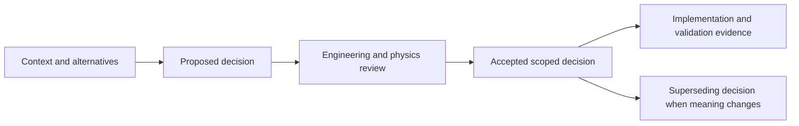

# Architecture Decision Records

An ADR captures one significant, hard-to-reverse decision: the context that forced it, the choice, the alternatives rejected, and the consequences accepted. ADRs are immutable once *Accepted* — supersede them with a new ADR rather than editing history.

- **Proposed** — under discussion
- **Accepted** — binding for current work
- **Superseded by ADR-xxxx** — historical

## Index

| ADR | Title | Status |
|---|---|---|
| [0001](0001-python-uproot-stack.md) | Python-first analysis stack with uproot/awkward (no ROOT/CMSSW dependency) | Proposed |
| [0002](0002-stream-data-with-parquet-cache.md) | Stream data from CERN via XRootD; cache normalized parquet, never mirror raw datasets | Proposed |
| [0003](0003-unified-event-schema.md) | One versioned internal event schema for real and simulated events (keystone) | Proposed |
| [0004](0004-delphes-for-detector-simulation.md) | DELPHES fast simulation as the default detector model | Proposed |
| [0005](0005-pythia8-primary-generator.md) | PYTHIA8 as primary generator; MadGraph5 optional for hard processes | Proposed |
| [0006](0006-snakemake-dask-orchestration.md) | Snakemake for pipelines; coffea/Dask for event-level parallelism | Proposed |
| [0007](0007-iminuit-zfit-statistics.md) | iminuit + zfit for fits; pyhf later for template likelihoods | Proposed |
| [0008](0008-docker-reproducible-releases.md) | Full reproducibility: containers, lockfiles, manifests, provenance stamps, Zenodo | Proposed |
| [0009](0009-fastapi-dashboard-interface.md) | Notebooks as primary interface; FastAPI + Plotly dashboard as exploration layer | Proposed |
| [0010](0010-polyglot-compute-strategy.md) | Polyglot compute: numba baseline → Rust kernels (PyO3) → JAX GPU math; Mojo pilot lane | Proposed |

## Template

The current engine direction is defined in [ADR-0011](0011-rust-engine-and-verifiable-contracts.md)
and the [engineering handbook](../engineering/README.md). Earlier entries remain historical
design proposals; their descriptions do not establish implementation status.

| ADR | Title | Status |
|---|---|---|
| [0011](0011-rust-engine-and-verifiable-contracts.md) | Rust fast-simulation engine and verifiable contracts | Accepted for design |

See [TEMPLATE.md](TEMPLATE.md). Filename convention: `NNNN-short-title.md` (next number = highest existing + 1).
