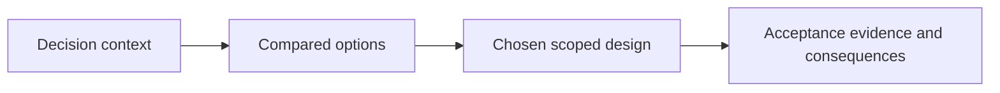

# ADR-NNNN: <short title>

- **Status:** Proposed | Accepted | Superseded by ADR-xxxx
- **Date:** YYYY-MM-DD
- **Deciders:** <names>

## Context

What problem forces a decision now? What constraints (technical, team, data) apply? What facts are we sure of?

## Decision

The choice, stated in one active sentence, then the essential detail.

## Alternatives considered

| Option | Why not |
|---|---|
| … | … |

## Consequences

- **Positive:** …
- **Negative:** … (what we accept and how we mitigate)
- **Neutral:** …

## References

Links to docs, prior art, discussions.
