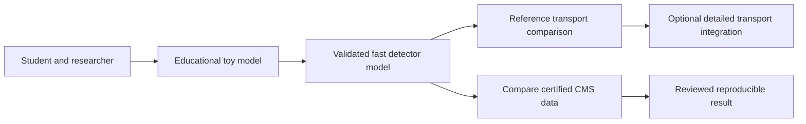

# 00 · Project charter and fidelity

Status: target design. Current code is a prototype with one 100-event remote-read demonstration; that sample has not passed certified-run and analysis validation gates.

## Product goal

HEPLab lets a student, educator, or analyst reproduce a CMS open-data analysis and compare the same selection against simulated events. A serious simulator needs a model with measured limitations, consistent units, and reproducible inputs. Dataset volume alone does not establish fidelity.

The initial reference workflow is 13 TeV Run2016G/H dimuons. Release 1 covers a documented Z-region spectrum and a validated fast-response model for muons. Low-mass resonances, photons, jets and MET extend the portfolio only after their own acceptance cases pass. Cross sections and precision widths require more corrections and uncertainty evidence than a peak plot.

## Fidelity tiers

| Tier | Purpose | Allowed claims | Gate |
|---|---|---|---|
| T0: analytic/toy | Understand kinematics and controlled smearing | Algorithm demonstrations and deterministic regression | Analytic conservation, distributions and edge cases |
| T1: parametrized detector | Track propagation, response tables, object efficiency | Predictions within calibrated species/energy/geometry domain | Independent response tables, held-out validation and uncertainty envelope |
| T2: DELPHES reference | External fast-simulation baseline with recorded card | Card-specific object distributions and comparisons | Exact versions, closure report and provenance |
| T3: optional Geant4 | Material interactions in explicitly specified geometry | Predictions for the configured geometry and physics list | Physics-list, material, cut and step convergence studies |

The custom Rust core implements numerical kinematics and a tractable fast-response engine. PYTHIA supplies hard-event and shower models. DELPHES supplies a reference detector approximation. A future Geant4 adapter uses its physics models through a process/file boundary. Implementing a Standard Model generator or CMS-quality shower/material transport from first principles is a separate research program; it has no implied completion date here.

## Language decision

Choose Rust for new low-level numerical and transport code: explicit ownership, typed domain objects, predictable allocation and concurrency checks fit this project. Existing PYTHIA/DELPHES/Geant4 components remain C++. Python owns notebooks, manifests, orchestration and statistical tooling. Rust is the project choice, not a universal claim that one language is best for all physics. Memory safety does not ensure correct formulas or unbiased models. See [numerical core](04-numerical-core.md) and [Rust ownership](https://doc.rust-lang.org/book/ch04-01-what-is-ownership.html).

## Users and completion criteria

Student: install the core, run a tiny offline example and see units and caveats. Educator: repeat the same pinned exercise without network. Analyst: process certified data with weighted simulation, inspect systematic variations, and export a complete run bundle. Contributor: reproduce a failing event by run ID and stable event identity.

The advertised first-plot target is ten minutes on a documented reference machine with dependencies already installed; report cold installation and remote fetch time separately. Tests and memory budgets must include a CPU-only path. A release needs successful Windows, Linux and macOS package checks or an explicitly narrower supported platform list.

## Vocabulary

An **event** is one accepted or generated collision record; a **particle** belongs to truth; a **hit** is a modeled sensitive-volume interaction; a **digit** is an electronics-level response; a **reconstructed object** is an analysis candidate. A **chunk** is a half-open source-entry range. A **run plan** freezes the source ranges and software/model configuration. **Closure** means a specified recovery test with known reference truth or a declared comparison; a data/MC overlay alone is not an efficiency measurement. **Certification** selects good detector running periods. **Calibration** estimates a response correction; **validation** checks that correction on independent evidence.

## Decision rule

No physics claim is promoted beyond its fidelity tier. Missing calibration, certification, generator weights or uncertainty evidence changes the run's validation state; it must not silently turn into a default correction. Specification changes are reviewed with their effect on cache identity and previously archived results.
