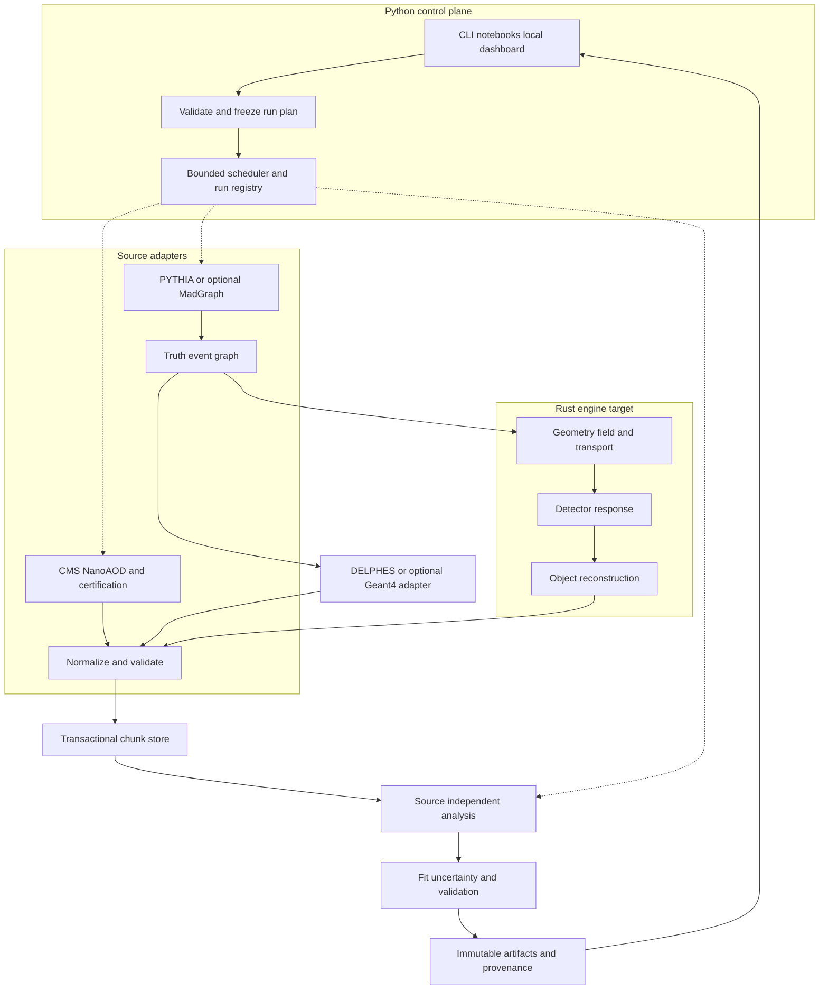

# 01 · Architecture and complete execution logic

Status: target design; the existing Python modules supply early interfaces. Requirement families: DATA, SCHEMA, CORE, GEN, TRANSPORT, RESPONSE, RECO, ANA, STAT, EXEC, API, TRUST, QA and PERF.



## Ownership and dependency direction

| Module | Owns | Must not own |
|---|---|---|
| `catalog` target; current catalog logic in `cli.py` | Typed manifests and snapshot resolution | Event selection or mutable portal records during a run |
| `io` | Transport, file identities, chunk transactions | Physics defaults or analysis thresholds |
| `readers` | Format-specific branch semantics and conversion | Invented missing measurements |
| `schema` | Units, shape and semantic validation | Native ROOT handles |
| `physics` reference / future `heplab-physics` Rust crate | Numerical primitives and physics model interfaces | Filesystem, Python objects, global random state |
| `sim` | Generator and detector process adapters | Claims that an executable or image exists without capability discovery |
| `processors` and `analyses` | Shared selection and mergeable accumulators | Raw source branch names or native detector formats |
| `stats` | Likelihoods, fit diagnostics and uncertainty | Editing the parent histogram artifact |
| `server` | Local presentation and safe job submission | Arbitrary filesystem paths supplied by HTTP clients |

The extension crate `kernels/` binds Rust to Python. The pure Rust core must also build without Python. Files, arrays and versioned job messages form boundaries to external C++ programs. Shared ownership across language runtimes is excluded until a measured zero-copy use case has a safe lifetime contract.

## Run algorithm

```text
execute(request):
    validate_request_and_supported_capabilities(request)
    resolve portal records, calibration, detector card, config, seeds, versions
    snapshot each input; never resolve a floating dependency after this point
    create plan with exact source entry ranges and resource ceilings
    if measurement: require certification, trigger policy, weight model, validation IDs
    persist PLANNED record with plan_hash and request_id
    for chunk in canonical_source_order(plan):
        if committed chunk matches identity and payload checksum: reuse
        else:
            acquire bounded worker token
            read real source OR generate truth -> selected detector backend
            validate units, event IDs, masks, jagged offsets and source capabilities
            certify real events; record rejection counts
            process all selected systematic variations with named streams
            commit normalized chunk and mergeable accumulator atomically
    merge accumulator records in canonical chunk order with duplicate detection
    fit only supported statistical models over declared domains
    evaluate analytic, detector and analysis validation policies
    write immutable artifact bundle; fsync and atomically publish run index
    mark SUCCEEDED only after all required commits and checks
```

A successful computation and a validated physics result are separate fields. `status=SUCCEEDED` means the requested work completed; `validation=unvalidated|validated|rejected` communicates the evidence. A failed or cancelled run never publishes a success artifact.

## Capability discovery

The target `doctor` report lists Python/Rust engine versions, ROOT readers, Docker daemon, image digest, PDF sets, calibration hashes, supported detector fidelity and GPU backend. Missing optional features produce `CapabilityUnavailable` before a job is started. No guessed container tag or source branch is a functioning simulator.

## Extension contracts

A source returns `(chunk_descriptor, columnar_events, metadata)`. A detector returns `(reconstructed_events, truth_associations, diagnostics)`. A processor exposes `required_capabilities`, `process_chunk` and `merge`. A fit returns `(parameters, covariance, optimizer_state, model_domain, validation)` as a child artifact. Every plugin declares a contract version and input/output capabilities before scheduling; incompatible versions fail before reading event bytes.

Cycles are forbidden across the dependency boundary. The server imports public services; core services never import the server or CLI. The existing use of private CLI helpers from the API is tracked for removal in [delivery](17-delivery-plan.md).
