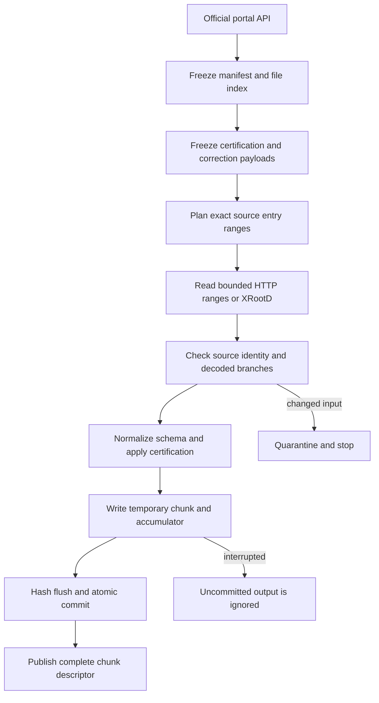

# 02 · Data supply, integrity and cache transactions

Status: required target. Existing fetch reads remote NanoAOD and writes one cache object; it does not yet satisfy transactional chunking, certified-run selection, complete integrity verification or sample identity.



## Required input inventory

| Asset | Authority and starting point | Required metadata |
|---|---|---|
| DoubleMuon real data | [RunG 30522](https://opendata.cern.ch/record/30522), [RunH 30555](https://opendata.cern.ch/record/30555) | DOI, dataset path, era, NanoAOD version, complete file index, entry counts, checksum algorithm and value |
| Good run/luminosity sections | [2016 certification 14220](https://opendata.cern.ch/record/14220), follow exact file linked by data record | Payload hash, applicable runs, full-detector or muon-only scope |
| Luminosity | [CMS luminosity calculation guide](https://opendata.cern.ch/docs/cms-guide-luminosity-calculation) | Input certification, trigger/prescale policy, normtag where required, units and uncertainty |
| Official reference MC | CMS NANOAODSIM records selected for exact process and campaign | Beam energy, mass/filter cuts, tune, PDF, cross section, sum of generator weights, detector/pileup campaign |
| Corrections | CMS payloads linked by release/campaign documentation | Era, object working point, validity range, evaluator version, uncertainty variations |
| Custom simulator inputs | PYTHIA config, selected LHAPDF set, detector card, field/material tables | Build IDs, hashes, coordinate conventions and units |

Reference MC must cover the selected observable. The previously suggested `DYToMuMu_pomflux_Pt-30` sample is a specialized, filtered process and is **not approved here as inclusive Z/Drell–Yan reference MC**. High-mass bins also do not validate the Z peak. Resolve an appropriate inclusive or Z-mass sample and review its generator configuration before adding a production manifest. Cross section values must be sourced; no placeholder number is accepted.

## Manifest and request contract

The target manifest is schema v1 under `contracts/dataset.schema.json`; current v0 YAML remains legacy. IDs are namespaced and aliases resolve uniquely. Store a portal snapshot and retrieval timestamp as audit information; run identity hashes the frozen content, not the retrieval clock. Store checksums as strings so leading zeroes survive YAML loading. A full dataset and a selected prefix have different identities.

Required selection modes are `entry_count`, `explicit_ranges`, and `full`. Byte limits are transfer ceilings, not event-count estimates. A limit reached mid-chunk yields a partial run or a retry; it does not silently mean “N events” based on guessed event size. `chunk_size > 0` and sample counts are positive integers. Requested source ranges are half-open `[start, stop)` and cannot overlap within one plan.

## Cache identity

```text
source_id = H(algorithm, portal_checksum, declared_size, frozen_uri_identity)
chunk_key = H(cache_contract_version, source_id, tree, start, stop,
              ordered_projected_branches, reader_build, schema_version,
              certification_hash, calibration_hashes, normalization_policy,
              data_kind, detector_model_hash_if_simulated)
```

Branch sets are canonicalized but row order is preserved. `is_data` is inferred from an authenticated manifest contract, never blindly overridden by a CLI flag. Adding certification or a different event range invalidates the cache. Partial samples may satisfy a request only when their descriptors prove complete coverage of the exact requested ranges.

## Read and verification algorithm

1. Confirm file listing, size and tree entry count against a source snapshot. A change during a run is `SourceChanged`.
2. Prefer a supported transport; only translate known CERN EOS paths to the official HTTPS mirror. Preserve file identity across mirrors.
3. Request the dependency closure of the analysis: event IDs, selection branches, weights and triggers as needed. Reject missing required branches before decoding chunks. Unsupported optional collections have an explicit absence mask.
4. Bound open handles, decompressed bytes and concurrent requests. Retry transient I/O a bounded number of times with recorded backoff; never retry invalid schemas as a network error.
5. For a complete file download, stream Adler-32/SHA verification against the portal checksum before use. **A projected range read cannot verify the full-file Adler-32.** Label it `source_checksum_declared` and separately hash decoded/cached bytes. Do not claim full-file verification.
6. Validate branch lengths and event IDs. Apply `good_run[run]` interval membership using an indexed interval search, inclusive lumi endpoints as specified by CMS certification.
7. Stream each normalized chunk into a transaction; avoid building one dataset-wide Python list.

## Commit, resume and concurrency

Each chunk has a unique staging directory and an exclusive writer lease. Write Parquet, source descriptor, accumulator, payload hash and metrics; close writers, flush files, then publish a commit marker atomically on the same filesystem. Readers see only committed descriptors. A crash after payload write but before commit is retryable; a crash after commit but before run indexing is repaired by scanning validated commit descriptors.

Two workers cannot publish different payload hashes for one key. Identical publication is idempotent; conflicting publication is `CacheConflict`. Recover stale leases using an owner token and recorded expiration; never delete an active writer's staging area. Quota enforcement accounts for temporary plus committed bytes. Eviction removes only unreferenced completed entries, and never changes an archived run's source identities.

Acceptance: fetch N then M events and prove M does not silently read the N cache; interrupt at every commit boundary; mutate a manifest checksum and observe cache invalidation; run offline using a complete committed range; assert certification endpoints and unknown runs; report a full-file checksum as unverified when only ranges were read. See [verification](14-verification.md).
