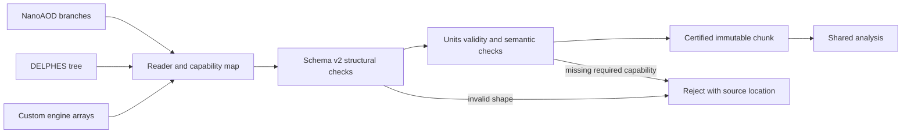

# 03 · Event, geometry and model contracts

Status: proposed event schema v2. Current registry v1 is a collection-name/field-name list and does not enforce these types or semantics. Versioned migration is required; do not relabel existing Parquet as v2.

## Scalar and jagged contracts

| Record | Required members | Semantics |
|---|---|---|
| Chunk | `schema_version`, `source`, `units`, `capabilities`, `events` or Arrow schema reference | One source entry interval; fixed normalization policy |
| EventInfo | `dataset_id`, `source_id`, `source_entry`, `run`, `luminosity_block`, `event`, `kind`, `weight` | Event IDs use nonnegative integers; entry IDs remain unique across files |
| Weight | `generator`, `normalization`, `pileup`, `corrections`, `variations` | Signed generator weights supported; data weight exactly one before declared prescale treatment |
| Muon/Electron | `object_id`, `pt`, `eta`, `phi`, `mass`, `charge`, `isolation`, `id_flags`, validity masks | Nonnegative pT and mass; charge integer with documented convention |
| Photon | Kinematics, pixel-seed value and validity, isolation definition | Missing seed cannot be fabricated as veto pass |
| Jet | Four-vector, algorithm/radius, btag discriminator and definition | Different btagger scores cannot be treated as equivalent |
| MET | `px`, `py`, `definition`, covariance if available | Magnitude/phi derived; zero-vector phi is explicitly conventional |
| Trigger | Menu ID, path IDs, decisions, prescale values/validity, source | Recorded for data, emulated/recorded for simulation |
| Truth particle | `particle_id`, PDG ID, status/definition, p4, vertex IDs, parent and child IDs | Directed graph with preserved generator status semantics |
| Association | reco object ID, truth particle ID, matching algorithm, score and ambiguity | Optional capability; no implicit index matching |

The current `Trigger.sim_only=True` is a tracked schema flaw: real-data HLT decisions are needed. A single parent index is insufficient for general generator graphs. Status codes from different generators cannot be equated by their integer alone.

## Units and coordinates

Use GeV for energy, GeV/c for momentum (numeric natural-units interface), metres for geometry, nanoseconds for time, tesla for field and charge in units of positive elementary charge. Metric is `(+,-,-,-)`. The detector uses right-handed `(x,y,z)` with beam along z. Phi is radians in `[-pi, pi)`; eta is dimensionless. Energy uses `E²=p²+m²` with c=1. Conversion from generator millimetres or Geant4 internal units happens once in adapters and is stamped.

Internal Rust types distinguish length, momentum, time and energy at construction boundaries. Floating-point array storage has a unit-bearing schema, not a unit field per scalar. float64 is baseline for transport/numerics; storing float32 requires a measured error budget. Angles, masses, positions and times must be finite. Nonfinite eta at zero transverse momentum cannot be serialized as a measured value; use Cartesian momenta or nullable derived eta.

## Absence and truthfulness

Optional absent collection differs from a present empty collection. A missing isolation measurement is null with a reason, never zero or a passing NaN. Store definition IDs, such as CMS PF relative isolation cone 0.4 versus DELPHES card isolation; a common field name does not establish physical equivalence. A selection declares its permitted definitions and must reject an incompatible source or use a separately validated translation.

Quality flags are named/versioned, or integers coupled to a bit-layout ID. `Photon.IsolationVar` cannot populate pixel-seed state; `Muon.IsolationVar` cannot populate quality flags. The current DELPHES adapter has those placeholder mappings and requires correction before physics use.

## Shape and identity invariants

For each jagged collection, offsets begin at zero, are monotone, have length `n_events+1`, and end at the object-array length. All fields share offsets. Event columns have equal length. Parent/child references stay within the event or declare a documented external reference. A source event key is `(dataset_id, source_id, source_entry)`; CMS `(run,lumi,event)` is an additional collision key used for overlap detection across primary datasets. Repeated physics events must not be counted twice when combining streams.

## Reader algorithm

Resolve the actual native schema before selecting branches; freeze a branch map with required/optional designation. Validate scalar versus jagged shapes. Convert units and preserve validity. Copy source event identity, truth weights and trigger definitions. Validate the normalized chunk, attach reader/version hash, then emit. Reject shape mismatches rather than truncating `zip` to its shortest input. Native array scalar methods must be handled explicitly; the existing MET scalar fix is not a full semantic validator.

## Migration policy

An additive optional field with explicit absence can be a minor schema increment. A unit, definition, weight or identity change requires a major increment. Migrators emit a new artifact with parent checksum, migration version and information-loss report. If the old payload lacks trigger information, migration cannot manufacture it. `contracts/event-chunk.schema.json` is a strict JSON interchange envelope for fixtures and requests; Arrow implementations must satisfy the same semantic invariants independently.
