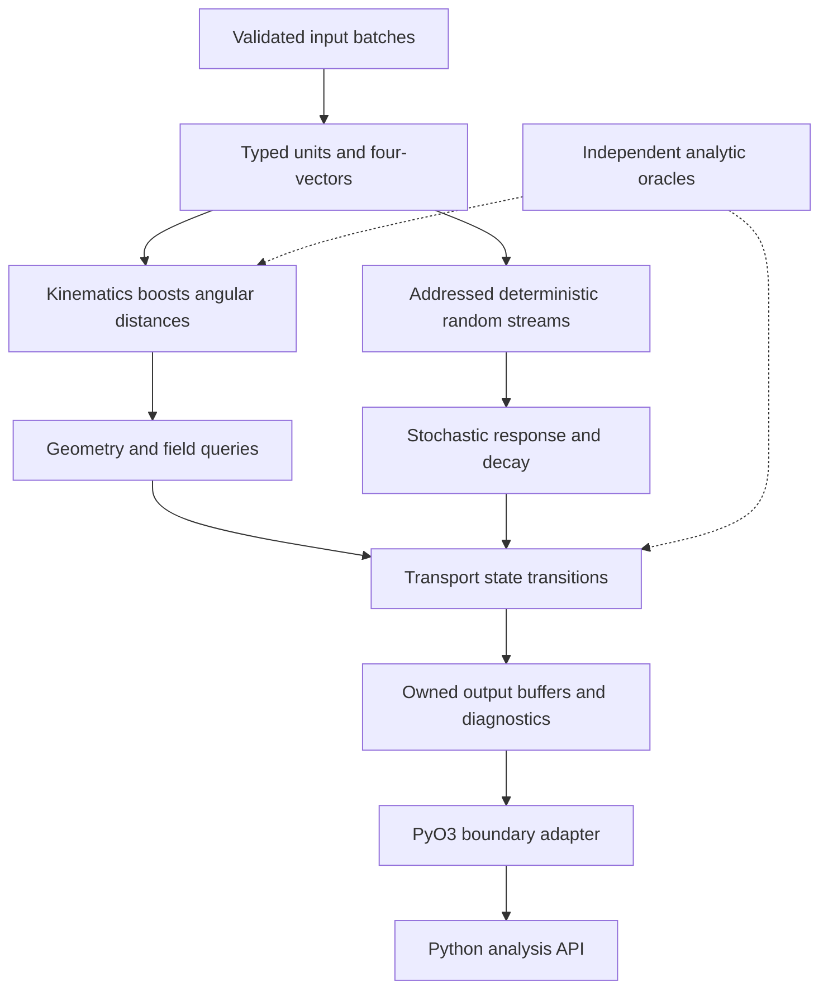

# 04 · Rust numerical engine and reference algorithms

Status: target specification plus Python reference and compiled Rust primitives.
See [implementation evidence](implementation.md); the addition-only scaffold has
been replaced. Calibrated response and speed claims still need separate evidence.



## Crate boundaries

Target workspace: `heplab-units` (newtypes and conversions), `heplab-kinematics` (Lorentz algebra), `heplab-rng` (addressed streams), `heplab-geometry` (navigation and field queries), `heplab-transport` (bounded stepping), `heplab-response` (detector models), `heplab-reco` (objects and associations), `heplab-engine` (batch execution), and `heplab-python` (PyO3). Begin with modules in one pure Rust crate; split crates only when dependency boundaries are demonstrated. Python remains the public teaching interface.

No `unsafe` in the initial numerical core. Any later exception requires a small audited boundary, documented lifetimes, sanitizer/Miri evidence where applicable, and a benchmark showing why safe code is insufficient. No blanket claim that Rust removes logic, numerical, deadlock or FFI bugs. Ownership/concurrency rationale: [Rust book](https://doc.rust-lang.org/book/ch16-00-concurrency.html).

## Four-vector contract

Store Cartesian `(E, px, py, pz)` in float64 and reject nonfinite or negative energy. Construct from `(pt, eta, phi, m)` only with `pt>=0`, `m>=0` and finite values:

```text
px = pt*cos(phi); py = pt*sin(phi); pz = pt*sinh(eta)
E = hypot(hypot(pt,pz),m)
m2 = E*E - (px*px + py*py + pz*pz)
```

Hyperbolic overflow is an explicit `NumericalDomain` error. A physical on-shell vector has `m2 >= -tol`, with `tol = 64*epsilon*max(E²,|p|²,1 GeV²)` as the initial floating-point guard; tests must justify it over the supported dynamic range. Only a small roundoff-negative value may clamp to zero for a mass result. A spacelike vector is valid for some algebraic uses, but `physical_mass` rejects a materially negative invariant. Do not silently convert every negative invariant to zero.

For rapidity or pseudorapidity, specify the longitudinal/transverse zero cases; preserve Cartesian values rather than forcing an infinite number through JSON. Angular distance is `DeltaR²=(eta1-eta2)²+wrap(phi1-phi2)²`. Wrap has range `[-pi,pi)` and maps positive pi to negative pi.

## Lorentz boost

Define a passive transformation to a frame moving with dimensionless velocity beta relative to the original frame:

```text
b2 = dot(beta,beta), require b2 < 1
gamma = 1/sqrt(1-b2)
Eprime = gamma*(E - dot(beta,p))
pprime = p + [gamma²/(gamma+1)*dot(beta,p) - gamma*E]*beta
```

The stable identity `gamma²/(gamma+1)=(gamma-1)/b²` avoids division by zero for beta=0. Boosting by negative beta is the inverse. Check invariant mass preservation against independent high-precision or analytic cases, including zero boost, rest particle, collinear and ultrarelativistic limits. State convention in every adapter; active boosts use different signs.

## Randomness and scheduling invariance

A global mutable PRNG makes chunk order part of the physics. The target addresses each stream by `(master_seed, run_model_hash, event_key, object_id, stage_id, variation_id, draw_counter)` using a versioned counter-based generator or hash-derived stream. Pin algorithm and integer-to-uniform conversion; test canonical vectors across Rust and Python. Hash input uses length-delimited canonical encoding, never ambiguous concatenation.

The reference uses SHA-256 address blocks and converts a 53-bit integer with endpoint guards to a uniform strictly inside `(0,1)`. This is a portable deterministic reference, not a throughput target. Transform two independent uniforms using Box-Muller: `z=sqrt(-2 ln u1)*cos(2*pi*u2)`. Exponential waiting distance is `-lambda*ln(u)`. Bernoulli accepts exactly `u < efficiency`, with efficiency constrained to `[0,1]`. Worker count and chunk boundaries must not alter draws for an event.

Nominal and systematic variants share a base stream when common random numbers are intended; the correlation group is explicit in the plan. Do not hash the variation name if a matched fluctuation is required; hash the correlation-group ID and vary the model parameter. Different detector modules have different stage IDs so an added diagnostic draw cannot perturb tracking efficiency.

## Weighted histogram primitive

Require finite, strictly increasing edges. Store integer `entries`, `sumw` and `sumw2` separately per bin, including underflow/overflow. Bins are left inclusive/right exclusive; `x==last_edge` is overflow. Nonfinite x or w is rejected and counted as invalid at the adapter boundary. Negative finite weights are supported. A sum of weights can be zero while its variance is positive.

Merge identical edge arrays only; stable bin-edge bytes are part of identity. Canonical reduction order and compensated summation reduce variation. Bitwise reproducibility is promised only within a pinned runtime/CPU execution mode if measured; cross-platform results have declared numeric tolerances. Compare zero-entry, negative-weight, cancellation and enormous/small-magnitude cases.

## Error and FFI contract

Use `Result<T, EngineError>` with `InvalidInput`, `UnsupportedModel`, `NumericalDomain`, `GeometryFailure`, `BudgetExceeded` and `ExternalFailure`. An error contains event/stage IDs and bounded diagnostics, not a NaN sentinel or unchecked panic. Programmer invariants may fail tests loudly; user input must not trigger a process abort.

PyO3 receives validated contiguous array buffers, checks shapes, converts to owned Rust data or a documented borrowed immutable lifetime, executes Rust-only work outside the GIL, and constructs Python output after reacquiring it. The pinned [PyO3 0.22 guide](https://pyo3.rs/v0.22.6/parallelism) uses `allow_threads`; update binding code and evidence deliberately when upgrading. No Python callbacks from worker hot loops. Batch APIs avoid crossing the FFI boundary once per particle.

## Evidence gates

The numerical reference is intentionally simple and inspectable. Rust must pass its own unit/property tests and comparisons against independently constructed four-vectors, analytic helices and weighted histogram sums. Matching two translations of the same wrong formula is insufficient. Benchmark only after those gates, and preserve the reference fallback until platform wheels and lifetime behavior are validated.
