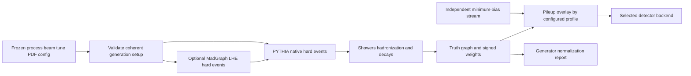

# 05 · Event generation, showers and pileup

Status: the registered native PYTHIA8/DELPHES chain is implemented and smoke-tested;
see [runtime evidence and limits](sim-runtime.md). General processes, pileup, a
published container, and independent cross-section validation remain delivery gates.
The digest-only container wrappers are legacy interfaces, not the working native path.



## Physics input contract

A generation configuration freezes collider species, energies per beam, crossing conditions, process, cuts, decay filters, tune, PDF set/member/version, electroweak parameters, masses, widths and random seed policy. For 13 TeV symmetric pp, beam energies are 6.5 TeV each; energy fields have explicit units. A phase-space filter changes acceptance and must enter the normalization record.

A PDF set is selected with the perturbative order and tune used by the configured generator. Installing every LHAPDF grid is unnecessary. Cross sections, filter efficiencies and matching schemes are read from the generation configuration and validation report, not inferred from a dataset name alone. See [PYTHIA releases](https://pythia.org/releases/), [manual](https://pythia.org/documentation/), and [LHAPDF sets](https://www.lhapdf.org/pdfsets.html).

## Driver algorithm

```text
validate_config; hash generator build, PDF data and all cards
initialize exactly one generator state per declared shard
for global event number in planned range:
    select independent deterministic generation stream or documented serial generator state
    call next event with bounded recoverable-failure budget
    if failure: record attempted event and reason; never silently renumber successful events
    preserve generator particle graph, weights and scale/PDF variations
    validate finite physical final states and generator-level conservation at declared boundaries
    emit truth event and generator metadata
finalize signed sums, attempted/accepted counts, filter efficiency and reported cross section
commit source descriptor and normalization metadata only after clean finalization
```

PYTHIA internal RNG and generator state may be serial and depend on all earlier attempts. Event-addressed custom response randomness does not automatically make generator production independent of sharding. For each generator adapter, promise reproducibility only for a fixed version/config/sharding unless a tested per-event seed/reset strategy preserves the physics model. Store generator shards and event numbering in the plan.

## MC normalization

For a cross section in pb and integrated luminosity in inverse pb:

`w_norm = luminosity_pb_inverse * cross_section_pb * filter_efficiency / sum_generator_weights`.

The exact inclusion of filter efficiency depends on whether the supplied cross section is pre-filter or post-filter; encode that convention to prevent double application. A k-factor is separate and sourced. Sum generator weights over the declared normalization population, not just selected events. Reject zero or numerically unstable denominator; report positive/negative sums, sum of squares and effective statistics. NLO samples can have negative generator weights. Detector corrections and pileup weights multiply separately with named variations.

## Pileup and primary vertices

Overlay independent minimum-bias events from a versioned library with recorded inelastic assumptions. Sample pileup multiplicity from the configured distribution; a Poisson law is only used when the model explicitly says so. Sample vertex z/time profiles and bunch offsets with units. Preserve hard-scatter versus pileup origin, event IDs and seeds. Do not double overlay on a sample that already includes pileup; capability metadata records its presence.

Memory ceilings bound particles after overlay; if exceeded, fail or move the event to a declared high-multiplicity queue. Never silently truncate truth particles. Detector reweighting to observed pileup is a distinct step from generating pileup and must not be applied twice.

## External process contract

Invoke executables with argument arrays, explicit working directories, sanitized environment and stdout/stderr limits. Stage outputs in a run-specific directory. Require nonzero events requested, valid seed range, timeout, cancellation and a clean exit plus parseable output. Pin image digests; network is disabled in production simulation after inputs have been staged. Record executable versions and file hashes inside the container rather than trusting a tag.

## Validation and licensing

Validate inclusive cross section against an appropriate independent reference within a predeclared model/MC uncertainty. Check initial/final four-momentum at a generator boundary with all modeled invisible particles and beam remnants accounted for. A detector-level visible momentum sum need not equal the incoming beam momentum. Use fixed-decay unit cases and held-out distribution comparisons. Store process restrictions in the report.

PYTHIA's upstream [licensing/citation instructions](https://pythia.org/documentation/) apply to redistributed binaries and containers. HEPLab's Apache-2.0 source license does not replace dependency licenses. Record source offers/notices and have redistribution terms reviewed for each composed image.
