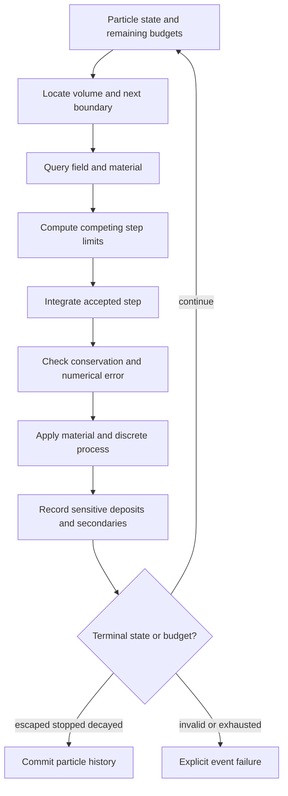

# 06 · Geometry, fields, material transport and decay

Status: analytic vacuum motion and a bounded heavy-particle thin-slab loss/scattering model are implemented in Rust and the independent Python reference. See [material increment](material-response.md). Finite-cylinder/annular-disk surface navigation, nominal CMS pixel geometry, and ideal-solenoid field-exit trajectories are now implemented; see [geometry and calibration](geometry-calibration.md). Full volume navigation, adaptive fields, showers and Geant4 remain targets.



## State and geometry

Particle state is `{event_id, particle_id, pdg_id, charge_e, mass_GeV, position_m[3], momentum_GeV[3], time_ns, accumulated_proper_time_ns, volume_id, origin, status}`. Geometry is immutable and hashed. Begin with coaxial cylinders, annuli and planar endcaps. Each volume names material, sensitive detector and parent transform. Reject negative dimensions, overlapping active volumes without a defined priority, nonorthogonal rotations and disconnected navigation regions.

Navigation returns the nearest positive intersection plus surface ID and normal. Treat tangency, starting-on-surface and zero-direction cases explicitly. Surface tolerance is a declared length coupled to the geometry scale. After crossing, locate the destination using direction and boundary side; an epsilon nudge must not skip a thin sensitive layer. Repeated zero-length crossings are a navigation error with a bounded retry count.


## Uniform-field analytic reference

For path length `s` in metres, magnetic field `Bz` in tesla, charge `q` in elementary-charge units and momentum in GeV/c:

```text
p = sqrt(px²+py²+pz²); require p>0
omega = -0.299792458*q*Bz/p              # radians per metre of full path
a = omega*s
px_new = px*cos(a) - py*sin(a)
py_new = px*sin(a) + py*cos(a)
pz_new = pz
x_new = x + [px*sin(a) + py*(cos(a)-1)]/(p*omega)
y_new = y + [px*(1-cos(a)) + py*sin(a)]/(p*omega)
z_new = z + s*pz/p
time_new = time + s/(beta*0.299792458)    # ns, beta=p/E
```

At `omega=0`, propagate on a line. For small `a`, use stable `sinc(a)=sin(a)/a` and `(1-cos(a))/a` series so the zero-field limit is continuous. The sign is fixed by `dp/ds = 0.299792458*q*(p cross B)/p`: positive charge initially along +x in +Bz curves toward -y. Magnetic propagation preserves |p| and energy. The transverse radius is `pt/(0.299792458*abs(q*Bz))`; pitch follows pz. Independent sign and radius checks are mandatory.

## General fields and step arbitration

Field maps require axis order, units, interpolation method and boundary policy. The target integrator is a relativistic magnetic-field method with verified order and norm/energy behavior, or an established external transport integrator. Choose minimum of geometry crossing, curvature accuracy, material loss, scattering validity, remaining decay distance, time-of-flight ceiling and maximum step. An adaptive method uses local error estimates in position and momentum, absolute plus relative tolerances and bounded rejection count. Halve tolerances in convergence studies; compare against the analytic uniform-field solution.

Time update uses beta for massive particles and c for massless particles. Momentum-zero particles enter `Stopped` or a documented at-rest process; no division by zero. Input with mass=0 and energy=0 has no valid propagation direction. Electric fields need separate work/energy updates and remain a gated extension.

## Materials and stochastic processes

Each material table stores density, effective composition, radiation/interaction lengths, stopping power and uncertainty/validity ranges. Compute mean charged-particle loss from validated tables or the declared Bethe–Bloch regime; do not extrapolate a central formula through low-energy, electron or radiative-dominant regimes. Straggling, bremsstrahlung, pair production, nuclear interactions and shower development require validated specialized models or the external Geant4 backend.

For a fast thin-layer scattering approximation, define angular variance from the chosen reference model using beta, momentum and material radiation length. State layer-thickness validity; avoid applying independent Gaussian kicks at arbitrarily small steps because that changes the physical distribution. Record the model's non-Gaussian tail limitation. Energy deposits plus escaped, invisible and secondary energy form an event energy ledger; tiny negative roundoff and material energy exchange have explicit rules. Do not clamp a physically impossible loss and call it a valid interaction.

## Decays and secondary queues

Sample proper lifetime `tau_sample=-tau_mean*ln(u)`. Advance proper time by `dt/gamma`; decay when the sampled threshold is crossed. An exact constant-momentum vacuum decay distance is `beta*gamma*c*tau_sample`. Branching ratios and daughters come from a versioned particle/decay table. Two-body phase space must conserve four-momentum; more complex decays remain generator/external-backend capabilities. Do not decay an already-decayed generator particle again.

Secondary queues have explicit particle, depth, step and energy budgets. Exceeding a budget fails or flags the event as incomplete under a named policy; it cannot silently remove energy from a successful event. Stable truth IDs keep parent graphs and detector associations inspectable. Per-event diagnostics include steps accepted/rejected, field lookups, navigation failures, deposits and conservation residuals.

## Reference backend

Geant4 is the optional detailed-transport authority through an adapter with recorded geometry, materials, physics list, production cuts and data-library versions. Its [physics manual](https://geant4.web.cern.ch/documentation/dev/prm_html/PhysicsReferenceManual/generalities/index.html) describes transport and competing processes. Convergence and physics-list comparisons are required before treating a custom approximation as equivalent over a domain. Detailed CMS detector reproduction needs experiment geometry and reconstruction conditions beyond a generic Geant4 installation.
