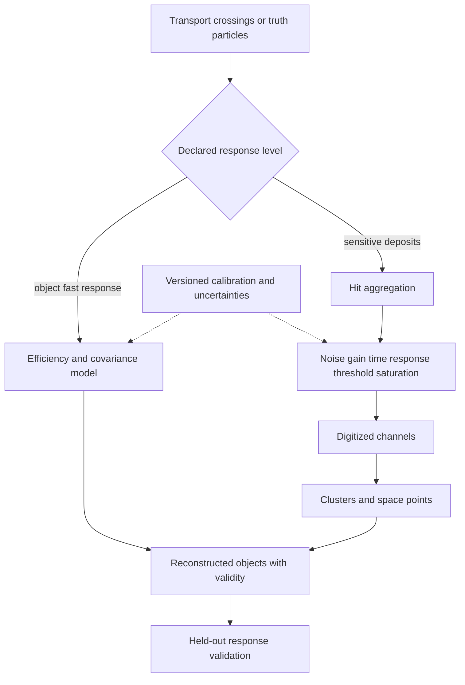

# 07 · Detector response and digitization

Status: educational addressed positive object response and deposit-to-ADC electronics are implemented; see [material and electronics increment](material-response.md). Scoped PDG material and DELPHES muon-transfer fits now have held-out reference checks; see [reference calibration](geometry-calibration.md). Experimental calibration, full calorimetry, timed hit aggregation and pileup remain targets.



## Model separation

Each backend declares `truth_to_objects` or `hits_to_digits`. Object efficiency/smearing models directly sample reconstructed candidates from truth; hit digitization models electronics from deposits. Do not apply full object efficiency again after a hit-based reconstruction that already accounts for inefficiency. A response graph rejects duplicated physical effects and verifies required inputs.

All tables declare dimensions, axes, bin edges, units, valid species, eta/pT/occupancy domains, data-taking era, detector geometry and systematic correlations. Out-of-domain policy is `error`, a reviewed alternative model, or a flagged extrapolation excluded from validated outputs. Interpolation cannot produce efficiency below zero or above one. Silent clipping hides bad calibration and is rejected.

## Tracking response

Start with truth charged particles reaching a declared tracking region. Apply acceptance, reconstruction efficiency and charge-assignment probability separately. Sample the measurement state, preferably curvature and angular parameters, from a calibrated covariance. For a simple track state `(q/pt, phi, eta, d0, z0)`, record sign and length conventions. Require symmetric positive semidefinite covariance; Cholesky failures identify invalid input rather than silently dropping correlations.

```text
model = lookup(species, pt, eta, occupancy)
require model supports all requested observables
if uniform(event,object,tracking_efficiency) >= epsilon: emit no track with loss reason
sample correlated residual vector using versioned covariance factor
construct measured state; reject or explicitly resample forbidden physical region
attach covariance, truth association and quality decision definition
```

A Gaussian pT model can generate negative momentum. Use an explicitly positive model, calibrated curvature model, or reviewed truncation with correct normalization; `max(0, sample)` adds a point mass at zero and must not masquerade as a calibrated resolution. Object-level fake rates need their own model and cannot be generated by efficiency alone.

## Calorimetry

Electromagnetic and hadronic response are distinct. A starting parametrization is `(sigma_E/E)² = S²/E + N²/E² + C²` with E in GeV and coefficients carrying corresponding units. This is a model to calibrate, not a universal detector law. Sample noncompensation, non-Gaussian tails, leakage, dead material and spatial/time segmentation only when calibration supports them. Multiple particles in one cell combine before threshold/saturation to preserve occupancy effects.

Photon conversions and electron bremsstrahlung affect object finding; add a tested model or mark the capability unavailable. Missing pixel-seed state must be null. Geometry impacts cell membership, and boundary bins need exact edge conventions.

## Electronics-level path

For each channel: aggregate deposits by time, convert to charge with recorded gain, convolve a response kernel, add correlated/uncorrelated noise streams, digitize ADC/TDC, apply threshold, saturate and flag overflow. Pedestals and zero suppression are separately recorded. Preserve lost/below-threshold energy in diagnostics and never equate ADC counts with GeV without the calibration conversion. Time windows are relative to a defined bunch crossing.

Dead/noisy channels, efficiency maps and pileup conditions have payload IDs. Electronics simulation is optional and expensive; a release that supplies only object response advertises that level.

## Systematics and model validation

Variations include momentum scale/resolution, efficiency, material, alignment, calorimeter scale/resolution and fake rates. Define shared nuisance IDs for correlated regions and common random draws for nominal/variation comparisons. Object ordering and worker count cannot change the nominal fluctuation.

Use separate calibration and validation samples. Measure residual bias, central width, tail fractions, charge-flip rate and efficiency versus truth kinematics/occupancy. Specify matching, denominators and uncertainty intervals. Compare with [DELPHES module definitions](https://delphes.github.io/workbook/modules/) using a pinned card; names such as `IsolationVar` do not establish equivalence to CMS PF isolation. A response validation report records domain-specific thresholds chosen before unblinding the held-out sample.
