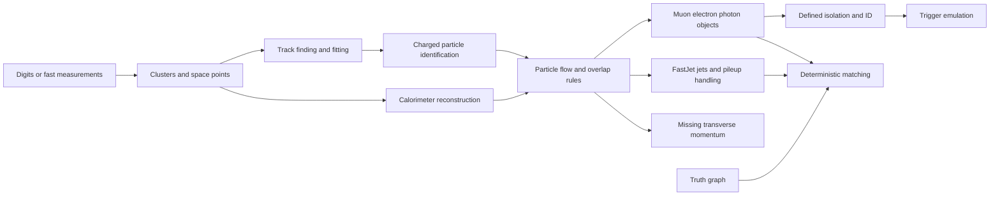

# 08 · Reconstruction, truth association and triggers

Status: target. Current analyses consume pre-reconstructed NanoAOD objects and the basic DELPHES adapter. Native tracking/particle flow/jet reconstruction and trigger emulation are not implemented.

## Reconstruction modes

Object fast simulation emits analysis candidates directly and supplies a response-model association. Hit-based reconstruction requires track finding, fitting and pattern ambiguities. These are separate capability modes; do not claim native track reconstruction for a smearing-only backend. The initial Rust engine targets the object mode, while native tracking is a later research milestone.

## Track fitting and identification

For hit mode: form seed candidates with explicit combinatoric budgets, propagate hypotheses through the same geometry with a specified fitter, update state/covariance using measurement likelihoods, and prune using declared quality thresholds. If using a Kalman filter, specify process noise, linearization, innovation covariance and outlier policy. Bound chi-square and require finite positive covariance diagonals. Compare against analytic straight/helix tracks and controlled outliers; do not call all truth particles “reconstructed tracks.”

Identification separates physics species hypotheses from quality. Muon flags describe tracking plus muon-station criteria; electron/photon flags declare shower and matching requirements. Native simulated working points need calibration to an external reference; matching a CMS field name alone is insufficient.

## Particle flow and overlap

Associate tracks with calorimeter clusters using compatible position/energy uncertainty and deterministic ties. Assign measured charged contribution before computing unmatched neutral energy. Preserve an energy/momentum ledger to prevent counting a track and its full calorimeter deposit twice. Electron/photon conversions and muon deposits require explicit policies. Ambiguous or unsupported models are flagged.

For NanoAOD input, use its existing object definitions and documented overlap removal; do not rerun a partial particle-flow algorithm over already reconstructed high-level collections. In analysis selections, define electron/photon and lepton/jet overlap priority and DeltaR threshold before processing.

## Jets and MET

Use an established [FastJet](https://fastjet.fr/) implementation for the target jet stage; verify version and exact recombination scheme before integration. Freeze jet algorithm, radius, input particle definition, minimum pT and pileup subtraction. b-tag scores include algorithm and working-point IDs, flavor definition and scale factors. Distinct taggers are not interchangeable scalar columns.

`MET_px=-sum visible reconstructed px` and `MET_py=-sum visible reconstructed py` for the declared PF/object collection. Record unclustered-energy, acceptance and calibration policy, and propagate correlated object variations consistently. Test a balanced two-body event, one invisible particle, acceptance loss and overlapping candidates. MET resolution must not be added twice through both objects and a separate soft term.

## Isolation and trigger logic

Isolation specifies cone radius, excluded candidate/footprint, particle types, minimum pT, vertex association and pileup subtraction. A source lacking candidates needed to recompute CMS isolation cannot synthesize it from unrelated information. For fast simulation, use an explicitly named approximate isolation or a calibrated response to a reference definition.

Trigger menus are versioned by era/run. Real data uses recorded HLT bits with known prescales and certification. Simulation uses a measured efficiency/turn-on model or a reviewed emulation, plus its uncertainty. Offline selections must be in a validated trigger region. A trigger bit absent from the source is `unknown`, not false or automatically accepted. Trigger ORs need overlap-aware efficiencies rather than blindly summing single-path efficiencies.

## Matching algorithm

Build candidate edges within a declared DeltaR/relative-pT/species criterion. Solve a specified one-to-one matching objective when the observable requires it; sort ties by stable truth/reco IDs. For unmatched objects report inefficiency or fake candidates, and preserve ambiguity flags. A greedy matcher and a global assignment can produce different denominators; record which is used and validate crowded events.

Efficiency denominator is a truth fiducial population; numerator is matched reconstructed objects passing selection. Data/MC shape overlays cannot supply truth matching for data. Tag-and-probe estimates in real data require a separate background/selection model in [analysis and statistics](10-statistics.md).
