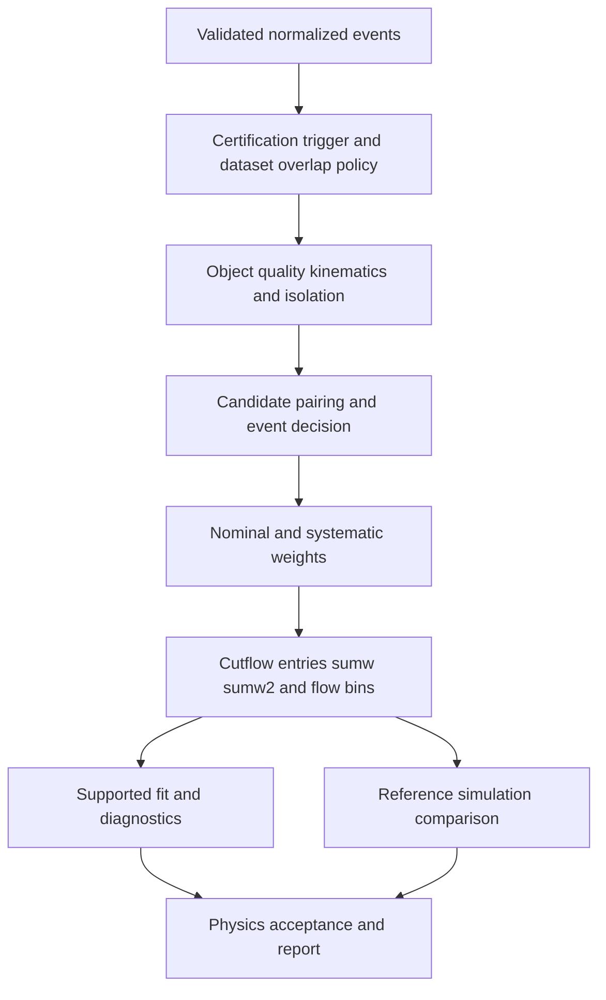

# 09 · Analysis algorithms and physics portfolio

Status: only the prototype dimuon selection is implemented. A corrected, weighted processor and the other studies require the gates below. Existing output with 15 selected pairs in 100 fetched events is a smoke demonstration, not a validated resonance or efficiency measurement.



## Common processor contract

`process_chunk(events, config, variations) -> Accumulator`. It does not write plots or resolve manifests. Validate the config before event iteration. Require strictly increasing finite histogram edges, nonnegative pT thresholds, sensible eta/isolation ranges, at least two objects for pairing and a finite ordered mass window. Unknown config keys are errors. All selection-boundary comparisons are part of the contract and tested.

Each cutflow stage stores event entries, signed sumw and sumw2. Candidate counts are a separate table; multiple pairs from one event must not be presented as independent events. Apply named variations coherently to objects, triggers and weights before candidate reconstruction. Merge accumulators with identical axes, selection hash, variation IDs and weight definitions only.

## A1: dimuon spectrum

Two configurations are needed. `dimuon_inclusive` explores resonances using appropriate low-threshold triggers, nonprompt/displaced-muon rules and separate efficiency treatment. `z_dimuon` uses trigger-compatible high-pT isolated muons and a Z-region mass window. The current pT>25 GeV isolated selection is a Z-oriented selection; extending its histogram down to 0.5 GeV does not establish efficient J/psi/Upsilon reconstruction.

```text
for event after certification and trigger policy:
    reject invalid required muon measurements; do not accept missing isolation
    select muons by declared ID definition, pt, abs(eta), isolation and impact parameters
    require object multiplicity >= min_n
    make unordered index pairs i<j
    apply opposite-charge condition and pair quality requirements
    compute mass using validated Lorentz vectors
    apply candidate mass interval
    if candidate_policy == all_pairs:
        fill candidates; preserve event clustering for statistical errors
    elif candidate_policy == closest_to_reference_mass:
        choose min(abs(m-m_ref), stable_pair_id); count one event
    elif candidate_policy == highest_sum_pt:
        choose max(sum_pt), then smallest stable_pair_id
    else: reject configuration
```

The choice of closest-to-Z mass sculpts the spectrum and cannot be used without disclosure in an unbiased lineshape study. Pair policy and multiplicity are analysis-specific. Electron and muon overlap policies must not depend on input ordering.

## A2: Z yield and efficiency measurement

Define the fiducial phase space, trigger menu, lepton working points, pair policy and fit background model before looking at the final yield. Distinguish acceptance from reconstruction efficiency. Estimate acceptance using generator truth in the declared process/domain; estimate efficiency using matched simulation and independent calibration, or a reviewed tag-and-probe method in data. Use luminosity from the same certified run/lumi subset and trigger conditions. For a cross section, `sigma=(N_signal)/(L*A*epsilon)` with a covariance model for yield, luminosity, acceptance, efficiencies and backgrounds. No number is publishable from a raw peak count alone.

Natural Z width, detector resolution, radiation and selection distortions affect the observed line shape. A Gaussian width is not the physical Z width. Comparing a fitted central value to a PDG number does not calibrate the detector or establish uncertainty coverage. Freeze the particle-data reference version and state the mass definition.

## A3: simulation validation

Run exactly the same analysis configuration on certified data and each declared simulation model, allowing only source capability adapters documented in the schema. Compare unit-area shapes separately from luminosity-normalized yields. Generator-level closure and reco/truth response tests require event associations; data/MC agreement alone does not measure detector efficiency. For each bin report statistical uncertainty, systematic band, undefined ratios and validity-domain exclusions.

## A4: diphoton

Require verified DoubleEG/DoublePhoton data and compatible trigger/certification, photon calibration, conversion/pixel-seed information, photon ID/isolation and electron veto. Configure leading/subleading pT or pT/mass cuts, fiducial regions, overlap removal and a candidate policy. Fill m(gamma gamma) with uncertainties and fit a normalized signal-plus-background model over an explicit range. Background model selection and signal-window policy are frozen before validation. A bump-hunt local significance is not a global discovery claim; toy studies and any look-elsewhere treatment are separate gates.

## A5: event display

Display only data supplied by the source. NanoAOD high-level objects are momentum glyphs or illustrative trajectories; they are not measured tracker hits. Truth or simulated tracks are labeled by origin/fidelity. Render coordinates in metres, energy in GeV and time in ns, with bounded object count, deterministic event selection and an explicit truncation indicator. Rendering changes do not mutate event values. Browser display never feeds reconstructed coordinates back into analysis.

## Analytical and physics acceptance

Analytic back-to-back same-magnitude muons reconstruct `2*sqrt(p²+m_mu²)`. Same-sign pairs fail an opposite-charge selection. Permuting input objects leaves the selected stable-ID result unchanged. Exact thresholds, empty/one-object events, zero/negative weights and invalid isolation each have independent fixtures. For physics acceptance use a statistically adequate certified sample, declared tolerances and independent review; the 100-event demo has inadequate coverage for many of these gates.
