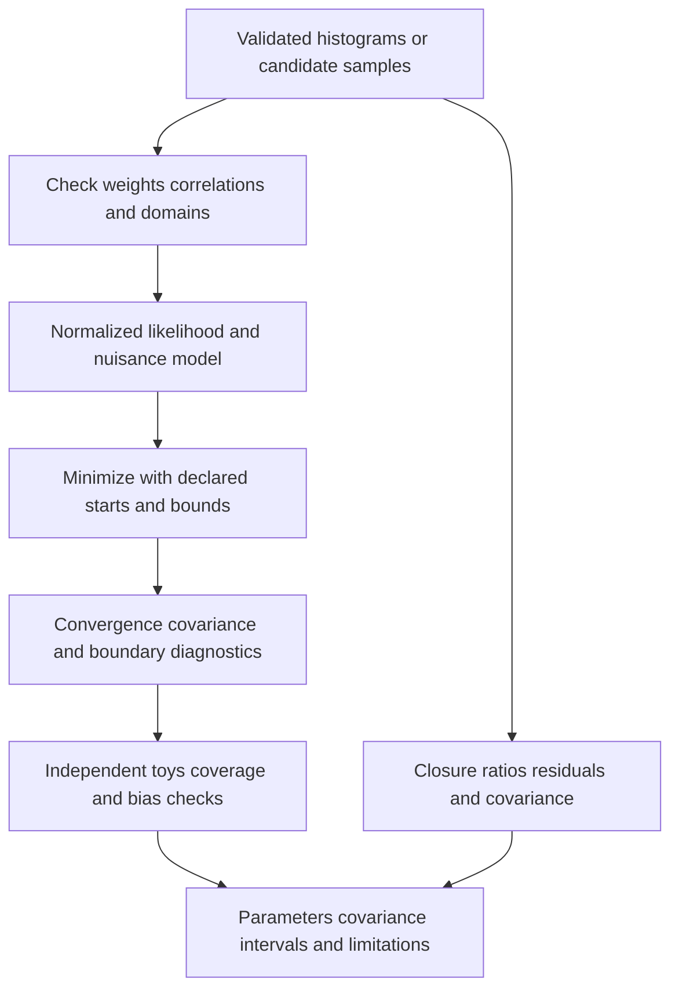

# 10 · Statistical inference, uncertainties and closure

Status: required design. The [implementation increment](implementation.md) fixes
finite-window normalization and adds covariance-aware compatible shape comparisons.
Efficiency calibration, response matrices and full physics coverage remain open.



## Weighted sums and sampling units

For independent weighted entries use `Y=sum(w_i)`, `V=sum(w_i²)` as a baseline MC statistical variance estimate. This formula does not remove correlations from multiple candidates sharing an event, reused MC events or fitted weights. Store event-level contributions when clustered errors or bootstrap are needed. Negative weights make an ordinary count Poisson model inappropriate. `N_eff=(sumw)²/sumw2` is a diagnostic for nonzero sumw2, not a universal event count or a fix for negative-weight likelihoods. See [iminuit weighted histogram methods](https://scikit-hep.org/iminuit/notebooks/weighted_histograms.html).

## Finite-domain mixture likelihood

For a peak over `[a,b]`, a Gaussian component is:

```text
g(x;mu,sigma) = exp(-0.5*((x-mu)/sigma)^2)/(sigma*sqrt(2*pi))
Z = Phi((b-mu)/sigma) - Phi((a-mu)/sigma)
g_truncated = g/Z
f(x) = fraction*g_truncated(x) + (1-fraction)*background_normalized(x)
NLL = -sum(log(f(x_i)))
```

Require `a<b`, `sigma>0`, `0<=fraction<=1`, finite parameters and strictly positive normalization. Use numerically stable CDF differences/log-sum-exp in extreme tails; clipping a bad density to a tiny constant can hide model failure. A uniform background integrates to one on the range. Exponential background uses the finite-window integral and a stable zero-slope limit. A Voigt/radiative model needs its own normalization and numerical-integration checks. Verify integral equals one at a grid of parameters including limits.

Extended likelihood adds Poisson information on yields when appropriate; a shape-only likelihood does not estimate an absolute event rate. Weighted data and signed MC require an explicitly supported cost function; do not silently reuse an unweighted NLL. Minuit/zfit/JAX implementations must share the same mathematical model and normalization, not merely a method name.

## Fit result and failure policy

Record parameter names/units, starting values, bounds, fit range, objective value, optimizer/build, function calls, termination reason, EDM where available, Hessian status, covariance, parameter correlations and boundary hits. A fit with an invalid minimum, unreliable covariance or parameter pinned to a boundary is not automatically a validated result. Store rejected fits and diagnostics without success-looking error bars. Use multiple deterministic starting points when the likelihood has competing minima; report the selection rule.

The fit writes a new child artifact referencing its parent payload hash. The current `fit` command modifies the parent JSON in place; replacement is a release blocker. No central mass or width is declared accurate merely because it agrees with a target number.

## Systematic model

Every nuisance has ID, prior/constraint if used, affected objects/bins, up/down payloads, correlation groups, applicable eras and calibration provenance. Recompute selections for shape-changing variations; weight-only treatment is valid only when documented. Maintain a covariance matrix `V_stat + V_syst`; encode shared luminosity, scale and model nuisance correlations. Avoid counting a calibration uncertainty both as a template shift and another independent nuisance.

Sensitivity derivatives can be estimated by paired variations with common random numbers, and must be checked for step-size stability. GPU/autodiff is optional after a CPU model passes density normalization, gradient finite-difference and fit-equivalence checks. GPU availability alone never changes statistical interpretation.

## Ratios, comparisons and efficiency

For `R=S/D`, a nonzero denominator and covariance are needed. Delta-method variance is `V_S/D² + S²*V_D/D⁴ - 2*S*Cov(S,D)/D³`. Zero denominators yield null with a reason. Normalizing all bins by their total introduces correlations; do not use an independent-bin error formula on unit-area ratios without accounting for the shared denominator. Cross-sample correlations arise from common systematic payloads and from splitting/reusing events.

Efficiency is a subset numerator over a specified denominator. Independent binomial intervals apply only for their sampling assumptions. Weighted/negative-weight efficiency requires a separately justified method; report unsuitable cases rather than returning a negative “probability.” Data tag-and-probe requires background subtraction and possible numerator/denominator covariance. Truth matching cannot be inferred from data histograms.

## Verification evidence

Use an independent sampler to generate toys at declared parameters, fit them and check bias, pull mean/width and interval coverage. Predeclare toy count, random seed policy, tolerance and statistical confidence. A 68% coverage target needs a binomial sampling uncertainty; there is no exact universal pass threshold for every toy count. Keep calibration and held-out validation separate. Goodness-of-fit comparisons must state covariance treatment, degrees of freedom and validity of any asymptotic approximation.
