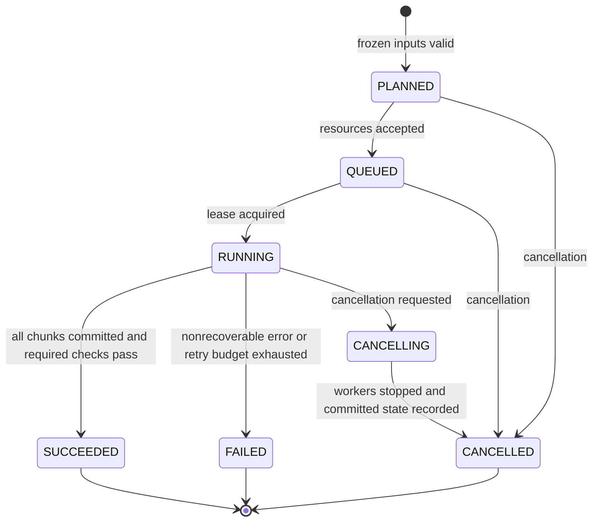
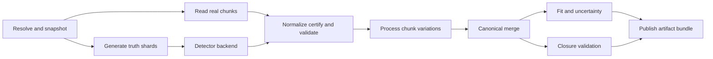

# 11 · Execution, retries, cancellation and deterministic merging

Status: target general orchestration. The local Workbench has a bounded SQLite queue with restart recovery, cancellation, per-job idempotency, a 500-job cap, and 30-day terminal-job retention. General data processing still runs in one process, `fetch` accumulates a full Python list, and Snakemake/Dask are not wired behind the processor interface.



## Immutable plan and mutable run state

Plan fields include source snapshots/ranges, schema/reader versions, detector model, generator shard plan, master seed/randomness algorithm, calibration/certification, analysis config, variations, execution budgets and required validation policies. Structural contract is `contracts/run-plan.schema.json`. Worker count and logging are operational fields; a computation may be schedule invariant only after tests establish it. Generator sharding that changes generated events belongs to physics identity.

Run state is a small mutable journal with run ID, plan hash, request idempotency key, status, chunk descriptors, retry counts, progress, errors and artifact IDs. Use atomic state transitions or a transactional local database. A terminal run is immutable; resumption creates a new attempt referencing the same plan and reuses only validated committed chunks.

## Pipeline DAG



Use a local bounded executor first. Snakemake can declare the durable file dependencies; Dask can distribute stateless chunk tasks. Do not add a second scheduler with a competing source of job state. All workers read the same plan hash and declared source range; no worker silently resolves a fresh portal record or picks another calibration version.

## Retry and failure taxonomy

Transient timeout/disconnection and worker eviction are retryable with bounded attempts and backoff. A source checksum change, schema mismatch, numerical-domain error, unsupported capability or invalid model is not automatically retryable. A late worker result after cancellation is ignored unless it committed before cancellation under the current lease; a stale lease cannot publish over a newer attempt.

Persist error kind, stage, event/chunk/source IDs, attempt and bounded context. A missing optional backend fails at preflight, not after a long download. Failed chunk attempts never count twice in accepted event statistics. Record attempted generator events separately from accepted physics events.

## Deterministic merge

```text
verify chunk plan hashes and accumulator contracts
sort by (dataset_source_order, source_entry_start, systematic_id)
reject repeated chunk keys and overlapping ranges
for each accepted chunk:
    add integer entries with checked overflow
    combine sumw and sumw2 with compensated pairwise reduction
    propagate invalid/flow counters and diagnostics
verify processed source coverage exactly matches planned coverage
finalize sorted artifact records
```

Floating addition is not associative. Reproducing event-level streams is distinct from reproducing histogram floating-point bits; freeze a reduction policy and publish tolerance for portable comparisons. Fit time and optimizer behavior also depend on library builds.

## Resource budgets and cancellation

Plan limits cover event count, source bytes, decoded bytes per chunk, object multiplicity, pair candidates, particle steps, secondary particles, open files, worker memory, CPU/wall time, log bytes and output disk. Budget exhaustion has explicit error/truncation status; it never silently discards objects from a validated result.

Cancellation stops new tasks, sends cooperative stop tokens, then terminates external child process groups after a grace interval. Close files and leave staging output uncommitted. Keep successful chunks and error diagnostics for review; never recursively remove a user-supplied path. Worker processes get isolated run directories and only the planned mounts.

## Acceptance

Kill a worker after each commit boundary; retry a completed chunk; deliver stale messages; cancel while generator output is open; run identical event plans with one and four workers; compare source coverage and weight sums. Double-clicking API submit with one idempotency key must not create two independent runs.
