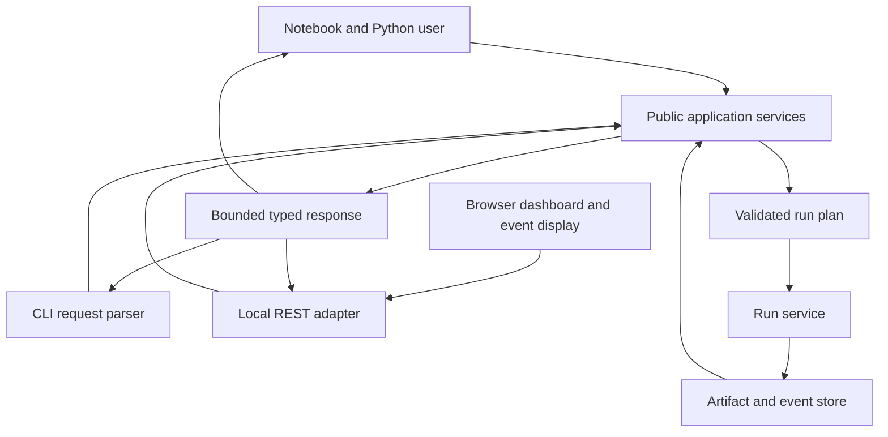

# 12 · Python, CLI, API, dashboard and event display

Status: local simulator GUI, bounded background Run/Stop jobs, event navigation, session-token/origin guards, and GET data/artifact routes are implemented. See [GUI design and acceptance](gui-design.md) and [native runtime](sim-runtime.md). Durable job recovery and the complete run-plan API below remain targets.

## Public Python target

`catalog.get(id)` returns a frozen typed dataset descriptor. `data.iter_chunks(request)` yields validated chunks under a resource context. `simulation.generate(plan)` yields truth descriptors; `simulation.simulate(truth,model)` yields detector output. `analyses.run(name,plan)` returns an artifact ID and validation state. `statistics.fit(parent_id,config)` returns a child artifact. No UI imports private CLI functions. Return structured errors; notebook examples call only these services.

These names describe the target API; inspect the current module before using them. Existing `fetch` returns a list and `process` takes lists. A compatibility adapter may provide list behavior only for explicit small sample requests with a memory ceiling.

## CLI contract

Expose documented commands with stable exit semantics: `0` success, `2` usage/contract/capability error, `3` I/O/integrity failure, `4` numerical/physics validation failure, `130` cancellation. This is the target; current exception handling maps many failures to 2. Machine mode returns a single JSON result/error with schema version and diagnostic paths. Progress goes to stderr. Unsupported verbs return failure, never a zero-exit placeholder.

Target additions: `doctor`, `plan`, `validate`, `cache inspect`, `runs status`, `runs cancel`, `export bundle`, `catalog import-record`. Fetch uses exact sample counts/ranges and optional transfer byte ceiling; `--sample 1GB` cannot imply a precise event limit. `run --input` validates content and schema, applies the same event limit for JSON and ROOT, and hashes source contents or a verifiable descriptor rather than a filename.

## REST target

| Route | Input and output | Boundaries |
|---|---|---|
| `GET /api/v1/capabilities` | Installed versions, supported fidelity/backends | No environment secrets or arbitrary directory listing |
| `GET /api/v1/datasets` | Catalog descriptors and pagination | Bounded page size; no event payload |
| `POST /api/v1/runs` | Typed request, idempotency key; 202 run ID | Registered dataset/model/config IDs only |
| `GET /api/v1/runs/{id}` | Run state, progress, error and validation state | Opaque ID resolved through registry |
| `POST /api/v1/runs/{id}/cancel` | Cancellation request | Terminal runs unchanged; idempotent |
| `GET /api/v1/runs/{id}/artifacts` | Artifact descriptors | Bounded metadata; hashed payload download route |
| `GET /api/v1/events/{dataset}` | Stable event key/page token and field projection | Max events/objects/bytes; explicit missing-field errors |
| `GET /api/v1/closure/{data}/{sim}` | Comparison artifact or validated comparison request | Both IDs resolved through registry; compatible inputs |

Use a versioned error body `{code,message,run_id,stage,details_id,retryable}`. HTTP 400 invalid request, 404 unknown object, 409 incompatible state/input, 413 resource ceiling, 422 unsupported capability/domain, 503 temporary backend outage. Deserializing a contract does not authorize filesystem access.

## Local service security

Bind to loopback and validate allowed hosts/origins. Loopback alone does not prevent malicious web origins from issuing local requests. State-changing operations require a per-session local token or equivalent origin/CSRF protection; do not embed it in URLs. Opaque IDs are checked against a registry and resolved inside permitted roots; defend encoded traversal, symlinks and junctions. The current closure route constructs paths directly and requires the same confinement used for run artifacts before release.

Do not accept arbitrary executable names, container images, absolute paths or Python snippets from browser requests. Simulation image digests and configs come from an approved local registry. Render labels as text, not executable HTML. Expose only bounded logs with secrets removed.

## Dashboard and accessible presentation

Views: dataset readiness/certification; plan preview with budgets; run progress/errors; histogram and cutflow; fit diagnostics; comparison with uncertainties; event display. Show fidelity, units, provenance, sample completeness and validation state beside every result. Empty, loading, failed and unsupported states are explicit. Keyboard navigation, readable contrast, axis labels, meaningful color-independent legends and data-table alternatives are required.

3D geometry comes from the model and carries a visible schematic/physical label. Glyph lengths use an explicit energy scale. Do not claim an extrapolated helix is a measured track. Cap rendered objects, allow deterministic filtering and flag display-only truncation. Exports contain the selected event ID and draw settings; a screenshot alone is not a preserved analysis.
