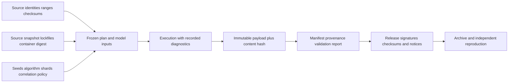

# 13 · Provenance, artifact preservation and trust boundaries

Status: target. Current provenance stores a Git SHA, schema version and config/manifest hashes; the populated fields do not capture dirty source changes, runtime versions, entry ranges, certification, seeds, output hashes or complete simulation state.

## Identity and content

There are three hashes: `plan_hash` identifies requested computation; `payload_hash` identifies exact output bytes; `bundle_hash` identifies the preserved collection. Equal plan hashes do not prove equal physics content, deterministic random streams, successful execution or even honest software. Verify payload hashes and validation evidence separately. Provenance must not claim that equal stamps imply correct or identical results without those conditions.

Hash strict canonical JSON with sorted keys, stable numeric policy and finite numbers only. Reject unsupported objects; `default=str` can collapse different objects into the same string. NaN/Infinity are invalid in interchange. Arrays remain ordered. Omit wall-clock metadata from computation identity while retaining it in audit logs. Hash the exact bytes of downloaded inputs and normalized configs with source-schema versions recorded.

The parent Git repository currently resolves to the drive root and HEPLab files are not established as independently tracked source. A SHA from that parent does not identify this project's dirty source. Until a dedicated repository is deliberately created, record a source-tree snapshot hash of permitted project files and an explicit `dirty/untracked` state. Never stage the entire drive or reset unrelated user changes.

## Artifact bundle contract

Required entries: `bundle.json`, frozen plan, dataset manifest snapshot, source/entry descriptors, calibration/certification/model payload hashes, source/build lockfiles, software bill of materials, histogram/cutflow payload, fit/comparison child artifacts, logs/diagnostics, validation evidence, citations/license notices and reproduction command. Large inputs can be content-addressed external references if availability/integrity are documented; the small release example is complete offline.

Artifacts are append-only. A new fit or correction creates a child with parent content hash. A run index atomically points to completed artifacts; it is not the authoritative payload. Store the exact configuration rather than only a hash that no longer resolves.

## Reproducibility levels

Level R0: input identities and full recipe preserved. R1: recomputation passes scientific tolerances in a pinned environment. R2: same-platform deterministic execution reproduces payload numeric arrays. R3: bitwise payload equality under specifically recorded hardware/runtime settings. A project must not promise R3 across CPUs/GPUs without measurements; math libraries, parallel reductions and transcendental functions vary. Reproducibility does not establish model validity.

## Input and process boundaries

Portal/API JSON, YAML, ROOT, Parquet and detector cards are untrusted data. Use safe YAML parsing with schema validation; do not load pickle or execute formula strings from users. Reject decompression bombs, huge branch shapes, invalid jagged offsets and oversized JSON before allocating. Restrict redirects/protocols for unattended fetching, preserving access to known official mirrors.

External simulators run with explicit mounts, bounded resources and no shell-built command strings. A detector card is code-like configuration and must be reviewed/pinned. Default service requests cannot choose arbitrary images or mount paths. Network access is required for explicit data acquisition; simulation jobs with staged inputs use a disabled network. Follow the [interface security contract](12-interfaces.md).

## Packaging and licenses

HEPLab source retains Apache-2.0. Dependency and data licenses are recorded per artifact/image, including PYTHIA's [GPL and citation instructions](https://pythia.org/documentation/). Separate process execution does not waive distribution obligations. Before publishing composed binaries/images, document applicable terms, required notices and source availability; get qualified review for uncertain redistribution cases.

Pin Python/Rust dependencies and simulation versions, record build flags and image digests, produce SBOM/checksum inventories, and publish a fresh-machine reproduction report. Publishing PyPI, GHCR or Zenodo records is a separate release action after the evidence exists. Do not fabricate a DOI, image digest, checksum or benchmark.
