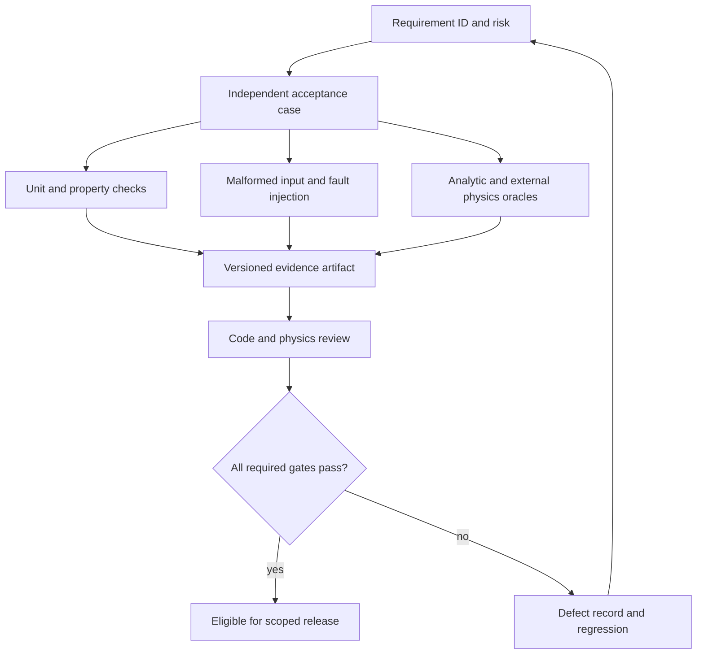

# 14 · Verification and physics validation

Status: required release gates. This chapter defines meaningful evidence; a test count or documentation checker is not evidence that an entire simulator is correct. The numerical reference tests created with this handbook cover only the implemented primitives.

## Evidence layers

| Layer | Independent check | What it establishes |
|---|---|---|
| Contract | JSON Schema plus semantic checks | Allowed types, units, shapes and domains |
| Numeric | Analytic/high-precision reference | Formula behavior in specified regimes |
| Statistical | Independently generated toys and distribution tests | Random sampling/fit behavior within stated uncertainty |
| Integration | Small committed real-format fixture | Reader/engine/analysis composition |
| Recovery | Kill/retry/corrupt/concurrent writers | State and transaction behavior |
| Physics | Held-out official simulation/data comparison | Model validity over tested domain |
| Packaging | Clean environments and wheel install | Distributable interfaces and assets |
| Preservation | Fresh reconstruction from bundle | Recipe completeness and input integrity |

## Mandatory adversarial cases

Numerics: zero boost; beta approaching one from below; beta>=1; NaN/Infinity; extreme eta; negative mass/pT; spacelike vectors; cancellation near zero invariant; wrap at ±pi; collinear/massive versus massless limits. Geometry: tangent cylinder, starting on a surface, zero transverse momentum, opposite charges, B=0, field reversal, grazing thin layer, repeated zero steps, escaped and stopped particles.

Randomness: same event with shuffled processing order, different chunk size, extra unrelated stage, one/four workers; open-interval uniforms; fixed canonical hash vectors; exponential and Gaussian moments with statistically predeclared tests. Response: efficiency exactly 0 and 1, invalid covariance, out-of-domain lookup, correlated variations, negative-tail handling and extreme pileup.

Data: missing branch versus empty collection; scalar MET; jagged mismatch; missing/NaN isolation; integer overflow in event IDs; invalid/overlapping source ranges; unchanged file name with changed content; certified-lumi endpoints; duplicate CMS event across primary streams. Cache: partial/full collision, manifest update, unreadable/corrupt Parquet, stale JSON sidecar, crash at each flush/commit boundary, two writers and symlink escape.

Analysis/statistics: same-sign pairs; multiple candidates in one event; event weights ignored/doubled; negative weights; zero total sumw with positive sumw2; upper histogram edge; mismatched bin edges; density integral over the fit window; narrow peak near a boundary; failed optimizer; singular covariance; incompatible eras/isolation definitions; empty comparison denominator.

API/process: encoded path traversal, symlink/junction, untrusted browser origin, duplicate submission, cancellation mid-generation, process timeout, stdout flood, unsupported image/backend and disk quota exhaustion. Notebook/package: catalog assets in a wheel, config resource discovery, offline examples and stale repository aliases.

## Physics oracle matrix

| Module | Reference | Acceptance protocol |
|---|---|---|
| Lorentz algebra | Analytic rest/two-body examples and independent precision arithmetic | Round-trip boost and invariant residual within declared numeric tolerance |
| Uniform-field propagation | Analytic radius, sign, time and norm | Field/charge reversal and step composition tests |
| General transport | Analytic field cases then pinned Geant4 configuration | Tolerance/step convergence and energy/secondary ledger |
| Response | Held-out calibration tables and DELPHES card outputs | Bias, resolution, efficiency and tails per domain with uncertainty |
| Generation | Generator reference tables and process cross sections | Matching beam/cut/tune/PDF conventions and MC uncertainty |
| Analysis | Reviewed CMS open-data workflow and golden fixtures | Cutflow at each stage, weighted yield and candidate policy |
| Fits | Independent sampler and integrator | Normalization, optimizer diagnostics, bias and interval coverage |

Tolerance values for detector closure require a calibration dataset and reviewer agreement. Keep them `TBD_BLOCKING` until sourced; do not invent universal 1% closure or Z-width accuracy. Numerical roundoff tolerances are different and can be set from floating-point analysis and tested dynamic ranges.

## Test execution and CI policy

Fast PR gates: contract checker, Python lint/types, pure-Rust fmt/clippy/unit/property checks, reference numerical tests, tiny offline ROOT/Parquet golden tests, reader+processor regression and package install. Rust FFI gets platform-wheel/import checks. Fault injection and statistical toys run in deterministic bounded jobs; optional GPU comparisons are a separate required gate only for a GPU release. Scheduled remote smoke checks report network failures distinctly from regressions.

Every property test records the failing seed/event and minimized fixture. Fuzzing targets parser sizes, geometry navigation, FFI shapes and input validation; cap resources. Mutate isolation masks, charge signs, normalization terms and cache range keys to show critical checks actually fail. Do not automatically approve mutated golden outputs.

## Review and defect handling

Fix an observed failure with a regression that fails on the old behavior, an independent explanation, and a code change. High-severity defects that bias results trigger an affected-run audit and model/artifact version bump. Physics review is independent of implementation review when a detector or inference model changes. If no qualified external review has occurred, the validation state remains explicit.
