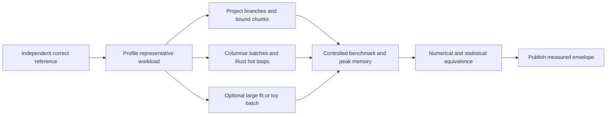

# 15 · Performance, memory and numerical portability

Status: target budgets and measurement protocol. There is no measured Rust engine speedup or full-dataset memory bound in the current prototype. The fetch function's accumulated Python list is a scale blocker.

## Resource model

Use chunked structure-of-arrays buffers for kinematics and validity masks. A worker processes one bounded event batch; a bounded queue applies backpressure to readers. Memory estimate includes decoded source buffers, normalized arrays, response state, pair candidates, variation buffers and output staging. Peak memory must scale with chunk size/workers/model multiplicity, not total dataset entries.

Initial configurable ceilings are policy defaults, not measured performance claims: 100,000 events per input chunk, one active chunk per worker, 2 GiB per worker, bounded 1,000 displayed objects, 100 API events, and explicit limits for pairs and secondary particles. These defaults need workload measurements; high-multiplicity events may require smaller chunks or larger declared budgets. A resource error is preferable to silent physics truncation.

## Algorithmic costs

All unordered lepton pairs cost O(n²); preselect objects and stream candidate evaluation instead of allocating every pair. Histogram updates cost O(log b) for arbitrary edges and O(1) for proven uniform bins. Geometry initially uses a small direct volume list; a BVH/spatial index is justified by a measured scene complexity threshold. Truth association's global assignment can be cubic; restrict candidate edges using a reproducible spatial index and preserve a reference solver for small cases.

Parallelize independent events/chunks. Avoid nested Dask workers each launching an unrestricted Rayon/BLAS pool. A single runtime resource budget divides event workers and inner threads. Batch FFI conversion and memory-copy cost count in timings. SIMD, unsafe buffers, GPU transfer and custom allocators require named profiles and correctness gates.

## Benchmark record

Every published row includes CPU/GPU/OS, RAM, compiler and flags, Python/Rust/library versions, model/fixture hashes, fidelity, number of events/particles, warm/cold conditions, network bytes, wall time distribution, throughput, peak RSS, output equality/tolerance, and command. Report several repetitions and variability. Separate source download latency from compute time. Include startup/import and artifact compression for end-to-end numbers.

Do not compare different physics fidelities as the same workload. A toy smear and material shower simulation have different scientific content. A Python fallback and Rust port must consume identical event/model identities for a meaningful acceleration claim.

## Optional GPU path

Candidate workloads: large likelihood evaluations, toys and response batches with regular array shapes. GPU execution needs float64 support or a validated reduced-precision error budget. Fix random addressing and deterministic reduction where possible; document backend differences. No silent CPU/GPU switch under one reproducibility claim. If transfer/startup dominates, remain on CPU. The first public baseline is CPU and runs without CUDA.

## Acceptance targets

Publish actual cold-install, first-plot and full-batch timings only after measuring a reference machine. A ten-minute example is a product goal, not current evidence. Compare peak memory on N and 10N events at fixed chunk/worker size. An unexpected trend blocks the streaming claim. Track p50/p95 event time, pathological geometry/multiplicity cases and throughput regressions with a predeclared noise threshold.
