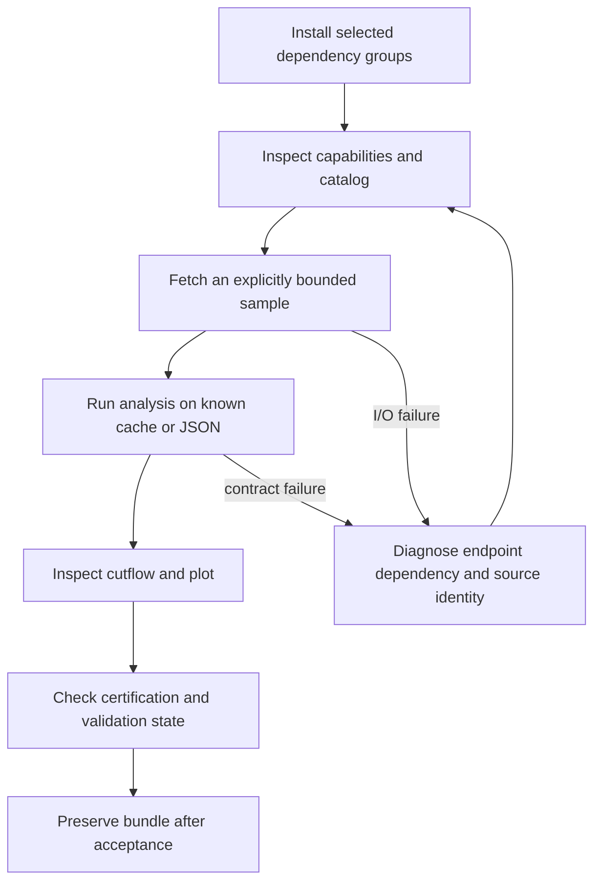

# 16 · Developer and user runbook

Status: commands labeled CURRENT are available in the prototype. Commands labeled TARGET are interface plans and must not be presented as installed features. Current fetch/analysis artifacts are exploratory until the listed release blockers are fixed.

**Update:** the canonical file is now `run2016g_doublemuon.yaml`, the old alias
works, fit outputs are immutable children, and cache v2 separates source ranges.
This catalog entry applies the pinned certification payload automatically.
See [implementation](implementation.md) and the [native engine guide](native-engine.md).
Earlier prototype cautions below are retained as history.



## CURRENT installation

From the project directory in PowerShell:

```powershell
python -m venv .venv
.\.venv\Scripts\python.exe -m pip install -e '.[analysis,serve]'
.\.venv\Scripts\heplab.exe version
.\.venv\Scripts\heplab.exe catalog list
```

Python >=3.12 is declared; individual dependency/platform compatibility still needs a supported-version matrix and lockfile. Installing Rust is not required for the current Python path. Scientific dependencies must be installed into the same interpreter running HEPLab. Core installation needs PyYAML; optional features require their extras. Container simulation needs a real built image and reachable Docker daemon.

## CURRENT real-data sample

The repository manifest named `run2016_doublemuon_example.yaml` currently describes real `Run2016G_DoubleMuon` record 30522. Its filename, earlier README text, default config alias and older packaged example are stale; align them before release. The previous successful sample uses this exact cache root:

```powershell
$env:HEPLAB_CACHE_DIR = 'D:\CERN\.cache\heplab'
heplab fetch Run2016G_DoubleMuon --sample 100events --chunk-size 100
heplab run dimuon --dataset Run2016G_DoubleMuon --max-events 100 --output artifacts/dimuon-run2016g-100.json
heplab plot artifacts/dimuon-run2016g-100.json
```

These commands demonstrate remote reading and a small analysis. They do not apply certified lumi selection, verify full-file checksums or make a full-dataset cache complete. A larger current fetch can overwrite the same sample cache key. Use distinct exploratory cache roots for separate sizes until the target transaction/range identity is implemented. Set `HEPLAB_CACHE_DIR` explicitly when reusing the earlier sample; it was stored inside the project, not under the default user cache.

## CURRENT offline use

`heplab run dimuon --input events.json --output artifacts/example.json` consumes legacy schema dictionaries. The numerical reference is independent and can be imported through an editable install or source path. Local synthetic fixtures are marked educational, never attributed as CERN collision events. Avoid in-place `fit` on a preserved parent artifact until child-artifact behavior is implemented; copy an exploratory artifact if experimenting.

## TARGET simulator procedure

Preflight model, generator/PDF versions, external image digest and resource ceilings. Freeze a run plan. Produce a small truth sample, validate generator normalization and analytic detector primitives, run T0/T1 response then compare with a pinned DELPHES reference. Resolve calibration/closure tolerances and review before production. `doctor`, `plan`, `validate` and `export bundle` are planned, not current commands.

## Diagnosis and recovery

Missing XRootD binding: use the known CERN EOS HTTPS mirror with verified byte-range support, or a supported Linux/container runtime. A failed native binding build does not invalidate ROOT files. HTTP 404: resolve the URL from the official record API/file index and confirm the mirror path; do not guess unrelated download hosts. Source checksum mismatch: stop, quarantine, refresh the frozen source snapshot deliberately and create a new plan.

Missing branch or incompatible isolation: inspect native schema and requested capabilities; do not patch with zero. Invalid fit/covariance: keep the failed result, check likelihood normalization/domain and sample suitability, then create a new child attempt. Cache parse failure: preserve the corrupt file for diagnosis, recompute into a separate transaction and verify its descriptor. Disk full: stop writers cleanly and free only known disposable staging/cache entries under a verified project path. Never delete an archived bundle to make a run look successful.

## Release reproduction

The target archived example includes frozen inputs small enough to run offline, source/package versions and a scripted reproduction command. A reviewer starts in a clean environment, installs the pinned package, validates the manifest, runs the example and compares numeric outputs within published tolerances. Record hardware/runtime and elapsed time. Only then publish the scoped support/reproducibility claim.
