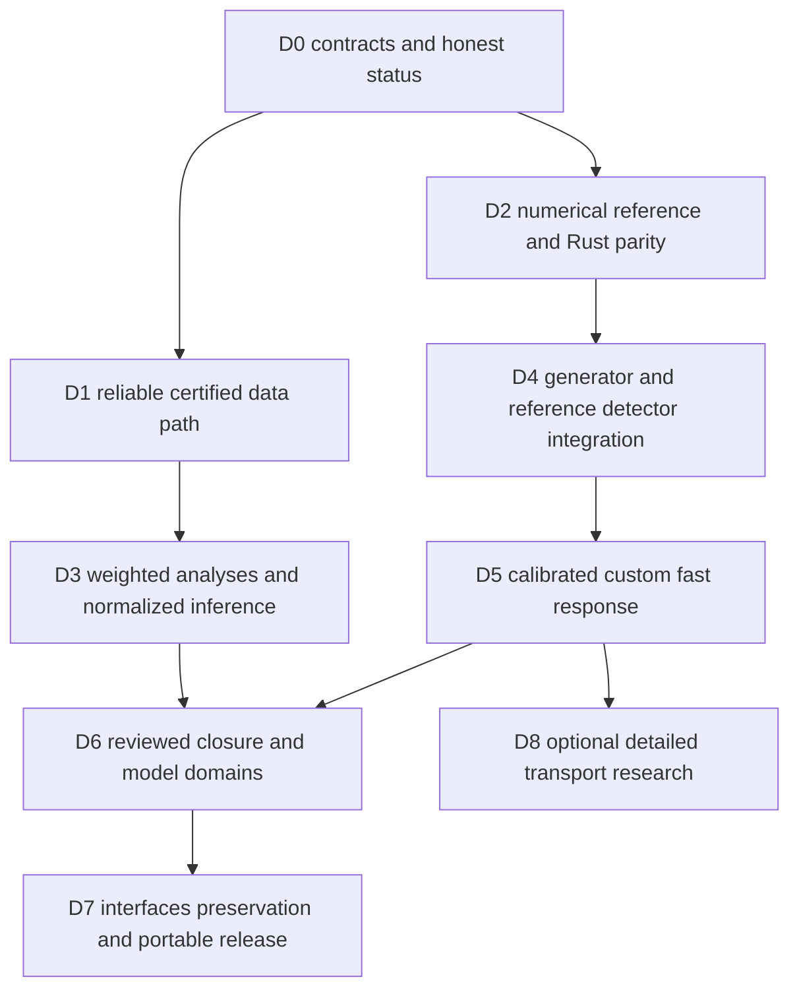

# 17 · Implementation inventory and delivery gates

Baseline: source inspection on 2026-10-27. This is an engineering inventory, not an assertion that historical tests or sample output prove production readiness. The previous 21-test pass predates changes to the manifest and does not describe the current suite.

**Current increment:** [implementation evidence](implementation.md) records the
seven P0 software fixes and compiled numerical engine. Defect observations below
remain the baseline for traceability; they are not all currently unfixed.

## Current capability ledger

| Capability | Existing evidence | Limitation |
|---|---|---|
| Catalog | YAML listing and record-info commands | Alias/package-copy drift; limited validation |
| Remote real data | 100-event HTTPS read from record 30522 and a Parquet cache | No certification, complete-file checksum, coverage descriptor or robust sample identity |
| Event schema | Registry v1 plus dictionary records | No full type/unit/semantic enforcement; trigger/truth design gaps |
| Dimuon | Candidate mass/cutflow/histogram prototype; 15 pairs in demo | Ignores event weights, accepts invalid isolation, no corrected efficiency/trigger model |
| Fitting | Optional iminuit Gaussian/uniform function | Finite-window normalization and diagnostics incomplete |
| Closure | Unit-area ratios | No errors, truth efficiency, covariance or calibration acceptance |
| Simulation | Toy smear and subprocess wrappers | No proven image, calibrated response or native transport |
| Rust | PyO3 addition scaffold | No compiled/tested physics core |
| Server | Basic local GET routes | No job submission, dashboard, complete path/origin controls |
| Packaging/CI | Declared checks and Dockerfile | No current wheel/reproducibility evidence; toolchain/dependency gaps |

## Defects and release blockers

| ID | Priority | Observation and consequence | Required acceptance case |
|---|---|---|---|
| BUG-001 | P0 | `io/cache.py` key excludes entry ranges and manifest/calibration identity; sample can masquerade as full dataset | N then M fetch; changed checksum/certification; exact-range coverage |
| BUG-002 | P0 | `dimuon/run.py` accepts nonfinite/missing isolation | Invalid isolation never passes a required cut |
| BUG-003 | P0 | Processor histograms/cutflows ignore event weights | Positive/negative weight reference with sumw2 and event/candidate distinction |
| BUG-004 | P0 | Fit Gaussian lacks truncation normalization | Independent integration across parameter/range grid and boundary toys |
| BUG-005 | P0 | Certification and trigger policy absent from data analysis | Good/bad lumi intervals and recorded/emulated trigger contract |
| BUG-006 | P0 | DELPHES isolation copied into quality and pixel-seed fields | Golden native fixture preserves absence and semantic definitions |
| BUG-007 | P0 | Git SHA can identify unrelated drive-root repository; dirty/untracked sources omitted | Source snapshot hash changes on any relevant file change |
| BUG-008 | P1 | Canonical config hashing uses `default=str` and allows nonfinite data | Unsupported objects/NaN rejected; canonical fixture vectors |
| BUG-009 | P1 | JSON input ignores `max-events`; ROOT source identity hashes filename | Consistent limits and same-name/different-content regression |
| BUG-010 | P1 | Reader optional defaults use number of fields rather than object count; `zip` may truncate | Missing optional branch retains correct object multiplicity or rejects |
| BUG-011 | P1 | Fetch keeps all events in memory; MB/GB converted to estimated event counts | Peak memory bounded by chunks; true transfer ceiling recorded |
| BUG-012 | P1 | Remote checksums recorded/shape checked but not verified over complete source | Full-download verification distinguished from projected-read integrity |
| BUG-013 | P1 | `fit` mutates parent JSON; artifact ID not payload content | Immutable parent and hashed fit child |
| BUG-014 | P1 | Closure checks only bins/range, not observable/weights/era/model; no covariance | Incompatible comparison rejected; zero-denominator and covariance cases |
| BUG-015 | P1 | API closure uses unchecked joined paths; browser-origin defenses absent | Traversal/symlink/origin tests and registry-only IDs |
| BUG-016 | P1 | Toy RNG is processing-order dependent and Gaussian pT clipped at zero | Event-addressed streams and documented positive response model |
| BUG-017 | P1 | Trigger marked sim-only; one parent index for general truth | Versioned schema migration with real triggers and graph associations |
| BUG-018 | P1 | Default aliases/docs/tests/package manifest disagree after real-record update | Single catalog authority and installed-wheel alias checks |
| BUG-019 | P1 | Simulation image name and entrypoint assumed without build evidence | Pinned built image, driver/card assets and real smoke output |
| BUG-020 | P2 | README/SKELETON diagrams and phase counts reflect older skeleton | Current status links and historical banners with no implied new features |

P0 blocks scientific production and trusted measurement. P1 blocks reliable public-release claims. This handbook records these defects; recording them does not fix them. The numerical reference delivered with this handbook improves the specification/equation evidence and is not a replacement for the listed repairs.

## Delivery packages with definitions of done

**D0 — specification and contracts.** This handbook, diagrams, strict request/envelope schemas, requirement IDs, numerical reference and independent tests. Checker reports structural/link coverage. Physics and Rust implementation remain separate gates. Review conflicting historical docs and track all unknown calibration thresholds.

**D1 — data foundation.** Fix BUG-001,005,010,011,012,018. Implement strict manifests, certified-lumi mask, required-branch closure, bounded Arrow chunks, transactional coverage metadata and offline replay. Prove packaging includes one authoritative catalog. Produce a fixture with source/entry/checksum evidence; do not claim full-file verification for projected reads.

**D2 — Rust primitives.** Implement pure Rust modules for units, Lorentz algebra, addressed RNG, weighted histogram and analytic helix. Match independently generated analytic fixtures and the Python reference, compile with checked errors and no initial unsafe code, add property/fuzz/FFI tests. Only then benchmark and bind through PyO3. Current machine has no detected Rust toolchain; do not mark compiled until real build logs exist.

**D3 — analysis/statistics.** Fix BUG-002,003,004,008,009,013,014. Separate inclusive/Z configs, enforce capabilities, preserve source limits/weights, implement flow bins and clustered candidate policy, use normalized likelihoods and immutable fit children. Produce a complete cutflow and coverage evidence on a scientifically adequate sample.

**D4 — external generation/detector.** Build real drivers and pinned PYTHIA/DELPHES image, freeze tune/PDF/cards and process domain, preserve normalization and truth graph, correct native reader semantics (BUG-006,017,019). Validate against an appropriately selected official MC process. A restricted `pomflux` or high-mass sample is not automatically the Z reference.

**D5 — custom fast engine.** Build geometry/field navigation, calibrated object response, deterministic random streams, association/reconstruction and uncertainty variations. Gate material interactions separately. Prove analytic transport, response-domain validation, reproducible schedule and bounded resources. BUG-016 resolved.

**D6 — physics acceptance.** Select independent held-out data/MC, source calibration and luminosity, agree numerical/statistical/physics tolerances before comparison, produce uncertainty-aware efficiency/resolution/shape reports and independent review. No fixed accuracy claim until evidence exists.

**D7 — public release.** Finish run registry/API/dashboard, BUG-007,015,020, packaging/support matrix, offline examples/notebooks, pinned dependencies, SBOM/notices, fresh-machine reproduction and archive recipe. Publishing repositories/packages/images/DOIs follows review of concrete artifacts.

**D8 — detailed transport.** Optional Geant4 adapter plus geometry/material/physics-list studies; or a separately reviewed custom transport research program. It does not delay an accurately scoped fast-simulation release. Target fidelity and calibration evidence determine claims.

No calendar estimate is assigned before profiling and dataset/model selection. Work packages are ordered by dependencies and scientific risk; completion is based on evidence, not lines of code or number of diagrams.
