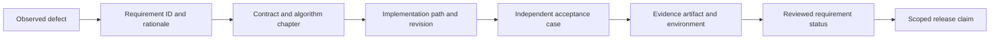

# 18 · Traceable requirements and acceptance cases

Status: evidence register. IDs, chapters, acceptance methods and states live in
[requirements.json](requirements.json). The [current implementation evidence](implementation-evidence.json)
and [simulation/GUI follow-up evidence](simulation-gui-evidence.json)
distinguish locally verified numerical/software behavior from partially
implemented target requirements. The [original verification record](verification-record.json)
is a historical specification baseline. The latest [geometry/calibration evidence](geometry-calibration-evidence.json) records scoped surface navigation and reference-model checks. No requirement is `physics_validated`.

## Register fields

`id` is stable and never reused. `title` is the behavior to establish. `document` links its normative specification. `verification` defines observable evidence; tests must check externally meaningful behavior. `status` is one of `specified`, `reference_verified`, `implemented`, `verified`, `physics_validated`, or `deferred`. `evidence` contains paths/URLs and revision/environment when available. `implemented` alone does not imply correctness. `deferred` requirements remain excluded from release claims.

## Acceptance bundles

| Gate | Required families | Review evidence |
|---|---|---|
| Numerical reference | CORE and numeric QA subset | Independent analytic checks and reproducibility vectors |
| Data prototype | DATA and SCHEMA | Source provenance, explicit ranges, corruption/recovery, real-format fixture |
| Analysis prototype | ANA and STAT | Weighted cutflow, fit integral, independent toys and missing-data rejection |
| Fast simulator | GEN, TRANSPORT, RESPONSE, RECO | Generator normalization, analytic transport, calibrated held-out response |
| Public release | EXEC, API, TRUST, PERF and QA | Fresh install, bounded memory, safe interfaces, complete bundle and domain limits |
| Laboratory detector | LAB-001 through LAB-008 | Identified device, decoded/replayable DAQ, clocks, independent efficiency denominator and held-out response |
| Desktop releases | DESKTOP-001 through DESKTOP-006 | Native Windows/Linux x86-64 and both macOS CPU targets, packaged workers, safe IPC and signed lifecycle |

An acceptance test must state input identity, preconditions, action, expected result, tolerance and reason for that tolerance. Physics tolerances still awaiting calibration use `TBD_BLOCKING` in the evidence report; a reviewer must replace them with sourced values before the corresponding validation gate.

## Checking documentation and contracts

`python tools/check_handbook.py` checks that every handbook page has a Mermaid block, local relative links resolve, requirement IDs are unique, documents referenced by the register exist, JSON Schemas are valid, and shipped JSON examples satisfy their schemas. It also rejects unsupported evidence statuses and duplicate IDs. It does not execute algorithms, inspect all source semantics, prove statistical power, or verify the accuracy of a scientific publication.

The target CI stores checker output, numerical tests and physics reports independently. A diagram parser check verifies Mermaid syntax when the official Mermaid parser is installed; text-pattern detection alone is not a renderer. Keep generated diagrams reproducible from the Markdown source and accessible text/tables.

## Change process

When a regression is found, assign a defect, identify the violated requirement and add a failing independent case. Changing a threshold/model/semantic contract creates a new version and affected-artifact assessment. Do not close requirements solely because their test name contains the ID. The register is a compact map; the linked chapter contains the full algorithm, failure policy and validity scope.
