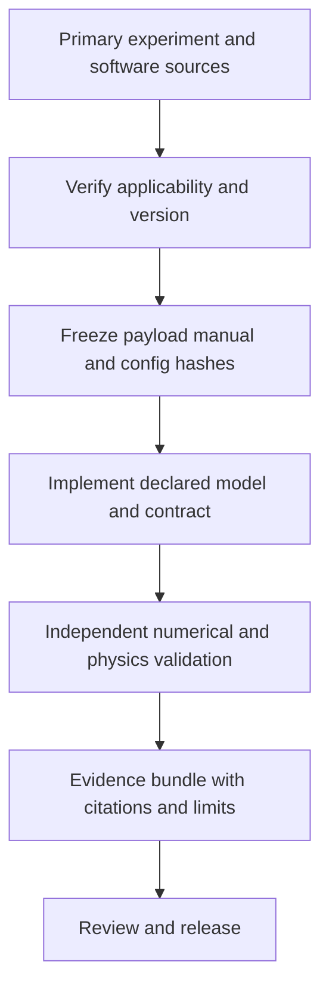

# 19 · Primary references and evidence policy

Source links checked during preparation on 2026-10-27. Versions and payloads must be frozen again for each actual simulation run; a live documentation page is not a build lockfile. Some primary sites use generated/manual version URLs; preserve the retrieved document and its hash with the run when its equations/model choices are used.

## Experiment data and conditions

| Source | Role | Applicability rule |
|---|---|---|
| [CMS Run2016G DoubleMuon 30522](https://opendata.cern.ch/record/30522) | Real 13 TeV NanoAOD validation population | Preserve DOI and exact file/entry subset; apply linked certification |
| [CMS Run2016H DoubleMuon 30555](https://opendata.cern.ch/record/30555) | Additional collision period | Preserve run coverage and trigger/correction differences |
| [2016 certified-run record 14220](https://opendata.cern.ch/record/14220) | Good lumi/run payload | Choose full or muon-only scope matching the analysis |
| [CMS NanoAOD guide](https://opendata.cern.ch/docs/cms-getting-started-nanoaod) | Native format, access and interpretation | Match the actual NanoAOD version/branch semantics |
| [CMS luminosity guide](https://opendata.cern.ch/docs/cms-guide-luminosity-calculation) | Luminosity calculation method | Freeze certification, applicable normtag and trigger/prescale policy |
| [CMS dataset discovery workshop](https://cms-opendata-workshop.github.io/workshop2026-lesson-nanoaod/03-what-data-is-available.html) | Official MC process selection and generator provenance | Resolve a suitable process/campaign, not just a similar name |

Record 30522 reports 45,235,604 events, 29 files and about 39.3 GiB. That is a source-record inventory, not local downloaded coverage. Current sample coverage is 100 source events. The record DOI is `10.7483/OPENDATA.CMS.ZQS3.LGLP`. Source file checksums from the portal remain declared values until complete-file verification is actually performed.

## Physics and simulation

| Source | Use in this design |
|---|---|
| [PYTHIA releases](https://pythia.org/releases/) | Pin generator source/version; obtain official build inputs |
| [PYTHIA documentation and license](https://pythia.org/documentation/) | Process/tune/PDF/decay settings, validity and citation obligations |
| [LHAPDF supported sets](https://www.lhapdf.org/pdfsets.html) | Select exact PDF data set/member/version required by the tune |
| [DELPHES repository](https://github.com/delphes/delphes) | Pin source and CMS detector card with its include dependencies |
| [DELPHES workbook](https://delphes.github.io/workbook/) | Model modules, ROOT structures, pileup and generator integration |
| [DELPHES module definitions](https://delphes.github.io/workbook/modules/) | Understand response and isolation semantics before mapping fields |
| [Geant4 Physics Reference Manual](https://geant4.web.cern.ch/documentation/dev/prm_html/PhysicsReferenceManual/generalities/index.html) | Reference treatment of particle transport, step limits and competing processes |
| [PDG particle numbering scheme](https://pdg.lbl.gov/2021/mcdata/mc_particle_id_contents.html) | Particle identity conventions; freeze reference version for implementation |
| [FastJet](https://fastjet.fr/) | Established jet clustering implementation; verify exact interface/release before integration |
| [iminuit weighted histogram methods](https://scikit-hep.org/iminuit/notebooks/weighted_histograms.html) | Weight/covariance limitations and supported inference approaches |

The generic formulas in this handbook are a mathematical project specification, not a claim that custom approximations reproduce the full CMS detector. Detector coefficients, particle-property tables, transport interaction models and performance numbers still require versioned input and domain validation. References to old PDG pages identify conventions, not current numerical constants; future release must select a reviewed current edition for any mass/width claim.

## Language and integration

[Rust ownership](https://doc.rust-lang.org/book/ch04-01-what-is-ownership.html) and [concurrency](https://doc.rust-lang.org/book/ch16-00-concurrency.html) support the engineering choice for new numerical/transport code. [PyO3 0.22 parallelism](https://pyo3.rs/v0.22.6/parallelism) matches the extension dependency currently declared in this checkout. These sources justify ownership/FFI decisions; they do not establish simulation accuracy or a speedup.

## Claims that need new evidence

No approved inclusive Drell–Yan MC record, full correction inventory, complete Geant4 CMS geometry, calibrated response coefficients, universal detector-closure threshold, published simulation image or measured Rust speedup is established here. Source each claim when its work package starts. Preserve the source, decision and uncertainty; do not substitute a plausible constant or restricted MC process to fill a table.
