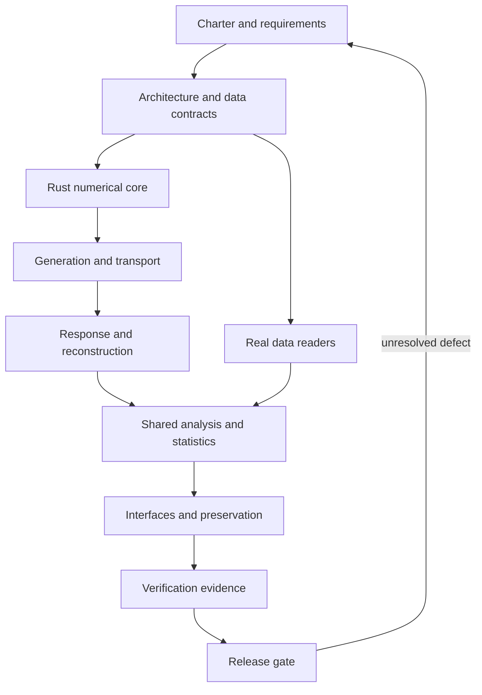

# HEPLab engineering handbook

Version: 1.0 design baseline · 2026-10-27 · Scope: CMS analysis, custom fast simulation, and optional reference transport.

**Implementation update:** [critical fixes and compiled Rust engine](implementation.md)
records current code/evidence and remaining gates. Numbered chapters retain
baseline observations where this increment supersedes them.

Current work follows the [CMS, laboratory and desktop completion plan](completion-plan.md)
and [CMS export/calibration workflow](cms-export-workflow.md).
The cross-product execution sequence, desktop-only simulator boundary, public
website track, Workbench UX redesign and risk register are in the
[detailed implementation roadmap](implementation-roadmap.md).
Workbench event displays can now be exported as vendor-neutral
[OpenUSD stages](usd-export.md) for external viewers and offline rendering.

This handbook defines the target system and the checks required to trust it. It is an implementation specification, not a claim that the target exists today. Every chapter distinguishes existing behavior from required behavior. **No document, language, or test suite establishes that software has zero bugs.** Release decisions require recorded evidence, physics review, and known limitations.

## Read the system in order

| Chapter | Purpose |
|---|---|
| [00 Charter](00-charter.md) | Users, fidelity levels, boundaries, vocabulary, success criteria |
| [01 Architecture](01-architecture.md) | Components, ownership, dependency direction, end-to-end flow |
| [02 Data supply](02-data-supply.md) | Catalog, certification, corrections, streaming, integrity, cache transactions |
| [03 Event contracts](03-event-contracts.md) | Units, types, nulls, identities, truth graphs, reader contracts |
| [04 Numerical core](04-numerical-core.md) | Rust choice, vectors, boosts, errors, deterministic random streams, FFI |
| [05 Generation](05-generation.md) | PYTHIA/MadGraph interfaces, beam/PDF/tune consistency, pileup and normalization |
| [06 Transport](06-transport.md) | Geometry, fields, propagation, surfaces, materials, decays, step arbitration |
| [07 Detector response](07-detector-response.md) | Tracking, calorimetry, resolution, efficiencies, digitization and correlations |
| [08 Reconstruction](08-reconstruction.md) | Truth association, tracks, particle flow, jets, isolation, MET and triggers |
| [09 Analysis](09-analysis.md) | Dimuon, Z measurement, diphoton and event display algorithms |
| [10 Statistics](10-statistics.md) | Weighted yields, normalized likelihoods, nuisance models, closure and coverage |
| [11 Execution](11-execution.md) | Run state machine, cancellation, resume, DAG, deterministic merging |
| [12 Interfaces](12-interfaces.md) | Python/CLI/API/dashboard contracts, bounded event display, errors |
| [13 Preservation and trust](13-preservation-and-trust.md) | Provenance, artifact identity, sandboxing, dependency licenses and releases |
| [14 Verification](14-verification.md) | Invariants, independent oracles, adversarial fixtures, physics acceptance |
| [15 Performance](15-performance.md) | Work budgets, vectorization, bounded memory, benchmarks and optional GPU |
| [16 Operations](16-operations.md) | Install, fetch, run, diagnose, recover and preserve a result |
| [17 Delivery plan](17-delivery-plan.md) | Prioritized defects, implementation packages, evidence required for completion |
| [18 Requirements](18-requirements.md) | Requirement IDs, acceptance cases, machine-readable traceability |
| [19 Sources](19-sources.md) | Primary references, their roles, and source verification policy |

## Contract and evidence hierarchy

1. Current code and executed checks establish what works today; [delivery status](17-delivery-plan.md) records gaps.
2. This handbook, its requirement register, and the JSON Schemas under `contracts/` specify the target. Proposed schema v2 is not wire compatible with the existing registry v1.
3. ADR-0011 records the new engine direction. Earlier project sketches and ADR-0001 through ADR-0010 remain historical design input; unresolved proposals do not prove a feature exists.
4. A requirement is complete only when its implementation, independent verification evidence, and documentation agree. A schema passing validation proves only structural validity.

The handbook gives pseudocode for the full execution chain. The executable numerical reference under `src/heplab/physics/` implements a deliberately smaller set of primitives; the Rust integration is a separate delivery gate. Use the [requirement register](requirements.json) to avoid confusing those scopes.

## Maintaining the handbook

Current increments: [native PYTHIA8/DELPHES runtime](sim-runtime.md),
[bounded material and electronics](material-response.md), and
[simulator workspace design](gui-design.md).

Latest: [sourced geometry and reference calibration](geometry-calibration.md).

The public read-only site and local desktop Workbench have separate product
boundaries: [web architecture and information design](../web/README.md). The
Windows Workbench build has been smoke-tested; public installers and the full
native platform matrix remain release gates.

Every new subsystem needs inputs, outputs, units, validity limits, a deterministic algorithm, error behavior, one Mermaid diagram, and an acceptance case. Every physics approximation needs a named authority or a declared project assumption. When an implementation changes meaning, update the contract and version before reusing a cache or result. Run `python tools/check_handbook.py` to check local links, diagrams, requirement references, and example contracts. The checker does not establish physics correctness.
