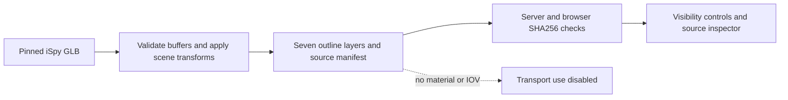
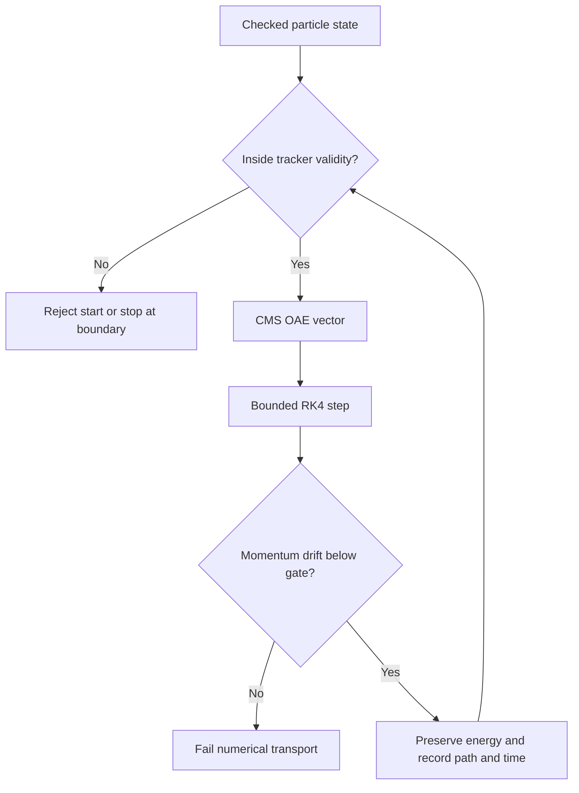
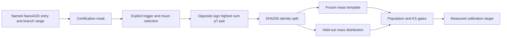
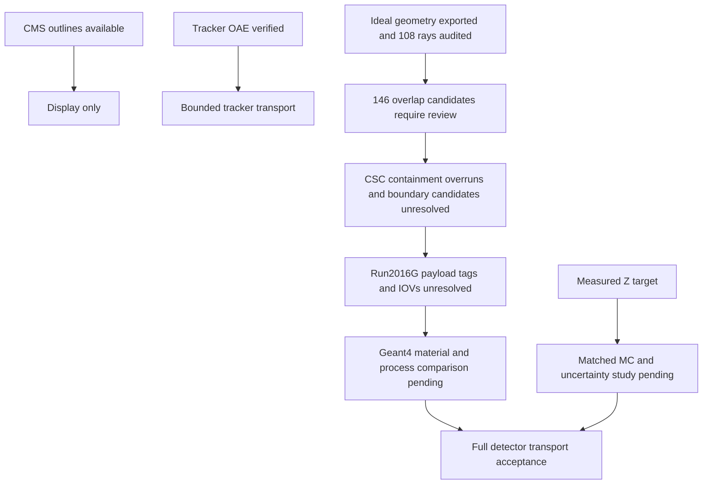

# CMS conditions and measured-data reference

This increment adds CMS display outlines, nonuniform tracker-field transport
and a certified measured Z→μμ target. **Full CMS material transport and
measured detector calibration remain incomplete.** No requirement is promoted
to `physics_validated`. The [earlier model](geometry-calibration.md) remains
available as the ideal-solenoid bench.

## Geometry display contract

`tools/import_cms_display.py` pins
[CMS iSpy](https://github.com/cms-outreach/ispy-webgl/tree/42b7d687344877f25213ec7650fc58148e87af2e)
and extracts explicit GLB line primitives, applying scene translation,
quaternion rotation and scale. Unsupported indexed, sparse or non-float
position encodings fail rather than being guessed. All 825,728 vertices remain
in metres, in seven little-endian float32 layers: original pixel, strips,
ECAL, HCAL/HF/HO, DT, CSC and RPC. ECAL barrel uses the upstream reduced
representation. Source files and derived layers have separate SHA256 identities;
MIT attribution ships with the package.

The browser verifies layers before drawing. Visibility controls, CMS/Tracker/Pixel
regions and source inspection are separate from the collapsible guide surfaces.
These meshes have no GlobalTag, alignment interval or material properties.
Beam pipe, services, magnet/yoke solids and passive materials are omitted.
The manifest sets `transport_compatible: false`; displaying a chamber does not
create a hit or energy deposit.



## Tracker field and transport

Python `cms_field.py` and Rust `cms_field.rs` port V. Karimaki's off-axis
expansion from the [pinned CMSSW BCyl implementation](https://github.com/cms-sw/cmssw/blob/c04fa510bb587b8ee3fa171888468f80de714fa8/MagneticField/ParametrizedEngine/src/BCyl.h)
and `TkBfield.cc`. This is TOSCA 1103l at nominal 3.8 T, tuned by CMS on MTCC
measurements in 2006. Our code performs no new fit to those measurements.
Double precision and the standard exponential are checked against the
official float-based reference.

The domain is strictly **r < 1.15 m and |z| < 2.8 m**.
`cms_tracker_field` returns the Cartesian vector. `trace_cms_tracker` uses
bounded RK4 vacuum integration, a charge/momentum domain, step budget and
momentum-drift gate. The GUI uses 5 mm steps and reduces steps near the validity
edge, then stops; it never substitutes zero field outside. Energy is constant.
Momentum magnitude is restored only after the uncorrected drift passes its
gate. Elapsed time uses the particle's energy and momentum.

The existing illustrative PDG silicon slab remains at 1 m of path. Transport
resumes from the changed state. This slab is independent of the displayed CMS
modules. Crossing markers intersect the sampled polyline with guide surfaces;
they are display predictions, not precision module navigation or measured hits.
The CMS field option rejects nominal settings other than 3.8 T. It does not
trace through calorimeters or the return yoke. Collision mode retains its own
DELPHES response.



`tools/fetch_cms_field.py` archives the official 160812 Run-II 3.8 T reference,
merged grid/index, volume XML, configuration and parametrization sources.
Map and reference exceed 100 MB and remain in artifacts. The inventory pins
URLs, repository revisions and SHA256 values. Merged grids require a compatible
CMS volume-aware reader; regular-grid interpolation across iron/air boundaries
is invalid. Binary compatibility with the separately pinned older configuration
and selection for Run2016G conditions remain unverified. A CMSSW EventSetup
probe using `106X_dataRun2_v35` successfully retrieved `MagneticField` from
`IdealMagneticFieldRecord` at runs 278820–278822. This confirms those lookups
only; the payload tag and IOV coverage across Run2016G are not established.

Of one million official reference rows, **14,867** lie in the OAE domain.
Both backends agree with their vectors within **1.416335 µT**, below the fixed
2 µT gate. The ideal 3.8 T approximation has mean vector discrepancy
**0.049097 T** on these same points. Nine compiled Rust trajectories spanning
charge signs, neutral motion and several momenta/directions pass independent
DOP853 comparisons. These are software regression results, not experimental
detector validation.

## Measured CMS reference

`tools/fetch_cms_measurements.py` reads exactly the first 100,000 entries and
named muon/trigger branches from the first file of
[CERN record 30522](https://opendata.cern.ch/record/30522). The derived ROOT file
has a verified local SHA256 and preserves source URL, entry range, branch
projection, declared source size and Adler32. A range read does not verify
the complete remote-file checksum.

`tools/validate_cms_measurements.py` applies the frozen 2016 certification
mask, either of two explicitly named DZ dimuon triggers, tight muon ID,
relative isolation < 0.15, |η| < 2.4, pT > 15 GeV and leading pT > 25 GeV.
It chooses the opposite-sign pair with highest scalar sum pT, then requires
60 ≤ mμμ < 120 GeV. Choosing by proximity to the Z mass is prohibited because
that sculpts the target. Duplicate event identities fail.

The cutflow is 100,000 input, 100,000 certified, 31,779 trigger accepted,
11,868 with an eligible pair and **10,863** in the mass window. A SHA256 split
on run/lumi/event freezes **5,457 reference** and **5,406 held-out** pairs.
KS statistic 0.021153 and p-value 0.173378 pass the predeclared minimum
1,000 pairs per subset and p ≥ 0.01 gates. Histograms, selected identities,
pairs, quantiles, cutflow and provenance are preserved. The GUI labels this
as a measured reference with calibration pending.



This first-file subset is not luminosity representative of Run2016G. Trigger
objects are not matched and no efficiency measurement is claimed. Z width
includes natural width, FSR, background and selection effects. No Rochester
correction is applied and no scale is tuned by forcing the raw peak to the
PDG mass. Matching selected MC, era-matched corrections, a signal/background/FSR
model and uncertainty studies are required before fitting detector response.
Split consistency alone cannot validate a full field or material map.

## Remaining acceptance gates

The [recommended Open Data environment](https://opendata.cern.ch/docs/cms-guide-docker)
is CMSSW_10_6_30. Record 30522's NanoAOD stage uses `106X_dataRun2_v35`; its
RECO stage used `106X_dataRun2_v27`. Do not substitute one GlobalTag for the
other. Run2016G covers runs 278820–280385.

The pinned image exported ideal Extended2016 DDD at depth 100 to
`artifacts/cms/geometry/export-2016-retry1/`. The preserved ROOT geometry has
3,678 volume UIDs, 2,282,856 placed nodes, 360 materials and 108 reference-ray
results. The geometry is ideal, not aligned reconstruction conditions.

The ROOT 6.14/09 TGeo overlap scan at 0.01 cm reported 146 candidates: 73
classified as extrusions and 73 as overlaps. These comprise 34 unique extrusion
volume pairs and 4 unique overlap pairs; the largest reported extents are
0.7248 cm and 0.0114 cm respectively. They are candidates for review, not
automatic proof of physical defects or benign constructs. See
`overlap-audit-classified.json`; do not enable full material transport until the
affected geometry is reviewed. Source-aware triage is preserved in
`overlap-review.json`, with TGeo placement facts in
`overlap-placement-details.json`. The pinned CSC source confirms several
daughter-outside-mother cases, including dead-gas daughters and FR4/frame and
layer-foil relationships. Their physical intent and Geant4 navigation impact
remain unresolved; no candidate has been cleared for transport.

An EventSetup probe under `106X_dataRun2_v35` retrieved the magnetic field
record at the first three Run2016G runs (278820–278822). The image's
`conddb list` command could not query the Frontier database because its Python 2
SQLAlchemy environment lacks the `sqlalchemy.dialects:frontier` plugin.
Therefore the field payload tag and its IOVs across runs 278820–280385 remain
unresolved, as do aligned geometry, alignment, field current/scaling and their intervals.
An independent Geant4/DDD navigation comparison is now the next geometry gate.
The field payload/IOV gate and full material/process transport remain open.
ROOT composition-derived radiation lengths cannot be assumed identical to
Geant4 values.



## Reproduction

Run from the project root, with the newly built Rust CLI available in WSL:

```text
python tools/import_cms_display.py
python tools/fetch_cms_field.py
python tools/fetch_cms_measurements.py
python tools/validate_cms_measurements.py
python tools/verify_cms_models.py
python -m pytest
```

The Rust verifier accepts distribution/executable options. The wheel includes
`cms-field-validation.json`, `cms-measured-validation.json` and independent
`cms-field-points.json`. Large inputs and selected pairs stay in `artifacts/cms`.
The requirement/evidence record is `cms-conditions-evidence.json`.
