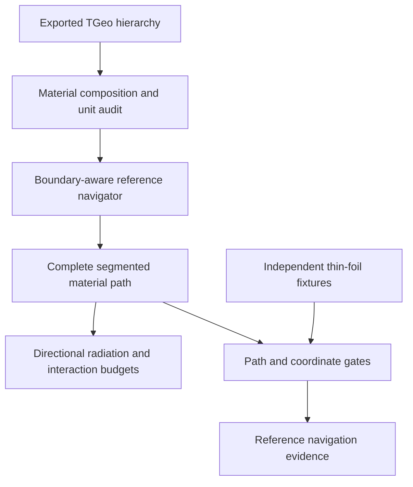
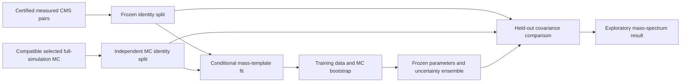

# CMS export workflow and conditional mass calibration

This continues the [completion plan](completion-plan.md). The pinned CMSSW image
was loaded and the ideal Extended2016 geometry export and reference navigation
completed. The preserved run and material reports in
`artifacts/cms/geometry/export-2016-retry1/` are the evidence. Full transport
remains gated on overlap review, Run2016G conditions, and Geant4 comparison.

## M0: resumable acquisition and export

The official image is pinned to registry manifest
`sha256:56ef1955c399912f4cdf53e91b39d66aca04a084d8a3a1002a7e27500ac1efa0`.
Its compressed layers total about 9.19 GB; the largest is about 7.65 GB.
Two normal Docker pulls failed during the large transfer, including one
short read after approximately 4.25 GB. No Docker settings or unrelated
containers were changed to address this.

`tools/pull_cmssw_resumable.py` requests exact 64 MiB ranges with six bounded
workers. It checks HTTP content ranges and lengths, preserves completed chunks,
and retries individual failed ranges. The completed manifest, config and every
assembled layer must match their pinned SHA256 identities. It writes an OCI
archive atomically only after complete verification. Public pull-scoped
registry tokens remain in memory and are never saved.

`tools/complete_cms_export.py` is a one-shot continuation of this authorized
job. It waits for the completed archive, independently verifies all archive
blob identities, loads it into Docker, then calls `tools/run_cms_export.py`.
It records each stage in `artifacts/cms/export-workflow/status.json`, with
separate Docker-load and export-driver logs. The acquisition cache is under
`.cache/cmssw-oci`; the final archive is `.cache/cmssw-oci.tar`.
Do not start a duplicate workflow while these processes are active.

The export driver uses an immutable image identity, bounded CPU/memory/time,
no container network, a read-only source mount and a dedicated writable output
mount. It preserves image/config identities, exit status and artifact hashes.
OCI image loading may omit a registry RepoDigest; in that case the driver
compares the pinned registry manifest's config digest to Docker's immutable
image ID before running it. A digest mismatch rejects the run.

```mermaid
flowchart LR
  Registry[Pinned public CMS manifest] --> Ranges[Resumable exact byte ranges]
  Ranges --> Hash[Verify every OCI blob]
  Hash --> Archive[Atomic OCI archive]
  Archive --> Verify[Independent archive verification]
  Verify --> Load[Docker image load]
  Load --> Export[CMSSW ideal geometry export]
  Export --> Audit[Material and navigation audit]
  Audit --> State[Preserved status and evidence]
```



If a stage fails, inspect its preserved log first. Completed chunks are reusable
by rerunning the acquisition script. Failed export outputs must be preserved;
repair the cause and use a new output directory, for example:

```text
python tools/run_cms_export.py --output artifacts/cms/geometry/export-2016-retry1
```

The workflow's automatic completion means **export and reference navigation**,
not full transport validation. Overlap review, compatible field/conditions,
Geant4 material equivalence and process validation remain gates.

## M1: reference material navigation

`deploy/cms/geometry_worker.py` is compatible with the CMSSW image's Python 2
runtime and modern PyROOT. It rejects missing solid conversions in the CMS log,
missing volume materials/shapes, cyclic or ambiguous volume graphs, invalid
density/lengths, invalid mixture fractions and hierarchy depth reaching the
export limit. It preserves elemental mass fractions, g/cm³ density, and
centimetre-to-metre conversions for radiation and interaction lengths.
CMS material fractions can carry small rounding discrepancies; the audit
records their source sum and normalizes fractions only when the discrepancy is
within 1e-4. Larger composition mismatches fail the audit.

The navigator records every straight-ray segment with volume path, material
identity, length and integrated X/X0 and X/λ. Zero-distance boundary loops fail
rather than using an arbitrary epsilon that might skip a thin foil. Segment
length accounting and coordinate/path agreement have explicit gates. The
export audit requests 108 deterministic rays across η and φ in the ideal CMS
description in the completed export. These are directional material references,
not scattered/curved particle trajectories or shower simulation.

`tools/verify_cms_material.py` has run against ROOT 6.40.04. Three independent
analytic rays cross 1 mm and 10 µm silicon foils, including reverse and oblique
directions. The largest observed material-path residual was approximately
7.18×10⁻¹⁷ m, below the declared 10⁻⁹ m gate. This is numerical fixture evidence,
not physical precision or CMS geometry completeness. The report is
`artifacts/cms/geometry/analytic-navigation.json`.



## M3: conditional measured mass-template calibration

The frozen MC source is official
[CMS record 35671](https://opendata.cern.ch/record/35671), the inclusive
UL2016 DY M > 50 GeV madgraphMLM/PYTHIA8 sample with processing
`106X_mcRun2_asymptotic_v17-v1`. `tools/fetch_cms_dy.py` projects 100,000 entries
and named reconstruction, truth, trigger and weight branches from one declared
file. File size, range, source checksum declaration and derived-file SHA256 are
recorded. This remains partial-source integrity, not verification of the entire
remote ROOT file. The frozen source is in
`manifests/reference/cms-dy-ul2016.json`.

Measured data and MC now use the same `selected_pair` implementation: named DZ
trigger selection, tight/isolated muons, pT/η cuts, and the opposite-sign pair
with greatest scalar sum pT. The measured sample's earlier cutflow and 10,863
selected candidates are unchanged by this refactoring. The selected MC sample
has 5,753 training and 5,677 held-out pairs. All projected generator weights
were checked to be one; this exploratory fitter rejects non-unit-weight MC
instead of silently mishandling signed weights.

`tools/calibrate_cms_mass.py` fits a conditional **one-dimensional selected
mass spectrum**, within 75–105 GeV. It integrates Gaussian broadening of the
frozen full-simulation MC mass population into bins and permits a uniform
nuisance background. The central fit is frozen before evaluating held-out
events. Its parameters are:

| Parameter | Central fit | Conditional bootstrap 95% interval |
|---|---|---|
| Mass scale | 0.9999071 | [0.9987046, 1.0009962] |
| Additional fractional mass σ | 0.0067303 | [0.0025907, 0.0094123] |
| Uniform nuisance background fraction | 0 | [0, 0.0134563] |

One hundred training data/MC bootstrap fits, with frozen seed 20261027, all
converged. Held-out covariance includes normalized conditional data counts,
finite-MC template uncertainty and propagated bootstrap fit uncertainty.
The normalization constraint is handled through the supported covariance
eigenspace. The held-out p-value is **0.736938**, passing the predeclared
p ≥ 0.01 and expected-count gates. Without the additional fit, the baseline
held-out p-value is 0.327119; it already passes this exploratory check.
The higher fitted p-value alone does not establish a necessary detector correction.



The result **does not calibrate individual muons, magnetic fields, materials or
the laboratory detector**. No production transport parameter changes. Official
Rochester/efficiency corrections, pileup reweighting, a validated background
model, physics-systematic uncertainties and independent-run/file closure remain
unresolved. One first-file data/MC range does not supply final run stability.
The JSON report and the GUI explicitly retain `detector_calibration_status:
not_validated`. Numerical p-values must not override that scope.

The fit report is stored in `artifacts/cms/measured/mass-calibration.json` and
the packaged reference resources. The GUI's Reference validation table exposes
the exploratory result and its limitations. Independent tests verify Gaussian
bin integration, injected-scale recovery, covariance normalization, pair
ranking, material units and stalled-boundary rejection.

## Reproduction and acceptance state

```text
python tools/pull_cmssw_resumable.py
python tools/complete_cms_export.py
python tools/fetch_cms_dy.py
python tools/validate_cms_measurements.py
python tools/calibrate_cms_mass.py
python -m pytest
```

The first two commands run as separate active processes in this session; the
workflow waits for acquisition. The PyROOT fixture verifier needs the ROOT
scientific runtime. Keep full CMS material transport and measured detector
calibration unaccepted until the remaining M1–M3 evidence is available. The
laboratory identity and all four desktop targets follow their separate gates
in the completion plan; they are not established by this increment.
