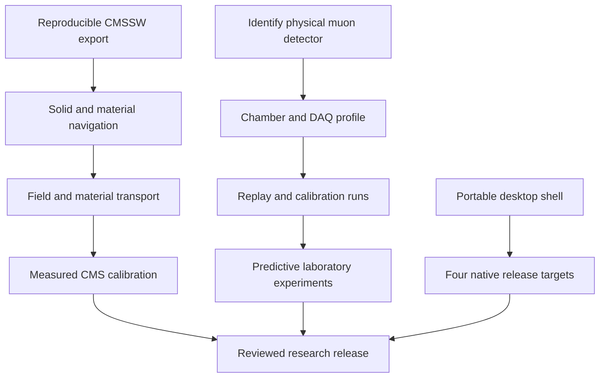
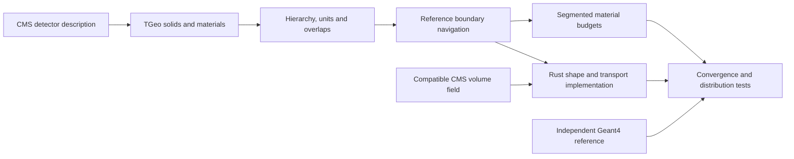
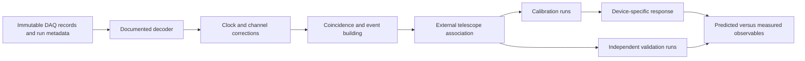
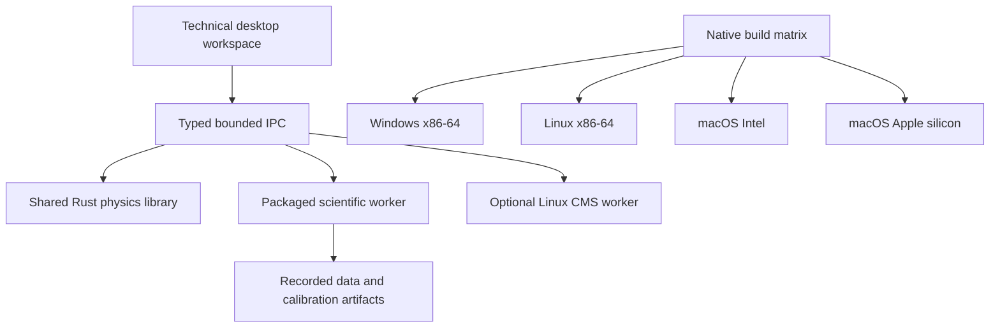

# Simulator completion plan: CMS, laboratory muons and desktop releases

Baseline: 2026-10-27. This is a gated delivery plan, not a claim that the
simulator is ready to operate an experiment. Its three deliverables are a
validated physics platform, a measured model of the user's actual muon detector,
and portable desktop applications. Completion means passing the acceptance
cases below within declared physics domains, rather than promising no bugs.

## Confirmed inputs and unresolved equipment identity

The user reports equipment that **detects muons**, believed to originate from
CMS, in a box approximately 1–1.5 m tall. It has not yet been physically
inspected. Chamber identity, active dimensions, gas gaps, strip geometry,
electronics, trigger arrangement and data format are unknown. The simulator
must not infer any of these from the enclosure size or label the equipment
as a confirmed iRPC. An existing CMS RPC, iRPC prototype or another muon
detector requires a different response and acquisition profile.

Initial hardware deliverable: photograph/transcribe the asset label and serial
number; obtain the chamber drawing and manual; list front-end, TDC/ADC, clock,
trigger, interfaces and DAQ software; obtain a recorded raw-data sample and
its decoding specification. Identify the authorized equipment operator and
existing gas, power and interlock procedures before proposing powered tests.
Software development begins with offline files and replay. Connecting hardware
or issuing control commands is a later, explicitly scoped integration activity.

For an identified iRPC, published CMS descriptions provide useful reference
concepts—double-gap structure, strip readout and timing—but are not parameters
for this unknown device. The 2016 CMS detector profile must remain separate
from Phase-II iRPC geometry and a standalone laboratory arrangement.

## Delivery sequence

| Milestone | Deliverable | Acceptance evidence | Dependency |
|---|---|---|---|
| M0: reproducible CMS export | Pinned container, working CMSSW, geometry/material ROOT file, complete logs and hashes | Smoke test, successful cmsRun, source inventory, material/solid/depth audit | **Exported and hash-verified; ideal Extended2016 DDD only** |
| M1: material navigation | Full exported solids navigated with material names, composition, density, X0 and interaction length | Analytic slab fixtures, boundary/tangent tests, complete path-length accounting, directional maps and overlap report | **Compared against native Geant4; acceptance blocked by unresolved geometry/navigation findings** |
| M2: field and transport | Volume-aware CMS field and material-coupled propagation with explicit supported species/processes | Run/IOV coherence, external field checks, tolerance convergence, energy ledger and Geant4 comparisons | M1 and compatible conditions |
| M3: measured CMS calibration | Era-compatible selected data/MC, corrections, response parameters and uncertainties | Frozen training/validation samples, weighted statistics, FSR/background treatment, held-out closure | M2 for transport claims; data/MC work can start earlier |
| M4: laboratory profile | Identified chamber and DAQ schema, geometry, clocks, channel map and run metadata | Reviewed inventory, decoder golden files, unit/time/channel validation | Physical identification and example data |
| M5: experimental replay | Real detector events, external triggers/tracks, calibrated timing and channel response | Replay equivalence, event loss accounting, independent efficiency denominator, held-out runs | M4 |
| M6: predictive experiments | Cosmic-muon source, chamber response and experiment comparisons | Flux/acceptance validation, measured timing/efficiency/cluster/noise closure, uncertainty budget | M5 |
| M7: desktop release | Windows x86-64, Linux x86-64, macOS Intel and Apple silicon installers | Native builds and smoke tests on each architecture; signing/notarization and upgrade checks | Application shell can start before M3/M6 |
| M8: research release | Versioned model cards, datasets, tutorials and reproducible experiments | Independent review, reproducibility run, open-source release checklist | Accepted domain-specific M3/M6 and M7 |

M0–M3 do not replace M4–M6. A CMS Z→μμ fit cannot determine a standalone
chamber's efficiency, signal propagation velocity, channel timing offsets,
dead time or trigger acceptance. Conversely, a cosmic telescope cannot fully
calibrate the CMS collider detector. Each profile has its own provenance,
conditions and acceptance report.

## CMS material and field implementation

1. Use the official CMSSW_10_6_30 Open Data image, pin its digest, and mount
   source read-only and only the intended output directory writable. Record
   the runtime release, configuration, source XML identities, resource limits,
   logs and exit status. A zero exit code alone does not establish geometry
   completeness: upstream conversion can omit unsupported solids.
2. Audit the TGeo hierarchy, unique volumes, placed nodes, maximum depth,
   shape classes and every material. Preserve mixtures and elemental mass
   fractions, not merely a silicon-equivalent thickness. Verify centimetre,
   g/cm³, radiation-length and interaction-length conversions explicitly.
3. Establish a reference navigator through the exported geometry before
   porting shape classes to Rust. Compare known analytic geometries and
   selected CMS rays, including thin layers and shared boundaries. Preserve
   physical placements; never turn display outlines into transport solids.
4. Export directional material budgets from the reference navigator with
   segmented path records. Verify that segment lengths sum to the tracked
   distance, all material IDs resolve, no step crosses an unexamined boundary,
   and reverse/perturbed rays behave as expected. Overlap findings are evidence
   to inspect, not something to hide behind an arbitrary priority rule.
5. Resolve compatible field geometry, map format, current/scaling and IOV
   together. The current OAE model remains bounded to its tracker domain.
   CMS merged-grid data require the compatible volume-aware reader, including
   coordinate transforms and sector mapping. No interpolation across distinct
   magnetic materials without the source algorithm's boundary semantics.
6. Couple magnetic stepping to geometry boundaries and process-specific limits.
   Initial Rust support is a declared muon transport domain. Mean ionization,
   straggling, multiple scattering, radiative muon losses and secondary handling
   need separate implementations and comparisons. Electromagnetic/hadronic
   showers are a separate delivery gate; an energy ledger does not validate
   their distributions. Keep Geant4 as an independent reference backend.

M2 acceptance is a matrix of particle type, energy, material, field region,
step scale and observable. Set numerical tolerances and statistical tests
before fitting or examining the validation results. Report failure and missing
coverage explicitly. A full-detector muon navigator is not a complete shower
simulation, and a geometry export is not a measured material calibration.

## Measured CMS calibration procedure

The existing 100k-event Run2016G sample supplies 10,863 selected dimuon pairs
and a frozen identity split. It is an exploratory reference, not the final
luminosity-representative calibration set.

Acquire compatible UL2016 post-VFP DY MC with recorded processing, generator
weights and source checksums. Freeze multiple data files/runs and independent
MC populations before tuning. Retain generator and reconstructed muons,
association indices, event weights, trigger bits/objects and pileup inputs.
Make selections and reconstruction definitions equivalent and document any
remaining difference. Do not discard negative MC weights or treat them as
ordinary binomial event counts.

Use era-compatible official momentum/efficiency corrections as the baseline
where available. Fit only identifiable residual parameters. Model natural Z
width, FSR and backgrounds before interpreting a mass-width change as detector
resolution. Validate charge/η/φ/pT dependence and run stability; reserve
independent runs/files for final closure and quantify statistical and model
uncertainties. Fit provenance must name the selection, samples, correction
hashes, software versions, objective, covariance, validity range and acceptance
tests. No fitted parameter becomes the default until its held-out gates pass.

## Laboratory experiment and calibration procedure

Build a versioned device profile from measured dimensions and channel wiring.
Raw data are immutable; decoding, time unwrapping, channel calibration,
clustering, coincidence/event building and track association are distinct
reproducible stages. Preserve counts of packets, triggers, accepted events,
dropped records, overflow, reset and dead-time intervals. A silent gap in data
is not a period with no muons.

The first experiments are recorded-data replay and channel/clock checks. Once
the physical setup and operator procedures are known, the candidate programme
is: dark/noise characterization; external-coincidence timing; channel offset
and time-walk calibration if amplitude information exists; strip propagation
calibration if both ends are read out; position/cluster-size response; and
efficiency with an independent trigger telescope. Rate/threshold/operating-point
scans are conditional on the actual equipment and approved operating ranges.
Do not invent high-voltage or gas settings from a generic publication.

Efficiency requires an independently defined denominator of muons crossing the
active area. Self-triggered detector hits alone cannot supply it. Absolute flux
requires measured live time, active area, angular acceptance, trigger efficiency
and environmental/overburden context. Cosmic generators must reproduce the
relevant angular/energy distribution; collider DY muons are not a substitute.
Split calibration and validation by run/time so nearby events cannot leak
the same drift into both samples. Persist masks and temperature/pressure/other
relevant measured conditions with the run.

## Desktop architecture and release targets

The selected release matrix includes **Windows x86-64, Linux x86-64, macOS
Intel x86-64 and macOS Apple silicon arm64 from the start**. CPU architecture
and operating system are separate dimensions. Linux arm64 can follow once a
runner and dependency matrix are available; it is not implied by Apple silicon
support.

Use a Tauri 2 Rust desktop shell around the existing technical workspace.
Keep physics in the shared Rust library; use a bundled, target-specific Python
worker for existing scientific analysis and file readers. Avoid requiring a
user's system Python. A typed, bounded desktop IPC adapter should expose the
same operations as the web service. Launch and supervise only packaged workers,
validate their protocol/version, cancel jobs, and shut them down with the app.
Use explicit resource paths and writable user/project directories. Never pass
user-supplied command strings to a shell. Do not disable the current origin
or path protections simply to make an embedded webview connect.

Build and test on each operating system/architecture. Produce Windows
installer, Linux AppImage plus Debian/RPM packages for selected distribution
baselines, and macOS app/DMG for both CPUs (a universal bundle is optional after
both native variants pass). Record glibc/WebKit and minimum OS requirements.
Verify numerical fixtures across architectures with declared floating-point
tolerances, package resource hashes, offline startup, read/write permissions,
crash recovery, cancellation, upgrades and uninstall behaviour.

Signing/notarization and distribution credentials are release dependencies,
not something that can be simulated by a local unsigned build. Native CMSSW
and the current Open Data image are Linux amd64 research backends. Keep them
optional behind a versioned local-container or remote-worker interface;
do not claim they run natively on Apple silicon or Intel macOS. The native
desktop must remain useful for Rust simulations, file analysis and laboratory
replay when a CMS container is unavailable.

## Completion tracking and immediate work

Each milestone stores its input hashes, executable identity, test report,
supported domain and unresolved findings. Add laboratory and desktop
requirements to the register before implementing those interfaces. Keep
status distinct: specified, implemented, numerically verified and physically
validated are different evidence levels. Device identification and real DAQ
samples remain user/equipment dependencies; they need not block CMS source
export or desktop architecture work.

Immediate sequence: complete image pull and export; audit the resulting
geometry/materials; implement reference navigation and its tests; acquire
compatible DY MC; make the calibrated data/MC comparison reproducible; then
port audited material navigation/processes to Rust. In parallel as work becomes
available, identify the equipment, collect offline DAQ samples, and build the
four-target desktop packaging matrix. Publish milestone outcomes instead of
an unsupported completion date.

Progress, 2026-10-28: M0 export completed (`export-2016-retry1`, 3,678 volumes,
360 materials, 108 reference rays); M1 overlap review and ROOT/Geant4 navigation
comparisons are complete for all 146 stored overlap candidates (38 source
volume-pair groups). The independent Geant4 build confirms the solid-level
containment/intersection witnesses. Across 5,256 local traces, 38 ray pairs
disagree on material paths, 41 fail material-boundary comparisons, 224 fail
volume-boundary comparisons, and forward/reverse checks fail 510/1,314 Geant4
and 478/1,314 ROOT cases. Path-length accounting and world-size sensitivity
checks pass, but there are zero transport clearances. Thus M0 is complete within
its declared ideal-geometry scope and M1's evidence run is complete while M1
acceptance remains blocked; neither establishes full CMS transport. Run
`python tools/verify_cms_navigation_evidence.py` to recheck preserved M0 hashes
and M1 summary consistency. The original geometry and source inputs remain
unchanged. M4/M5 offline software foundation—device profile
with explicit unknowns, loss-accounted decoding, clock epochs, channel offsets,
coincidence events, independent-trigger efficiency and immutable replay
records—is implemented on synthetic fixtures only; see
[laboratory replay](laboratory-replay.md). The physical equipment is still
unidentified, so M4 acceptance has not started. M7 foundation: the shared
operation table, bounded worker, Rust supervisor and frozen Linux sidecar are
implemented and tested; the Tauri 2 shell has since been compiled and exercised
on Windows x86-64. Linux and both macOS bundles, cross-architecture fixtures,
and signed distribution remain open; see [desktop shell](desktop-shell.md).

## External dependencies that prevent milestone closure

The repository can finish software and evidence work that has local inputs, but
it cannot manufacture the evidence below. M3 production calibration needs
independent, era-compatible data and MC with corrections, signed-weight and
FSR/background handling, and held-out closure; the checked-in 100k data/MC
subset is explicitly exploratory and range-integrity only. M4/M5/M6 acceptance
needs the physical device identity, operator-supplied DAQ specification and
real recorded runs with an independent track/trigger denominator. M7 needs
native Linux and both macOS runners plus signing/notarization credentials for a
distributable release. M8 depends on independently reviewed accepted M3/M6
domains and completed M7. These gates must stay open until those inputs and
reviews exist.

Sources: [official CMS Docker environment](https://opendata.cern.ch/docs/cms-guide-docker),
[CMS iRPC electronics and readout](https://cds.cern.ch/record/2792677/files/CR2020_098.pdf),
[CMS iRPC production and performance](https://cds.cern.ch/record/2924323/files/document.pdf),
[Tauri distribution](https://v2.tauri.app/distribute/), and
[Tauri packaged workers](https://v2.tauri.app/develop/sidecar/).
