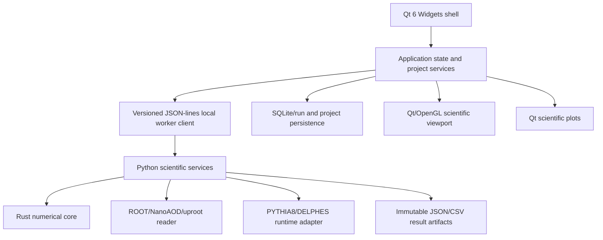

# HEPLab native desktop rebuild audit

Status: repository baseline, 2026-11-23

The historical `desktop/` application has been deleted from this checkout. The
README and earlier documents describe a Tauri/WebView2 implementation, but that
implementation is not part of the current repository. This audit therefore
starts a new C++20/Qt 6 native application instead of restoring or wrapping that
historical browser shell.

## Verified repository capabilities

| Area | Existing implementation | Scientific status |
|---|---|---|
| Python numerical reference | `src/heplab/physics/reference.py`, `engine.py` | Verified analytic primitives and educational response; not calibrated CMS physics |
| Rust numerical core | `kernels/physics-core` | Compiled and parity-tested for a bounded T0 numerical scope |
| Rust/Python binding | `kernels/src/lib.rs` | Native extension exists on Linux/WSL; Windows wheel remains a release gate |
| PYTHIA8/DELPHES | `src/heplab/sim/pipeline.py` | Registered external runtime adapter; availability is runtime-discovered and unvalidated |
| CMS NanoAOD | `src/heplab/readers/nanoaod.py` | 100-event real-data smoke and certification support; broad held-out validation remains open |
| Dimuon analysis | `src/heplab/analyses/dimuon` | Scoped weighted cutflow and exploratory data result |
| CMS data workspace | `src/heplab/server/data_workspace.py` | Implemented local service operations; not a native UI |
| Job lifecycle | `src/heplab/server/workbench.py` | Submit/poll/cancel/result pieces exist; immutable committed-state rules require native integration |
| JSON-lines worker | `src/heplab/desktop/worker.py` | Typed local operations contract remains usable and should be adapted to Qt IPC |
| Detector geometry assets | `src/heplab/data/cms-display` | Hash-manifested display layers and sourced geometry metadata; not experimental calibration |
| OpenUSD export | `src/heplab/export/usd.py` | Export capability exists for offline visualization |

## Historical or proposed functionality

The Tauri shell, Rust IPC core and frozen worker are deleted. Browser/Canvas
and WebGL event displays are compatibility surfaces in existing Python server
code, not native Qt implementation assets.

The following remain proposals or incomplete gates: full calibrated CMS
transport, measured detector response, pileup modeling, full truth/reconstruction
schema v2 migration, general collision processes, full software/certification
registration, zfit/JAX service paths, and production signing/notarization.

## Dependency graph

## GUI requirements matrix

| ID | Requirement | Backend prerequisite | Initial status |
|---|---|---|---|
| DESKTOP-001 | Native shell and navigation | Qt 6/CMake | In build |
| DESKTOP-002 | Versioned worker client | `operations.json`/worker protocol | Usable |
| DESKTOP-003 | Minimal analytic run | Python reference or Rust native engine | Available in T0 scope |
| DESKTOP-004 | Project/run persistence | SQLite and immutable artifact model | Partial |
| DESKTOP-005 | Linked event views | Event object IDs and bounded event files | Contract partial |
| DESKTOP-006 | PYTHIA8/DELPHES workflow | Runtime discovery and pinned external install | Capability-gated |
| DESKTOP-007 | CMS recorded-data workflow | 100+ event/ROOT reader and certification | Exploratory |
| DESKTOP-008 | Calibrated detector response | Independent calibration and held-out evidence | Unavailable |
| DESKTOP-009 | Native 3D detector viewport | Qt/OpenGL and geometry assets | Planned |
| DESKTOP-010 | Scientific plots | Typed plot data and Qt rendering | Planned |
| DESKTOP-011 | Windows installer | Qt deployment, signing, native acceptance | Blocked |

## Risk assessment

1. **P0 — No local C++ toolchain on PATH.** Qt 6 libraries exist, but this
   machine exposes no `cl`, `clang-cl`, MinGW or Ninja compiler. Native builds
   cannot be certified until one is installed and pinned.
2. **P0 — Historical implementation is deleted.** No desktop source may be
   claimed as existing or restored.
3. **P0 — Physics validation is incomplete.** The app must label
   educational/unvalidated and unavailable states explicitly.
4. **P1 — Worker protocol is Python-oriented.** JSON-lines over Qt subprocess
   is viable, but output size, cancellation and restart behavior need a native
   contract test.
5. **P1 — Event schema v2 is proposed.** Native models should adapt to the
   surviving v1 data while never pretending v2 fields are present.
6. **P2 — Rendering performance.** Qt Widgets/OpenGL is preferable for a
   controlled scientific desktop; Qt Quick 3D and WebEngine are excluded in the
   initial architecture.

## Definition of done for the rebuild

A milestone is complete only with:

- compilable CMake targets on the declared toolchain;
- passing unit and integration tests relevant to the introduced feature;
- a native end-to-end demonstration;
- a representative screenshot or automated visual evidence;
- a requirements update and development log entry;
- no fake success state for unavailable backends or data;
- explicit blockers and limits for scientific claims.
