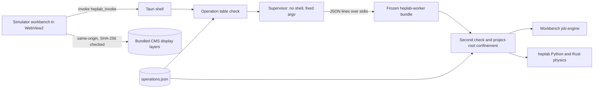

# Desktop simulator app (M7 foundation)

Status, 2026-10-28: **the HEPLab simulator workbench runs as a native Windows
x86-64 desktop app.** Researchers can set up a run, simulate, inspect particles
in the 3D CMS view and export results, with no Python install, no browser and
no local web server. The IPC core and frozen worker are also tested on Linux
x86-64. Linux and macOS bundles have not been built yet; their first build is
the `.github/workflows/desktop.yml` matrix. Nothing is signed
or distributed, and the Windows installer has not been run.



## What a user gets

The app window is the same workbench as `heplab gui`
(`src/heplab/server/static`), copied unchanged by `desktop/prepare_frontend.py`
at build time. Its model browser, XY/XZ/3D viewport with CMS iSpy outlines,
parameters, Run/Stop, run history, particle, crossing, calibration and
capability tabs, and *Export result* all work. Run artifacts are written to the
app's data directory (`%APPDATA%\org.heplab.desktop\projects\default\artifacts`
on Windows).

The **analytic muon thin-slab bench** runs inside the app with the bundled Python
and Rust engines. **Drell–Yan PYTHIA8/DELPHES** uses the separately installed,
pinned Linux runtime. On Windows the app discovers it in WSL Ubuntu at
`~/.cache/heplab/sim-runtime`, without launcher environment variables. An explicit
`HEPLAB_SIM_PREFIX`/`HEPLAB_SIM_WSL_DISTRO` configuration takes precedence.
See [runtime setup](sim-runtime.md) for other installations.

The collision workflow generates 13 TeV pp gamma*/Z → muons through the DELPHES
CMS card. It provides signed-weight pT, eta, mass and missing-pT distributions,
statistical error bars, a configurable muon selection and cutflow, selected-event
navigation, CSV event tables and saved analysis JSON. Muon-bin error bars include
same-event correlations. There is no luminosity scaling or extra bench smearing.
The generator cross section and detector approximation remain unvalidated.

The 2026-10-29 frozen-worker acceptance generated 100 collisions at seed 42,
found 113 reconstructed muons and 33 selected events, navigated a selected event,
reopened the same analysis after restart, and cancelled active 1000-event
generation without publishing a partial run. The worker ran with Python and
simulation-path environment overrides removed. See
`output/desktop-collisions/frozen-collision-acceptance.json` for local evidence.

Two packaging defects were fixed: numerical readers now initialize on the main
thread and include Awkward's native libraries; every simulation child receives
closed standard input so WSL cannot consume requests from the desktop IPC pipe.
The latter is essential when generation and request polling run concurrently.

The 2026-10-28 laboratory update bundles the native **Rust PyO3 engine** inside
the worker, with a numerical startup check. The default workspace offers a
32-event angular muon sample, four plots of computed observables, event navigation,
truth/sample response kinematics, run comparison, saved-run reopening, and setup
import/export. The angular source samples isotropic directions within |eta|<2.4
at fixed momentum. It is an explicitly synthetic back-to-back pair experiment,
not collision generation. Samples are limited to 200 events. With the coarse DY
response enabled they require |p|>=27.8 GeV/c, keeping pT>=5 GeV/c in its domain.

Each event is saved separately; aggregate observables travel with the run, so
large trajectory arrays are not sent over IPC as one batch. The result JSON is
the completion marker. Stopping a running sample does not publish a partial
result. Completed runs and event files can be reopened after worker restart.

Build the native binding before freezing a release worker (use a clean build
environment with PyInstaller, PyYAML, Pydantic, maturin, numpy, awkward and uproot installed):

```powershell
maturin build --release --locked --manifest-path kernels/Cargo.toml --out desktop/kernel-wheels
python -m pip install --no-deps --find-links desktop/kernel-wheels heplab-kernels
python -m pip install --no-deps .
python desktop/build_worker.py
# From desktop/:
npx --yes @tauri-apps/cli@2 build --ci --target x86_64-pc-windows-msvc --bundles nsis
```

The freeze step explicitly includes the dynamically imported binding and refuses
to ship if the packaged worker cannot load and exercise Rust. CI now builds the
binding on each platform before freezing; the application does not require a
system Rust or Python installation.

Follow-up acceptance: 65 focused Python tests and 14 native Rust tests passed.
The actual frozen Windows worker completed an eight-event Rust sample and reopened
event 3 after restart. Driving the rebuilt native window completed a 32-event
Rust run (`55e304e4b55d453a7c9001c1`), with event 0 and event 1 showing different
kinematics. Browser acceptance covered charts, comparison, setup round trip,
saved-run reopening, event navigation, active cancellation, and a failing injected
energy residual. Conservation badges now evaluate explicit absolute gates
(1e-9 GeV for the bench ledger, and `max(0.002 GeV, 2e-5 * beam total energy)`
for generator ROOT residuals, matching the pipeline's native-float gate); these are
numerical checks, not detector calibration.

## Components

| Part | Location | Behaviour |
|---|---|---|
| Operation table | `src/heplab/desktop/operations.json` | The only operations that exist: workbench session, detector geometry and display manifest, calibration report, job submit/get/cancel/event, project overview and evidence, engine capabilities, datasets, runs list/get, lab profile and replay. Argument types are `id`, `path`, `number`, `integer` and `object` (structure only; job configs are validated by the workbench's strict `RunConfig` model). Rust reads the table with `include_str!` and the worker loads the same file. |
| Worker | `heplab.desktop.worker` | Announces protocol, version and operation list, then answers one JSON line per request. Re-validates every request. Holds one workbench `Jobs` engine, the same class the web server uses, and cancels running simulations when the shell closes its input. Paths must be plain relative paths, never follow symlinks, and stay inside the project root. |
| IPC core | `desktop/core` (std + serde, plus `windows-sys` or `libc`) | Validates before launching anything. Spawns an explicit executable with a fixed argument vector and no console window. Checks protocol, exact version and the operation set during the handshake. Size-limited reads and multiplexed calls matched by request id, so a slow operation never blocks job polls. A per-operation timeout or cancel abandons only that call; the worker and its jobs keep running. The worker process tree (a kill-on-close Job Object on Windows, a process group on Unix) is killed and restarted only on a crash, a protocol error, or when more calls are abandoned than it has request threads (`max_concurrent_requests`). Shutdown closes stdin first so running jobs are parked for the next launch. |
| Workbench transport | `src/heplab/server/static/workbench.js` | When `window.__TAURI_INTERNALS__` exists, the existing `api()` helper maps its 9 paths to operations, and display layers load from the bundled `cms-display/` files with the existing SHA-256 checks. In a browser nothing changes. |
| Shell | `desktop/src-tauri` | Two commands (`heplab_invoke`, `heplab_cancel`). No shell/fs/http plugins. CSP: scripts, styles, fonts and connections from `self` and Tauri IPC only. On exit it cancels in-flight work and waits at most 3 s for the worker lock before shutting the worker down. |
| Packaging | `desktop/build_worker.py`, `desktop/prepare_frontend.py` | PyInstaller one-dir worker shipped as the `worker/` bundle resource (no per-launch unpacking, nothing left in the temp folder after a forced stop), checked by a handshake with every `PYTHON*` environment variable removed. The frontend step copies the workbench and verifies each display layer against its manifest hash. |
| Matrix | `.github/workflows/desktop.yml` | Windows x86-64 (NSIS/MSI), Linux x86-64 (AppImage/deb/rpm, Ubuntu 22.04 baseline), macOS Intel and Apple silicon (app/DMG, minimum macOS 11). Each runner confirms its native host triple, then freezes, tests and bundles. Bundle hashes are recorded and bundles are uploaded unsigned. |

## Evidence so far

- 21 worker tests, including a full simulator job through the worker
  (submit, idempotent resubmit, poll to completion, event fetch, artifact
  written), rejection of extra config fields and non-integer event indices,
  web/desktop payload equality, and path, size and shell-argument rejections.
- 14 Rust tests (5 unit, 9 integration), passing natively on Windows and
  Linux, including cancellation that kills a grandchild process. `cargo
  clippy -D warnings` and `rustfmt` are clean for the core and the shell.
- Windows x86-64 (Rust 1.99.1, MSVC 14.51, Windows SDK 10.0.26100, WebView2
  156): release build with an 11.2 MB frozen worker and an unsigned NSIS
  installer.
- Driving the running app as a user: the workbench loaded, connected to the
  worker and loaded all 7 CMS display layers with SHA-256 verified. Pressing
  Run on the analytic bench completed (*validation: educational_unvalidated*),
  filled the particle table with the two 45 GeV muons (0.5508 MeV deposit,
  55/54 ADC), and *Export result* saved a 179 KB JSON file. The app then
  closed with no worker processes left. Force-killing the app also left none.
- Security checks from inside the live webview: unknown operations and path
  escapes are refused by the shell, external `fetch` is blocked by the CSP,
  and `plugin:shell|execute` is refused by Tauri's permission check.
- Defects found and fixed on the way: orphaned Python children after
  cancellation, the workbench Run button staying disabled (it requires a
  session token), CMS display layers blocked by a missing `connect-src
  'self'`, and a possible exit hang on a held worker lock.

## Not done

- General collision processes, pileup and a desktop runtime installer; Linux and
  macOS bundles (DESKTOP-001); cross-architecture numerical fixtures
  (DESKTOP-004); signing, notarization, updater and uninstall checks
  (DESKTOP-005).
- The Rust binding is bundled and verified on Windows. The updated packaging
  workflow builds it for Linux/macOS too, but those release bundles still need
  native acceptance runs.
- On Windows the worker joins its Job Object just after spawn. A child started
  in that gap of microseconds would not be contained. The PyInstaller
  bootloader unpacks its files before starting Python, so this gap is not hit
  in practice; closing it fully needs a suspended start.
- The public `web/` package is a read-only explainer and has no desktop IPC
  transport. Desktop operations are exposed through the local app's typed IPC
  bridge; the FastAPI `/workbench` page remains a local compatibility surface.
