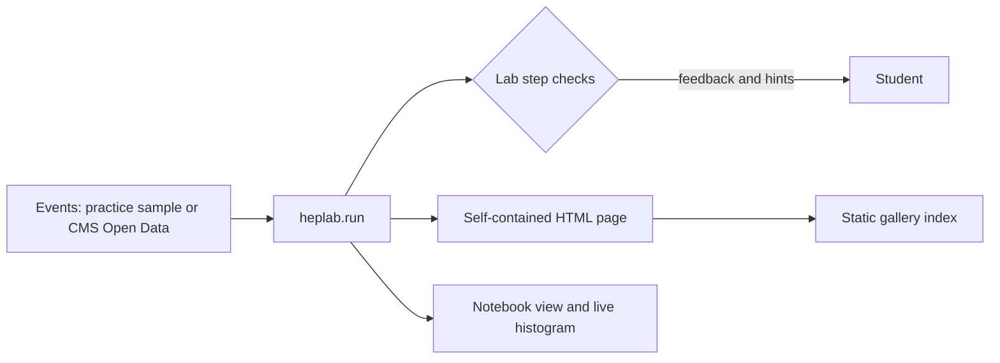

# Education, sharing and notebooks

Three user-facing features built on the [Python API](python-api.md). Pages are plain
HTML. The notebook uses optional ipywidgets (`heplab[notebook]`) with an HTML fallback.



## Guided labs (education mode)

A lab is a sequence of steps, each with a task, progressive hints and an automatic
check that turns a student's answer into specific feedback. The first lab,
**Rediscover the Z boson** (`z-boson`, about 60 minutes), is aimed at first-year
courses and International Masterclasses:

| Step | Student provides | Check |
| --- | --- | --- |
| `load` | the event list | at least 1000 events, with two-muon events present |
| `select` | an analysis configuration | opposite charge, pT ≥ 15 GeV, isolation ≤ 0.3, with a reason for each miss |
| `mass` | one invariant mass computed by hand | within 0.1 % of the reference computation |
| `histogram` | the `heplab.run` result | tallest bin above 50 GeV lies in 86–96 GeV, from at least 200 pairs |
| `fit` | `heplab.fit_peak` output or `(mass, error)` | within 1 GeV of the PDG mass, with uncertainty below 1 GeV |
| `width` | a multiple-choice answer | resolution, not lifetime, broadens the peak |

```python
import heplab

lab = heplab.labs.start("z-boson")
events = heplab.labs.practice_events()
lab.check("load", events)
lab.hint("select")
lab.save("progress.json")          # resume with the same events: resume(..., events=events)
lab.export_html("worksheet.html", student="A. Student")
```

The tutorial notebook is `notebooks/masterclass/z-boson.ipynb` in the repository.
From a terminal:

```bash
heplab learn list
heplab learn show z-boson
heplab learn practice-data z-boson --output artifacts/z-events.json
heplab run dimuon --simulation --input artifacts/z-events.json --output artifacts/z.json
heplab learn check z-boson --artifact artifacts/z.json
```

`heplab learn check` grades the histogram and fit steps and exits non-zero until both pass.

**Practice data is synthetic.** `practice_events()` generates Z→μμ decays (relativistic
Breit–Wigner at the PDG mass and width, two-body decay boosted to LHC-like kinematics,
1.5 % pT resolution) mixed with a falling continuum, non-isolated pairs and same-sign
pairs that a good selection removes. Every event is labelled with
`generator: heplab-practice-z-mumu-v1`. It is for teaching the method offline. It is not
CMS data, and labs accept real CMS Open Data through `heplab.read(...)` instead.

New labs are a JSON file in `src/heplab/labs/` (title, steps, hints, choices) plus a
check function per step registered in `heplab.labs.CHECKS`.

## Shareable results

`heplab export-html ARTIFACT` (or `heplab.export_html`) writes one HTML file that works
offline, with nothing loaded from the network:

- analysis results: an interactive histogram (drag to zoom, log scale, hover for bin
  value ± error) and the cutflow with stage efficiencies;
- workbench runs: a transverse (x–y) and longitudinal (z–r) event display with the
  detector surfaces, zoom, pan and per-track hover;
- the full provenance record and an embedded result record (raw per-candidate arrays are optional).

The page follows the viewer's light or dark theme. The result is embedded as JSON with
`<` `>` `&` escaped, so record content cannot inject markup. Raw per-candidate arrays are
left out by default (the histogram carries them); pass `include_raw=True` to the Python
API or `--include-raw` to the CLI to keep them.

`heplab gallery DIRECTORY` writes `index.html` for every exported page in a directory,
newest first, from metadata each page carries (kind, title, result digest, export time).
The gallery is a static folder: publish it anywhere that serves files (a course site,
GitHub Pages, an LMS). HEPLab never uploads it.

## Notebook display

```python
lab = heplab.labs.start("z-boson")
lab.display()                       # interactive checkpoint widget

heplab.notebook.show(result)        # the export page, inline and sandboxed

live = heplab.notebook.LiveHistogram(60, 120, bins=60).display()
for event in events:
    live.fill_event(event, config)  # redraws in place, throttled to 4 Hz
live.done()
```

`Lab.display()` is the interactive guided flow and invokes the same registered checks
as the Python API. `show` renders the same page inside a sandboxed `iframe`, so its script cannot touch
the notebook. With the notebook extra it returns an `ipywidgets.HTML` widget.
`LiveHistogram` updates one widget in place; `fill_events` analyzes a batch once.
Without ipywidgets, both retain a plain HTML/IPython fallback.
`Lab` and `Feedback` objects also render as HTML in notebooks.

## Not yet built

- Labs inside the desktop and web workbench. Today they run in notebooks and the CLI.
- A hosted public gallery service. Galleries are static folders the user publishes.
- More labs (J/ψ and Υ, W → μν with missing energy, H → 4ℓ).
