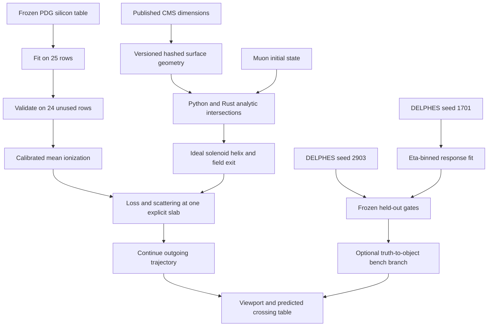

# Sourced geometry, trajectories, and reference calibration

The next increment adds [CMS outlines, nonuniform tracker field and measured references](cms-conditions-and-measurements.md). Full material transport remains pending.

This increment adds the original CMS pixel detector's nominal cylindrical and
annular surfaces, tracker/solenoid envelopes, field-aware trajectories, predicted
crossings, and two scoped reference calibrations. It does not establish a detailed
CMS detector simulation or experimental detector calibration.



## Geometry and field provenance

| Component | Model dimensions | Source |
| --- | --- | --- |
| Original pixel barrel | Radii 0.044, 0.073, 0.102 m; full length 0.53 m | [CMS original pixel detector, section 1](https://cds.cern.ch/record/1971152/files/CR2014_389.pdf) |
| Original forward pixels | Disks at z = ±0.345 and ±0.465 m; radial span 0.06–0.15 m | Same publication |
| Strip tracker envelope | Outer radius 1.10 m; half-length 2.80 m | [CMS tracking performance description](https://cds.cern.ch/record/1277738/files/fermilab-pub-10-724-cms.pdf) |
| Solenoid bore envelope | Radius 3.0 m; length 12.5 m; nominal Bz 3.8 T | [CMS magnet description](https://cms.cern/news/pay-attention-cms-magnet-powered) |

These are published nominal dimensions, not an alignment/survey payload. The
original pixel detector operated through 2016, before the 2017 replacement;
see [CMS tracking history](https://cms.cern/detector/identifying-tracks).
The model contains nine surfaces. It does not invent strip-layer locations,
sensor modules, passive services, calorimeter cells, or muon chambers.

`heplab.physics.detector.geometry()` returns the numerical model, era, per-surface
source URL, units, field assumption, limitations, and geometry SHA256. The hash
covers the model values and provenance, not downloaded upstream PDF bytes. Direct
CERN PDF retrieval encountered an anti-bot page; dimensions were verified against
the indexed publication text. A full archived geometry source package remains open.

The field is an ideal uniform axial field inside the finite bore and zero outside.
The model omits fringe and return-yoke fields. The exact helix is joined continuously
to a straight outgoing trajectory at the first cylinder/end-face exit. Starting
states must be inside the bore. This field approximation is explicitly recorded.

## Navigation, transport, and GUI semantics

The new engine `intersect` operation accepts a checked track, a finite cylinder or
annular disk, Bz, and a path budget in metres. Cylinder roots use circle-circle
geometry, or a stable quadratic in the zero-field limit. Disk roots use monotonic
z motion and annular acceptance. Forward roots at zero path are excluded without
a spatial nudge. Tangencies are deduplicated. Repeated turns are retained within
the 1024-turn and 100 m request budgets; the GUI samples at most a 20 m path.

Python is an independently executed scalar reference. The Rust backend performs
the intersection work for Rust bench runs. Display sampling uses the checked
analytic propagator; it does not determine whether a surface was crossed.

In the bench, the trajectory is propagated to an explicit slab after 1 m of path.
Its calibrated ionization loss and addressed scattering change the outgoing state.
The displayed continuation starts from that state. Other geometry surfaces have
no assigned material. This is a single-slab transport experiment, not a CMS material
budget. An independent optional object-response branch starts from truth; its
efficiency and momentum response are not applied again to deposits or digits.

For native DELPHES events, reconstructed muon momentum is extrapolated from an
assumed interaction point through the ideal field. The resulting paths and crossings
are predictions, not native track fits or measured sensor hits. DELPHES is not
smeared a second time. Future vertex-aware/truth overlays need explicit inputs.

The UI provides Pixel/Tracker/Solenoid region scales, per-surface visibility,
source/dimension inspection, XY/XZ/3D projections, a predicted-crossing table with
positions/path/time, and a reference-validation report. Camera and visibility
controls do not alter exported numerical results.

## Silicon mean-ionization calibration

The frozen input is the [PDG 2025 silicon muon table](https://pdg.lbl.gov/2025/AtomicNuclearProperties/MUE/muE_silicon_Si.txt).
Its SHA256 is `4f1fbf9a287a59765de8b5ea840471fe72c2b675c982e995bac9b57d2c0425fd`.
It is included as a source payload and parsed reference data under
`src/heplab/data/reference/`. Density is 2.329 g/cm³ and radiation length 0.09370 m;
see the [PDG silicon material properties](https://pdg.lbl.gov/2025/AtomicNuclearProperties/HTML/silicon_Si.html).

The calibrated quantity is mean **ionization** loss for muons in bulk silicon.
For the table's mass stopping power in MeV cm²/g, multiply by `2.329 * 0.1` to
obtain GeV/m. Radiative columns are retained in the parsed source, but are not
silently folded into this thin-slab model. Stochastic loss, radiative interactions,
and showers are separate missing capabilities.

The kinetic-energy domain is 0.1–100 GeV. Alternate table rows, including the
endpoints, define 25 log-energy linear interpolation knots. The other 24 rows are
held out. The predeclared gate is maximum absolute relative error ≤2%.
Observed maximum: **0.410525%**. Production lookup uses only the fitted knots;
the held-out values do not become extra interpolation knots after validation.
Out-of-domain queries reject. Payload hashes are checked before use.

This establishes agreement with a published reference table, including its rounded
values and assumptions. It does not measure detector stopping power or calibrate
electronics gain.

## Muon response transfer calibration

Two independent 1000-event native PYTHIA8/DELPHES shards use seeds **1701** and
**2903**, respectively, with the pinned DY process and CMS card documented in
[the runtime guide](sim-runtime.md). Calibration requires different seeds, equal
generation conditions/cards, unit event weights, and committed ROOT checksums.

Eligible truth muons have status 1, 5≤pT≤200 GeV, and |eta|<2.4. Charge-aware
one-to-one matching uses delta-R<0.05 and deterministic distance/index ordering.
Efficiencies refer to this DY population and DELPHES object definition, including
its selection effects; they are not universal muon reconstruction efficiencies.

The fitted response is log(reco pT / truth pT), with bias and width measured in
three absolute-eta bins. These parameters map to the engine's positive lognormal
response through `relative_resolution=sqrt(exp(sigma²)-1)` and
`momentum_scale=exp(log_bias+sigma²/2)`. The GUI can apply this transfer model in
the separate bench branch. Its domain rejects other kinematics/modes.

| Absolute eta bin | Training matches / eligible | Held-out matches / eligible | Width ratio held-out / fit | Efficiency pull |
| --- | --- | --- | --- | --- |
| 0–0.9 | 422 / 496 | 393 / 468 | 0.9392 | -0.4749 |
| 0.9–1.7 | 339 / 402 | 348 / 409 | 1.0730 | 0.2996 |
| 1.7–2.4 | 297 / 362 | 312 / 355 | 1.0240 | 2.1870 |

Frozen gates require at least 100 matches per population/bin, absolute log-bias
difference ≤0.01, width ratio in [0.6,1.4], and absolute efficiency pull ≤3.5.
All bins pass. Reports include Wilson 95% efficiency intervals, standard errors
on log bias, and observed three-sigma tail fractions. The gates are deliberately
broad for this sample size. Passing them does not establish precision modeling,
pT dependence, tail agreement, pileup transfer, or experimental CMS calibration.

## Reproduction and evidence

```text
heplab sim chain --events 1000 --seed 1701 --output artifacts/calibration/train-1701
heplab sim chain --events 1000 --seed 2903 --output artifacts/calibration/heldout-2903
python tools/calibrate_reference_models.py --training artifacts/calibration/train-1701/events.root --heldout artifacts/calibration/heldout-2903/events.root
python tools/plot_reference_validation.py
```

Use a fresh run directory when repeating generation. Successful reference fitting
writes versioned payloads; failed gates retain the report and do not publish new
coefficients. `artifacts/reference-calibration.json` and the exported PNG record
the local comparison. This is currently a source-checkout calibration workflow.

| Requirement | Implemented/verified scope | Remaining boundary |
| --- | --- | --- |
| TRANSPORT-002 | Cylinder/disk roots, tangencies, on-boundary starts, finite extents, thin separated surfaces, repeated turns | Full volume navigator, transforms and overlap/material priorities |
| TRANSPORT-004 | PDG reference mean loss coupled to one slab and outgoing trajectory; energy ledger | Complete detector material map and secondaries |
| RESPONSE-001 | Explicit reference domains, disjoint native seeds, held-out gates and payload hashes | Experimental calibration and systematic coverage |
| RESPONSE-003 | Addressed efficiency/lognormal sampling with fitted scale/resolution | Full covariance and occupancy dependence |
| GUI-003/004/008 | Sourced geometry inspector, linked crossings, region scales, native event navigation | Detailed detector geometry and measured-hit overlays |

See [geometry/calibration evidence](geometry-calibration-evidence.json). No complete
requirement is promoted to `physics_validated` by these scoped checks.
