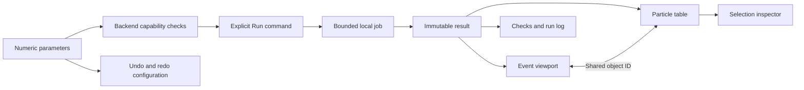

# Simulator workspace interaction design

The current UI is an application workspace: command toolbar, model browser,
event viewport, numeric properties, selection inspector, and tabulated results.
The initial presentation-heavy layout has been replaced. This design is a tested
implementation increment, not a claim of usability certification or user research.

## Source review and interpretation

These resources guide design decisions; they do not collectively define a formal
standard for particle simulators.

| Resource | Relevant observation | Application in HEPLab |
| --- | --- | --- |
| [NVIDIA Physics Umbrella UI](https://docs.omniverse.nvidia.com/kit/docs/omni_physics/latest/dev_guide/physics_umbrella/physics_umbrella_ui.html) | Registered simulator selection and capability reporting expose compatibility. | One backend per workflow; unsupported backends disabled; a capability/check table states supported models and open validation gates. |
| [Microsoft Research: The Magic of UI Physics](https://www.microsoft.com/en-us/research/wp-content/uploads/2016/02/uiphysics09.pdf) | Physics-driven interaction must preserve user control and productivity. This paper studies UI behavior, not detector simulation accuracy. | Predictable pan/orbit/zoom, direct numeric edits, fit/reset, and undo for configuration. View manipulation never changes scientific state. |
| [Creative Navy technical simulation case study](https://interface-design.co.uk/case-studies/ux-ui-design-technical-software-users/) | Scientific tasks move between configuration, spatial context, and interpretation. Consistent orientation and visible parameter context aid reasoning. | Persistent panes, linked selection, units at inputs and tables, RGB XYZ orientation, and stable parameters across projections. |
| [IEEE DIGITEL 2010 resource supplied by user](https://www.computer.org/csdl/proceedings-article/digitel/2010/3993a038/12OmNwF0BWt) | Article content was unavailable through the retrieved page. | No principles or findings are attributed to this inaccessible article. |

## Implemented interaction requirements

| ID | Behavior | Acceptance |
| --- | --- | --- |
| GUI-001 | Run configuration uses exact numeric values and units. | Seed, momentum, field, thickness, noise, threshold are editable; invalid server inputs reject. |
| GUI-002 | Computed results stay separate from edited inputs. | Modified parameters show that another run is required; viewport remains the previous committed event. |
| GUI-003 | Selection is shared across representations. | Tree, table, and viewport selections address the same object ID and update the property inspector. |
| GUI-004 | View controls affect the camera only. | XY/XZ and 3D orbit, pan, zoom, fit, grid/ring visibility preserve exported numerical results. |
| GUI-005 | Backend compatibility is explicit. | Analytic reference/Rust and native PYTHIA8+DELPHES are distinct; no extra material smearing is applied to DELPHES output. |
| GUI-006 | State and failure remain inspectable. | Queued/running/completed/failed/cancelled jobs; Run/Stop availability; retained session log; completed results export. |
| GUI-007 | Workspace supports keyboard operation. | F5 run, Escape stop, F fit, 1/2/3 projections, Ctrl+S export; tabs, table selection, splitters, inputs support keyboard access. |
| GUI-008 | Large event data stay outside the browser. | One selected event is read from the committed ROOT file; event index is bounded by the run. |

The desktop layout prioritizes the viewport and compact property rows with readable
application text. Side panes resize. On narrow screens the panes stack; no separate
physics behavior is introduced. No web fonts, remote scripts, decorative animation,
external telemetry, or network assets are required at runtime.

## Scientific representation boundaries

The current display uses the [sourced geometry and reference calibration](geometry-calibration.md)
increment. The bench continues a field-aware trajectory from the outgoing state
after its single silicon slab. Other detector surfaces have no assigned material.
Predicted crossings are displayed with position, path length, and time.

Native DELPHES muons are extrapolated from an assumed interaction point through
the ideal solenoid. These are predicted paths; measured sensor hits and native
track-fit states are separate missing inputs. The geometry inspector records
nominal dimensions, source URLs, era, and geometry hash.

## Remaining UX validation

Browser workflow checks establish working interactions, not expert usability.
Future evaluation should observe a physicist configuring a fixed-seed run,
inspecting a conservation discrepancy, comparing events, and exporting evidence.
Measure task completion, configuration errors, selection ambiguity, and the ability
to distinguish input, truth, detector response, and visualization assumptions.
