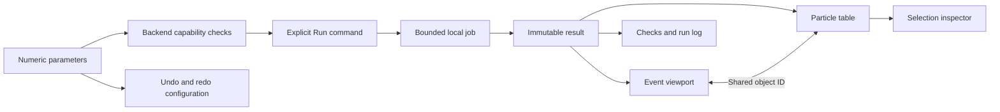

# Simulator workspace interaction design

The current UI is an application workspace: command toolbar, model browser,
event viewport, numeric properties, selection inspector, and tabulated results.
The initial presentation-heavy layout has been replaced. This design is a tested
implementation increment, not a claim of usability certification or user research.

## Source review and interpretation

These resources guide design decisions; they do not collectively define a formal
standard for particle simulators.

| Resource | Relevant observation | Application in HEPLab |
| --- | --- | --- |
| [NVIDIA Physics Umbrella UI](https://docs.omniverse.nvidia.com/kit/docs/omni_physics/latest/dev_guide/physics_umbrella/physics_umbrella_ui.html) | Registered simulator selection and capability reporting expose compatibility. | One backend per workflow; unsupported backends disabled; a capability/check table states supported models and open validation gates. |
| [Microsoft Research: The Magic of UI Physics](https://www.microsoft.com/en-us/research/wp-content/uploads/2016/02/uiphysics09.pdf) | Physics-driven interaction must preserve user control and productivity. This paper studies UI behavior, not detector simulation accuracy. | Predictable pan/orbit/zoom, direct numeric edits, fit/reset, and undo for configuration. View manipulation never changes scientific state. |
| [Creative Navy technical simulation case study](https://interface-design.co.uk/case-studies/ux-ui-design-technical-software-users/) | Scientific tasks move between configuration, spatial context, and interpretation. Consistent orientation and visible parameter context aid reasoning. | Persistent panes, linked selection, units at inputs and tables, RGB XYZ orientation, and stable parameters across projections. |
| [IEEE DIGITEL 2010 resource supplied by user](https://www.computer.org/csdl/proceedings-article/digitel/2010/3993a038/12OmNwF0BWt) | Article content was unavailable through the retrieved page. | No principles or findings are attributed to this inaccessible article. |

## Implemented interaction requirements

| ID | Behavior | Acceptance |
| --- | --- | --- |
| GUI-001 | Run configuration uses exact numeric values and units. | Seed, momentum, field, thickness, noise, threshold are editable; invalid server inputs reject. |
| GUI-002 | Computed results stay separate from edited inputs. | Modified parameters show that another run is required; viewport remains the previous committed event. |
| GUI-003 | Selection is shared across representations. | Tree, table, and viewport selections address the same object ID and update the property inspector. |
| GUI-004 | View controls affect the camera only. | XY/XZ and 3D orbit, pan, zoom, fit, grid/ring visibility preserve exported numerical results. |
| GUI-005 | Backend compatibility is explicit. | Analytic reference/Rust and native PYTHIA8+DELPHES are distinct; no extra material smearing is applied to DELPHES output. |
| GUI-006 | State and failure remain inspectable. | Queued/running/completed/failed/cancelled jobs; Run/Stop availability; retained session log; completed results export. |
| GUI-007 | Workspace supports keyboard operation. | F5 run, Escape stop, F fit, 1/2/3 projections, Ctrl+S export; tabs, table selection, splitters, inputs support keyboard access. |
| GUI-008 | Large event data stay outside the browser. | One selected event is read from the committed ROOT file; event index is bounded by the run. |

The desktop layout prioritizes the viewport and compact property rows with readable
application text. Side panes resize. On narrow screens the panes stack; no separate
physics behavior is introduced. No web fonts, remote scripts, decorative animation,
external telemetry, or network assets are required at runtime.

## Event viewport rendering and live mode

The viewport draws detector outlines, guide surfaces, grid, tracks and crossing
markers with WebGL (`static/event-display-gl.js`); a transparent 2D canvas on
top keeps labels, the orientation triad, the scale bar and picking. If WebGL is
unavailable or its context is lost, the previous Canvas2D renderer is used.
Measured on an integrated Intel Arc GPU with all seven CMS outline layers
(~413k segments): 135 ms per frame with Canvas2D, ~7 ms with WebGL, in both the
browser and the WebView2 desktop shell.

- **Replay** animates each trajectory outward from the origin along its
  sampled path. The clock is flight path in metres; the displayed time is
  `s/c`, a light-travel label, not a per-particle velocity model. Crossing
  markers appear as each track reaches them. Reduced-motion users get complete
  tracks without autoplay.
- **Live** recomputes one bench event (`POST /api/v1/preview`, desktop
  `workbench.preview`) on every slider move: momentum, Bz, aimed η/φ
  and slab thickness. It uses the same `bench()` physics as Run, is validated by
  the same `RunConfig`, carries `preview: true` and is never saved.
- **Recorded CMS events**: *Browse selected real events in 3D* opens the
  selected data events of the current analysis; ←/→ or PageUp/PageDown step
  through them. Each event also shows reconstructed NanoAOD jets (cones to the
  ECAL), calorimeter towers (jet energy split by PF EM/hadronic fraction,
  0.02 m/GeV), electrons (ideal 3.8 T helix to the ECAL face), photons, isolated
  tracks, taus (off by default; unfiltered candidates mostly duplicate the
  muons), PF MET and the primary vertex. These come from display-only sidecar
  files built by `tools/build_cms_display_projection.py`: the same entry range of
  the same Open Data source, joined per event by run/lumi/event and refused on
  any identity or checksum mismatch. The muon projections used by analyses and
  calibrations are unchanged; without a sidecar the display falls back to muons.
  Towers and cones are display construction from stored kinematics, not
  calorimeter hits or clusters. The Canvas2D fallback draws muons only.

## Scientific representation boundaries

The current display uses the [sourced geometry and reference calibration](geometry-calibration.md)
increment. The bench continues a field-aware trajectory from the outgoing state
after its single silicon slab. Other detector surfaces have no assigned material.
Predicted crossings are displayed with position, path length, and time.

Native DELPHES muons are extrapolated from an assumed interaction point through
the ideal solenoid. These are predicted paths; measured sensor hits and native
track-fit states are separate missing inputs. The geometry inspector records
nominal dimensions, source URLs, era, and geometry hash.

## Remaining UX validation

Browser workflow checks establish working interactions, not expert usability.
Future evaluation should observe a physicist configuring a fixed-seed run,
inspecting a conservation discrepancy, comparing events, and exporting evidence.
Measure task completion, configuration errors, selection ambiguity, and the ability
to distinguish input, truth, detector response, and visualization assumptions.

## Product redesign plan

The desktop Workbench is the intended simulator UI. The public project website
is a separate read-only product and must never contain local run controls or
hosted simulation. The detailed work packages, product boundary, acceptance
gates and risk register are in the
[implementation roadmap](implementation-roadmap.md). Apply this sequence
before a broad visual rewrite:

1. Observe representative researchers, detector/simulation engineers and
   learners completing setup, run, inspect, compare and export tasks.
2. Map navigation to Home, Simulate, Runs, Data, Laboratory (only when a real
   profile/decoder is supported), and Learn/Help. Keep a persistent project
   context and a three-zone simulation workspace.
3. Separate draft inputs, preflight, job execution, committed result and
   view-only exploration. Show backend, seed, model version, units, supported
   domain, provenance and validation maturity at the point of use.
4. Implement run lifecycle and immutable results first, then linked event/table/
   inspector interactions, comparison, project import/export, and finally
   device-specific workflows after laboratory acceptance.
5. Re-test keyboard and assistive-technology use, narrow windows, crash/restart,
   and task completion on packaged desktop builds. Do not present test-passing
   software as physics validation.

The site should explain how to obtain and understand the desktop app, show
evidence and limits, and offer tutorials and contribution/release information.
It should not be the place where users run the simulator.

## Detector inspection controls

The Event display toolbar provides explicit zoom out/in buttons, a zoom percentage,
and Fit (F). Mouse-wheel and trackpad zoom keep the point under the cursor fixed;
the supported scale is 10% to 12,800% of the selected region. Keyboard +/− uses
the same camera path. Drag orbits in 3D, and Shift+drag pans.

Core selects the Pixel region, enables its original CMS module outlines, and hides
the outer detector, grid and guide surfaces. This isolates the barrel and endcap
modules for inspection. XY looks along the beam axis at the concentric layers;
XZ shows the longitudinal arrangement. Region → Tracker restores the larger
silicon tracker view, and Region → CMS restores the full detector framing.

Camera operations leave event data unchanged. The finest bundled geometry is
module boundaries; magnification does not add sensor-pixel or electronics detail.
The same controls and adaptive metre/centimetre/millimetre scale bar work with
the WebGL renderer and the Canvas2D fallback.

Rendering offers Solid surfaces, Solid + edges and Outlines. Opaque faces use
depth testing and flat directional lighting. Cutaway removes a sector around
the Z axis; Opening adjusts its width (30–180 degrees) and Rotate changes its
azimuth. Both detector faces and outlines are cut consistently. Event tracks,
reconstructed objects, and crossing markers remain overlaid and uncut.

Surface assets preserve the pinned CMS source identity. Native GLB triangles
are used where present. Pixel and strip faces are triangulated only from closed,
convex, planar source-outline loops; rejected outlines remain visible in solid
mode. These thin visual faces do not establish material thickness or transport
geometry. Rebuild them offline with `python tools/build_cms_surfaces.py` from
the existing hash-verified `.cache/cms-display` sources. The manifest records
native/derived triangle counts, retained outlines, byte sizes and SHA-256 hashes.

Each CMS display layer has a keyboard-accessible 0–100% opacity slider. These
settings persist in local browser storage and do not change RunConfig or event
results. Reset opacity restores detector layers to 100% and the guide shell to
20%. Core restores pixel opacity so it remains useful after a transparency preset.
Transparent WebGL faces use weighted blended accumulation/revealage, with opaque
faces retaining depth testing. Unsupported float render targets and context loss
use the depth-sorted Canvas2D fallback. Tracks and reconstructed objects remain
visible over detector faces regardless of opacity.

Event focus frames the tracker horizontally, softens pixel/strip modules and adds
an optional smooth blue Tracker shell (guide). Its radius and half-length come
from the existing tracker-envelope guide; it is illustrative, has no material,
and does not replace source CMS module geometry. Rotate view changes camera roll
by 90 degrees. The preset changes only display settings. The bundled recorded
sample does not contain the full charged-track/hit collections shown by iSpy;
no extra tracks or measured hits are inferred for visual density.
