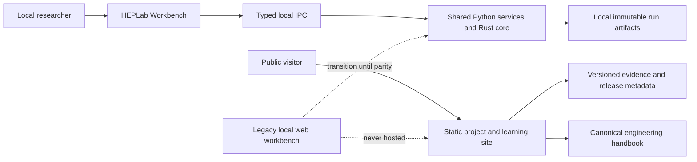

# Implementation roadmap: physics, desktop, website and workbench

Status: execution plan, 2026-10-28. This document breaks the open delivery
gates into reviewable work packages. It is not evidence that a package has
passed. The requirements register, versioned artifacts and independent
acceptance reports remain authoritative for completion claims.

## Implemented foundation and current status

The following foundation is present in this checkout and has passed the named
software checks; these items do not close the scientific, distribution or
usability gates below:

- Public site and simulator have separate boundaries: `web/` is read-only;
  local execution belongs to the CLI and HEPLab Workbench.
- Website capability maturity is read from
  `src/heplab/data/project-capabilities.json` in both the static fallback and
  Python overview API. The project site has no desktop IPC transport.
- Public site dependencies are exactly pinned; CI installs from the frozen
  lockfile, typechecks and builds. Source maps are off; the evidence chart is
  lazy-loaded and Latin font subsets are bundled.
- A Windows x86-64 Workbench build has been smoke-tested. Linux and macOS
  bundles have a native CI build matrix but still need clean-machine install
  verification; no public installer is distributed or signed.
- The current workbench has a command bar, model browser, resizable viewport,
  parameter inspector, run history, diagnostics and result tables. It has not
  passed representative-user or assistive-technology studies.
- The current CMS navigation comparison has unresolved geometry and reverse
  path findings. M1/M2 remain blocked from full material transport claims.
  M3's existing calibration artifacts are exploratory. Laboratory software
  accepts synthetic fixtures only; M4–M6 require real equipment and data.

Reproduce the local foundation checks with `python -m pytest tests -q`,
`python tools/check_handbook.py`, `python -m mkdocs build --strict`,
`dotnet build web/HEPLab.Web/HEPLab.Web.csproj`, and the isolated-wheel
check in CI. Passing these checks means software regression coverage passed;
it does not upgrade a physics maturity state.

## Product boundary and decision

HEPLab has two user-facing products with different jobs:

1. **Public project website (`web/`)** explains the project, evidence, learning
   material, installation and releases. It is read-only and never runs a user's
   simulation, reads local files, uploads data, or exposes a hosted workbench.
2. **Desktop simulator (`desktop/`)** is the local application for configuring
   runs, replaying owned data, viewing events and exporting results. The current
   local FastAPI workbench remains the development/compatibility surface until
   the desktop app covers the agreed workflows. It is not the intended public
   browser product.

The desktop app should be called **HEPLab Workbench** in UI copy until a short
user naming exercise chooses a better name. “Workbench” describes the current
technical workspace without promising a validated detector simulator. Keep the
package and CLI names stable unless a separately reviewed migration is needed.

## How to execute the roadmap

### Work package rules

- Start each package by naming the requirement IDs, input identities, supported
  domain, and predeclared acceptance thresholds. If a threshold needs physics
  evidence, source it before examining held-out outcomes.
- Make the smallest reviewable vertical slice. Keep raw inputs immutable,
  generated artifacts content-addressed, and training/validation partitions
  disjoint by run or source file where possible.
- Add failure-path cases with the feature: malformed/unsupported input,
  missing dependency, timeout/cancel, disk-full/partial output, restart, and
  incompatible provenance as applicable.
- Store command, environment, toolchain/container digest, source revision,
  input hashes, output hashes, exit code, and limitations in the evidence
  record. Preserve failed attempts if they reveal a real blocker.
- Do not promote `implemented` to `verified` based on test names or successful
  happy-path runs. Do not promote any physics claim to `physics_validated`
  without independent scientific review.
- Review software, data and documentation licenses before packaging. Keep
  credentials out of source and artifacts; use a secret manager for signing.

### Cross-cutting quality gates

| Gate | Required before merge/release | Common failure to prevent |
|---|---|---|
| Provenance | Inputs, configs, code and outputs identify themselves; hashes and units are checked | Stale cache or artifact presented as a new result |
| Contracts | Strict schemas reject unknown, nonfinite, inconsistent and oversized data | Silent defaults, truncation or semantic drift |
| Reproducibility | Fixed seed/build/config reproduce declared observables; chunk/worker invariance tested where promised | Hidden dependence on iteration order or machine state |
| Statistics | Weighted and correlated quantities use appropriate estimators; partitions are independent | Treating signed weights as counts or leaking events across splits |
| Failure safety | Cancel, timeout, disk errors, malformed backend output and restart leave no committed partial run | Partial artifacts mistaken for completed results |
| Usability | Task-based observation plus keyboard/screen-reader and narrow-window review | UI technically works but exposes ambiguous state or hidden assumptions |
| Release security | Least-privilege IPC, no shell command strings, path confinement, dependency/license inventory | A packaged UI gains unintended local or network authority |

## Track A — CMS geometry, field and transport (M1–M2)

### A0 — Pin the current reproducible baseline

**Inputs:** pinned `CMSSW_10_6_30` image, current export recipe, current saved
TGeo/Geant4 candidate artifacts. **Output:** one canonical export identity in
the repository and an evidence index mapping candidate IDs to their geometry
hash.

1. Rerun export and overlap audit in the digest-pinned image. Verify all output
   hashes, 3,678 volume inventory, 360 materials, maximum depth, 108 rays and
   146 overlap candidates. Compare export configurations and source XML
   inventories with the previously audited source; record expected ROOT-file
   variation if serialization or UID ordering is nondeterministic.
2. Freeze a clean source snapshot and exact reproduction command. Preserve the
   old comparison unchanged. Never point evidence from geometry hash A at
   geometry hash B.
3. Run independent Geant4 checks on the new geometry. Update the report only
   after confirming all 146 cases map by source volume identity and witness,
   all trace counts reconcile, and raw logs/build outputs are retained.

**Gate A0:** every report names exactly one geometry hash; an automated
consistency check rejects mixed exports. A changed export requires a complete
recomparison or explicit proof that candidate mapping and material semantics
are unchanged.

### A1 — Resolve M1 navigation findings without hiding them

**Known risks:** CSC active/dead gas, frame/FR4 and foil mother containment;
CASTOR source nesting; ECAL envelope/supermodule boundaries; yoke seams;
nonreciprocal paths and cross-backend disagreements. A matching bulk material
does not prove a unique volume boundary.

1. Keep the baseline DDD and exported TGeo immutable. Create a versioned
   candidate geometry variant with a written source-based rationale for every
   change. Record intended material ownership at boundaries, ancestor/neighbor
   context, and any lost or added material.
2. For each finding family, make a minimal variant and test it independently.
   Prioritize CSC frame/FR4 path disagreements, then CSC gas/foil containment,
   CASTOR, ECAL, and yoke volume identity. Do not “fix” by arbitrary priority,
   epsilon pushes, silently deleting daughters, or replacing materials with
   Air.
3. Expand deterministic witness cases to neighboring volumes, both traversal
   directions, tangencies, thin layers, perturbations, and rays not selected
   because of a known overlap. Test material identity, volume identity,
   boundary position, path totals, X/X0 and X/lambda in both ROOT and native
   Geant4. Include padded-world sensitivity and no-navigation-loop behavior.
4. Add randomized/property-generated ray cases with fixed recorded seeds and
   shrinking/reproduction of every failure. Stratify by geometry region and
   solid type; keep witness cases as regressions. A passing targeted sample is
   not a detector-wide error-rate estimate.
5. Have a geometry/domain expert review the intended DDD semantics and the
   candidate diffs. Record disagreements and unresolved volume ownership.

**Gate A1:** all scoped analytic fixtures pass; no unexplained forward/reverse
material or boundary differences; every enabled solid/material has a declared
representation; candidate/source hashes and independent-review disposition are
recorded. If only selected regions pass, expose a region allowlist and keep full
detector navigation disabled. **M1 closes only for the explicitly accepted
geometry/domain.**

### A2 — Resolve field and conditions coherently

1. Identify the intended 2016 data-taking GlobalTag and exact run/luminosity
   interval. Resolve geometry, alignment, field current/scaling and field map
   records from one compatible conditions snapshot. Archive record names,
   payload tags/hashes, since/till IOVs, run list, and the conditions software
   version.
2. Compare OAE and merged-grid files against their pinned source revisions and
   geometry. Implement or adapt the authoritative volume/sector reader; test
   coordinate transforms and map-boundary behavior. Never interpolate across
   magnetic materials unless the source algorithm defines that behavior.
3. Test field values at axes, seams, map edges, sector boundaries, outside
   validity, and both sides of material transitions. Compare with a separately
   executed CMSSW EventSetup oracle at representative IOVs, not merely with
   vectors generated by the port itself.
4. Introduce adaptive/error-controlled integration only with explicit local
   error estimates and deterministic termination budgets. Compare tightened
   tolerances to high-accuracy DOP853/CMSSW trajectories for charge, momentum,
   direction and path-length grids. Check reversibility, norm/energy
   conservation, time of flight and boundary crossing.

**Gate A2:** field payload and geometry/IOV identities are compatible; sourced
field values meet predeclared tolerances; trajectories converge as tolerances
tighten; out-of-domain and IOV changes fail explicitly. This completes field
navigation evidence but does not by itself establish material transport.

### A3 — Build transport as separately validated processes

1. Define the initial particle/material/energy/field domain and units. Keep
   mean ionization, straggling, multiple scattering, radiative muon losses,
   decay and secondary production as separate capability flags.
2. Add one process at a time with a per-step energy/momentum ledger and explicit
   escaped/deposited/secondary terms. Bound step count, path length, secondaries,
   CPU and memory. Preserve random streams by event/process address so work
   ordering does not change results.
3. Compare analytic limits and distributions to independent Geant4 physics
   lists/materials at frozen energies, thicknesses and angles. Compare means,
   quantiles, tails and correlations with predeclared statistical power. Use
   independent seeds and avoid tuning on the final comparison set.
4. Test geometry coupling at boundaries: no step may cross an unexamined
   material boundary; process limits may shorten but never extend a geometry
   step. Reconcile the energy ledger on stopped, escaped, decayed, cancelled,
   and step-limit events.

**Gate A3 / M2:** accepted field/geometry subset, process matrix, Geant4
comparisons, convergence report, uncertainty and uncovered domains. Do not
call a muon transport gate a shower simulator; electromagnetic/hadronic shower
support is a distinct research program.

## Track B — CMS measured calibration (M3)

1. Freeze a multi-file/run certified Run2016G data sample and compatible UL2016
   DY MC sample. Preserve complete sample catalog identity, processing,
   branch projection, ranges, checksums/integrity class, generator weights,
   trigger objects/bits, pileup, truth association and corrections. A projected
   range with declared checksum is not a whole-file integrity verification.
2. Define a common selection and object definition before fitting. Keep event
   weights signed, account for multiple candidates per event, and model
   correlations. Separate data/MC differences that cannot be corrected with
   the available fields.
3. Apply official era-compatible momentum and efficiency corrections when
   applicable; pin their versions and payload hashes. Fit only identifiable
   residual response parameters. Model natural Z width, FSR, backgrounds,
   trigger/selection efficiency and pileup before interpreting a fitted mass
   width as resolution.
4. Split by run/file/time before optimization. Use training runs for fitting,
   validation runs for model selection, and a final held-out set for closure.
   Freeze all selection, correction, fit, covariance and stopping choices
   before opening the held-out result.
5. Evaluate charge, eta, phi, pT, run, pileup and occupancy slices, including
   negative-weight stability and low-statistics behavior. Report covariance,
   statistical uncertainty, model/systematic variations and failed coverage.
6. Have an analyst not involved in tuning reproduce the report from a clean
   checkout and review source, weights, corrections, selection and interpretation.

**Gate B / M3:** independent reproducible held-out closure meets sourced
tolerances and the model card states valid era, object definition, kinematic
range, corrections, uncertainty and limitations. Until then the mass template
remains exploratory and production defaults do not change.

## Track C — Laboratory device and experiments (M4–M6)

### C1 — Identify and profile the device (M4)

1. In an offline equipment-intake review, record manufacturer/model, asset
   label/serial, chamber type, drawing/manual revision, active area, gaps,
   electrodes/strips, gas/material information, front-end, TDC/ADC, clock,
   trigger, cable/channel map, firmware, DAQ and raw format. Separate reported,
   documented and measured values with source identities and uncertainties.
2. Identify the authorized equipment operator and obtain the facility's written
   power, gas, interlock and access procedures. Software planning does not
   infer or prescribe operating voltage/threshold/gas values.
3. Obtain an immutable raw sample, decoder specification, known-trigger/event
   expectations and golden expected output. Remove private identifiers where
   required without changing the bytes used for integrity validation.
4. Version the profile schema for the actual device. Validate units, ranges,
   channels, timebase, wrap/reset behavior, byte order and firmware version;
   unknown critical fields block the stage rather than receiving defaults.

**Gate C1 / M4:** reviewed inventory, profile digest, golden raw fixtures,
decoder loss accounting, and no inferred hardware facts. No physical control is
implemented by this milestone.

### C2 — Replay and calibrate (M5)

1. Preserve raw bytes read-only; derive decoded data, clock epochs, offsets,
   masks, coincidences and clusters as immutable content-addressed children.
2. Establish clock units and synchronization with known injection/trigger
   fixtures. Derive channel offsets and time-walk only where amplitude/timing
   fields support them; measure strip propagation only when the readout permits
   it. Retain overflow, reset, dead-time and dropped-record counts.
3. Define track/trigger association independent of the chamber's own hits.
   Require active-area crossing position for detector efficiency. Track
   denominator loss and dead time explicitly; self-triggered counts cannot
   establish absolute efficiency or flux.
4. Partition calibration and validation by separate runs/time blocks. Compare
   raw-to-decoded counts, timing, residuals, noise, cluster size, efficiency,
   rate stability, masks and environment. Estimate uncertainty and systematic
   sensitivity to thresholds, association windows and dead-time treatment.

**Gate C2 / M5:** real-data replay is deterministic and loss-accounted;
independent denominator and held-out runs exist; all quantities carry units,
calibration identities and uncertainty; closure gates pass or are explicitly
reported as failures.

### C3 — Predictive cosmic-muon studies (M6)

1. Select a source model matching the site's altitude, overburden and angular/
   energy domain. Validate flux and acceptance separately from chamber
   response; measure active area, live time and trigger efficiency.
2. Compose the identified geometry/material/electronics response with the
   validated source. Propagate uncertainty from geometry, flux, trigger,
   efficiency, timing and electronics; keep response parameters frozen from
   training runs.
3. Predict observables not used to tune the model (e.g., angular distribution,
   cluster/time distributions or independent run rates) and compare to held-out
   measurements. Record environment conditions and run selection.

**Gate C3 / M6:** held-out predictive comparisons pass agreed uncertainty-aware
criteria and a device-specific model card states domain and unsupported uses.

## Track D — Desktop product and release (M7)

### D1 — Product and architecture freeze

- Treat the desktop Workbench as the only simulation UI product. Keep the
  public website read-only and the CLI/service APIs available for automation.
- Agree the first-release task set: configure/run analytic reference model;
  inspect provenance/capabilities; browse runs; compare selected events;
  inspect diagnostics; export/import a project bundle; manage datasets and
  profiles; replay a supported lab file only after a decoder exists.
- Select user data/project locations, backup/upgrade migration policy, offline
  behavior, log retention, crash recovery and privacy defaults. Do not place
  user projects in installation directories.
- Keep typed IPC allowlisted and bounded; use structured arguments, explicit
  capabilities, project-root grants and per-operation budgets. No arbitrary
  shell, plugin or network permission in the renderer.

### D2 — Native matrix and package verification

1. Build frozen worker and shell on Windows x86-64, Linux x86-64, macOS Intel
   and macOS Apple silicon. Confirm native triples and minimum OS baselines;
   record compiler/runtime/toolchain and artifact hashes.
2. Run the same frozen numerical fixtures on every target with predeclared
   tolerances; test no system Python, fresh user profile, offline startup,
   spaces/non-ASCII paths, read/write confinement, cancellation, crash/restart,
   upgrades, rollback, uninstall and orphan-process cleanup.
3. Install and smoke-test actual NSIS/MSI, AppImage/deb/rpm and app/DMG outputs
   on native clean machines/VMs. Test package-manager dependencies and WebView
   minimums. A CI build alone does not prove installer UX or runtime startup.
4. Create SBOM and license/notice bundle for Python wheels, Rust crates,
   frontend packages, fonts, CMS display assets and bundled runtimes. Verify
   offline application operation and provide supported OS policy.
5. Add signing/notarization in a protected release workflow after unsigned
   packages are accepted. Never commit signing credentials. Verify signature,
   updater/rollback, quarantine behavior, upgrade and uninstall on clean users.

**Gate D / M7:** all four native packages and smoke reports exist, numerical
fixtures agree, lifecycle/security/license gates pass, and signed artifacts
have a published support matrix. If a platform is unsupported, remove it from
the declared support promise instead of implying parity.

## Track E — Public explanatory website (separate from simulator)

### E1 — Purpose and content model

The site's job is to answer: what HEPLab is, what runs today, what evidence
supports each claim, how to install the desktop app, how to learn/contribute,
and where to get releases. It must not invite a visitor to run a hosted
simulation or to expect browser access to their files.

1. Build a claim/evidence content registry keyed by capability ID. Each claim
   includes maturity, supported domain, evidence URL/hash/date and a short
   limitation. Generate the public summary from this registry or the canonical
   evidence API; eliminate duplicated status values in `content.ts` and
   `project.py`.
2. Replace obsolete “desktop planned” copy when the downloadable product is
   actually released. Until then, label Windows app evidence as prerelease and
   show platform availability from release metadata rather than prose.
3. Publish pages: Project overview; Simulator product/install guide; Learn
   (guided event-to-response walkthrough); Evidence and limitations; Docs;
   Community/contributing; Releases/support. Keep algorithm detail linked to
   the handbook rather than copied.
4. Use actual repository/issue/security links only after verifying ownership
   and target. Add citation and notice links; do not fabricate adoption,
   performance or validation claims.
5. Keep the event display on the site explicitly illustrative or backed by an
   identified public run artifact with source/hash/seed/backend and a text
   alternative. It is a teaching visualization, never a simulator control.

### E2 — Frontend reliability and deployment

- Pin every direct dependency and use frozen-lockfile install in CI. Update
  dependencies intentionally with changelog and security review.
- Add unit tests for evidence/status mapping, theme state, track demo math and
  offline API behavior; add browser tests for API online/offline, navigation,
  keyboard operation, narrow screens, no console errors and external links.
- Add lint/format and accessibility automation, plus manual screen-reader and
  contrast review. Remove source maps from public builds or keep hidden maps as
  private CI artifacts. Move inline theme initialization to a CSP-compatible
  external script if policy requires.
- Snapshot public evidence with a timestamp and source digest so the hosted
  guide remains useful without the local FastAPI service. Keep public content
  separate from any read-only summary endpoint.
- Optimize evidence plots and fonts after measuring bundle size; lazy-load
  charts and preserve captions, units, source and uncertainty. Test without
  third-party network assets and analytics by default.
- Add deployment preview and link checking. Publish only after custom domain,
  repository identity, privacy/contact policy and release URL are verified.

**Gate E:** a new visitor can accurately describe the desktop/local boundary,
implemented capability maturity and unsupported physics domains; every claim
links to evidence; the web app builds and runs independently; accessibility
and responsive checks pass; zero simulation-control routes exist on the public
host.

## Track F — Workbench GUI redesign for researchers, engineers and enthusiasts

### F1 — Discover workflows before visual redesign

Run 5–8 moderated sessions across at least one researcher/analyst, one
simulation or detector engineer, and one learner/enthusiast. Ask each person to
complete representative tasks using the current app; do not pitch a design
before observing friction. Tasks:

1. Create a named project and run a seeded reference simulation.
2. Determine which engine ran, its validity state, and the limits of its result.
3. Select a particle in the viewport/table and find its units, parent/truth,
   response and uncertainty.
4. Find a failed preflight or run, correct it, cancel a long run, and recover
   the prior committed result.
5. Compare two runs and export a reproducible bundle with inputs and logs.
6. Open a real data artifact or lab profile and identify which fields are
   missing before attempting analysis.

Capture completion, time, misconfiguration, backtracking, confidence and
misinterpretation of illustrative vs validated output. Record anonymized
observations and prioritize recurring high-impact problems.

### F2 — Information architecture and interaction model

Use persistent project navigation and a task workspace, with explicit routes:

- **Home/Project:** recent projects, capability status, recent runs and clear
  next actions.
- **Simulate:** model/backend selection, parameter form, preflight, viewport,
  run status and result summary.
- **Runs:** searchable, filterable immutable run list; compare selected runs;
  inspect inputs, environment, logs and exported artifacts.
- **Data:** local dataset catalog, sample provenance and import state.
- **Laboratory:** device profiles and replay only when a real decoder/profile is
  supported; otherwise explain requirements and show no fake controls.
- **Learn/Help:** task-based tutorials, units, assumptions, keyboard shortcuts,
  troubleshooting and links to canonical docs.

Within Simulate use a stable three-zone layout: model/project rail, central
viewport or table, and contextual inspector/configuration panel. Provide
resizable/collapsible panels, tabs for event/particles/hits/diagnostics, and a
command area for run, stop, compare and export. Avoid putting every concern in
one tab strip or deeply nested modal.

### F3 — Scientific state and UX safety

- Make draft inputs, preflight, executing job, committed result, and view-only
  exploration visually and semantically distinct. Editing parameters never
  mutates a completed result. “Run” creates a new immutable artifact.
- Before execution show a concise preflight: backend, model/version, seed,
  dataset ranges, event count, supported domain, expected resource use and
  blockers. Explain disabled controls with a reason and a route to resolve it.
- Keep validation state adjacent to results: illustrative, software-verified,
  reference-compared or physics-validated, with scope and evidence link. Never
  use color alone or a generic “success” badge for physics correctness.
- Use a consistent units layer (quantity, unit, precision and conversion). Show
  source, calibration, assumptions and uncertainty in the inspector; use
  tooltips only for secondary help, not essential scope.
- Link selection across viewport, event tree, table and inspector by stable
  object ID. Provide text/table alternatives for all canvas-only information.
- Keep pan/orbit/zoom and visibility display-only. Label predicted crossings,
  display geometry, simulated hits and measured hits differently.
- Provide undo/redo for drafts; confirmation only for irreversible deletion or
  export overwrite. Cancel preserves last committed result and records state.

### F4 — Visual system and accessibility

- Establish tokens for typography, spacing, surface hierarchy, focus, warning,
  error, valid, pending and evidence maturity. Use compact density with readable
  scientific tables; allow a comfortable density option.
- Adopt stable table conventions: sortable columns, explicit units, sticky
  headers, copy cell/row, empty/loading/error states, keyboard row selection,
  pagination/virtualization for large data, and exported CSV/JSON identity.
- Test keyboard-only workflows, screen-reader labels/live updates, focus
  management, 200% scale, high contrast, reduced motion, light/dark, minimum
  window size and localization-ready strings. Use shapes/patterns/labels as
  well as color for event tracks and quality states.
- Ensure crash/restart returns to project/run list, recovers only verified
  committed artifacts, and identifies incomplete jobs without presenting them
  as results.

### F5 — Implement by vertical slice

1. Add shared typed UI models generated/checked against IPC/API schemas.
2. Establish navigation shell, project switcher and global status/help.
3. Refactor current workbench into feature modules (simulation setup, event
   viewer, run history, diagnostics) with a typed API adapter and no duplicated
   service logic.
4. Ship the run setup + preflight + job lifecycle + immutable result slice.
5. Ship linked event/table/inspector exploration and comparison.
6. Add project import/export, dataset provenance and recoverable failures.
7. Add lab workflows only after M4/M5 decoder acceptance; don't build generic
   hardware controls as placeholders.
8. Consolidate the desktop UI as primary; retain or deprecate `/workbench`
   only after parity, migration, and support requirements are met.

### F6 — Usability acceptance

Repeat the task study with representative users on native packages. Target at
least 80% unassisted completion of critical setup/run/inspect/export tasks,
zero critical scientific-state misunderstandings during the tested tasks, and
documented resolution of all severity-1 usability/security findings. Treat
these as product acceptance thresholds, not universal usability guarantees.
Include keyboard and assistive-technology users in formative review. Re-run
after substantial navigation/state changes.

## Sequencing and dependencies

| Order | Work | Can proceed in parallel with | Hard dependency |
|---|---|---|---|
| 0 | Freeze current artifact identities and reconcile M1 comparison to current geometry | Website status content; GUI user research | Current repo checkout and Docker image |
| 1 | M1 geometry variant and field/IOV resolution | M3 data acquisition; desktop shell/product discovery | Source/conditions access and domain review |
| 2 | M2 transport processes and comparisons | Desktop UX/build matrix; website reliability | Accepted geometry and field scope |
| 3 | M3 calibration training/held-out closure | GUI and website implementation | Compatible samples, corrections and analyst review |
| 4 | M4 device intake | Desktop and public site | Physical asset, operator, device documents |
| 5 | M5 real replay and calibration | Public website and desktop release engineering | M4 profile, raw runs, independent trigger/tracks |
| 6 | M6 cosmic prediction and validation | M7 platform builds | M5 held-out detector response and site context |
| 7 | M7 signed desktop release | M3/M5/M6 work can continue | Native runners, release signing, supported runtime policy |
| 8 | M8 research release | — | Accepted M3/M6 domains, M7, independent review |

The public project site can ship before M3/M6 if its claims are accurately
scoped and its release/install pages show only actual artifacts. The desktop
can ship an educational/reference capability before all physics gates only if
its UI clearly states its supported domain and does not imply a validated CMS
or laboratory detector simulation.

## Risk register and preventative actions

| Risk | Early signal | Prevention / response |
|---|---|---|
| Geometry repair matches one navigator but violates source intent | Backend-specific path “fix” or unexplained hierarchy mutation | Source review, minimal variants, both backends, ancestor/neighbor tests, independent geometry reviewer |
| New export silently mismatched to old comparison | Different geometry hash in source and report | Hash-bound evidence index and automated mismatch rejection |
| Field map from incompatible era/IOV | Record exists but run coverage/payload relationship unknown | Resolve records together; retain run/IOV matrix; reject unclassified runs |
| Calibration overfit or sculpted mass result | Training/held-out drift, mass-window-dependent optimum | Freeze splits and selection, model FSR/background, independent reviewer, publish failures |
| Signed MC weights misinterpreted | Negative weights dropped or binomial errors used | Weighted contracts, sumw2/covariance, cancellation and low-effective-count tests |
| Lab profile guesses device from enclosure/CMS association | Unknown field populated from publication | Provenance state on every parameter; block computation on unknown critical inputs |
| Trigger efficiency presented as detector efficiency | No external track position or live-time denominator | Label denominator, reject absolute efficiency without independent active-area crossings |
| Desktop UI gives false scientific confidence | “Run succeeded” read as “model validated” | Separate execution state, verification maturity and physics validity in UI and exports |
| Platform packaging differs by host | CI passes but package fails on clean machine | Native clean VM install, frozen worker handshake, fixture parity and lifecycle tests |
| Public site and API drift | Capability status differs between UI/docs/API | One status registry and CI contract test; evidence hash and freshness visible |
| GUI grows into a dense control panel | Too many global tabs/settings before task observation | Task studies, progressive disclosure, persistent context and staged vertical slices |
| Bundled dependency/license or asset issue | Missing notices, font or data attribution | SBOM/license review, packaged notices, checksum and clean offline install |

## Decision log to keep current

Record decisions with date, options, evidence, owner and revisit trigger:

- accepted geometry variants and supported regions;
- selected Run2016G GlobalTag/IOVs and field reader;
- data/MC samples, corrections, selection and held-out tolerances;
- actual lab device identity and approved offline data format;
- desktop platform support and minimum OS policy;
- public website host/domain/repository and real release links;
- Workbench naming, target workflows and telemetry/privacy policy;
- any deferred requirement and the user-facing limit it creates.

Do not block unrelated work on preferences that can be tested in a prototype;
do not convert a missing external input into an assumed product fact.
