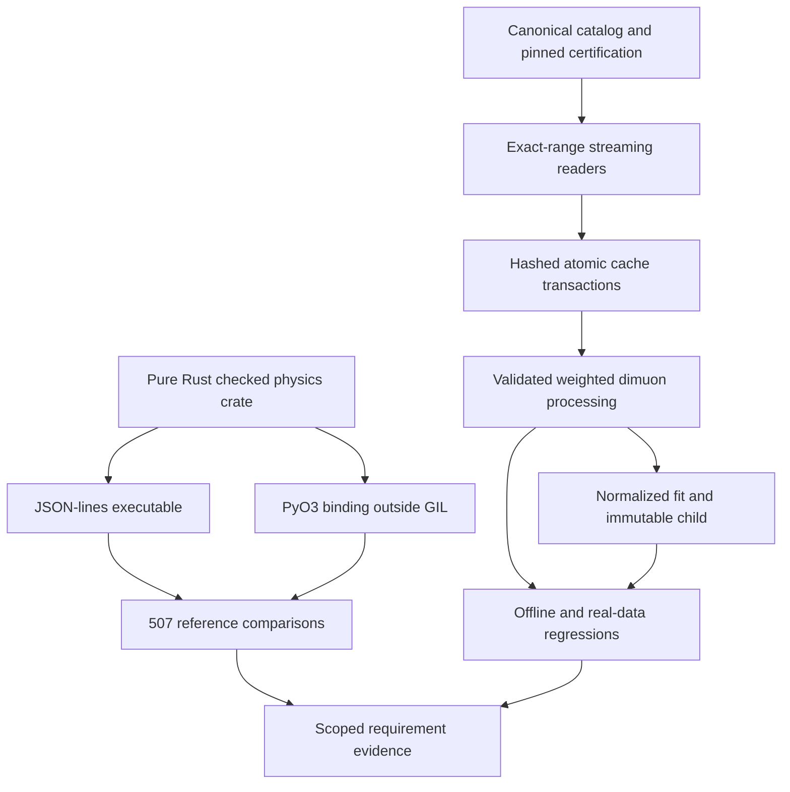

# Implementation increment · critical fixes and native engine

Latest follow-up: [simulation and GUI evidence](simulation-gui-evidence.json),
[native runtime](sim-runtime.md), [material models](material-response.md), and
[GUI design/source review](gui-design.md). The counts below describe the earlier increment.

Date: 2026-10-27. This page supersedes prototype observations in the original
[delivery baseline](17-delivery-plan.md) where the code below changed. Target
physics/release gates still apply. Machine-readable evidence is recorded in
[implementation-evidence.json](implementation-evidence.json).

## Seven P0 software defects addressed

| ID | Implemented fix | Verification |
|---|---|---|
| BUG-001 | Cache v2 identities include source, entry range, manifest, reader, projection, data kind and certification; commits hash payloads and row counts | N then M/full ROOT fixtures; concurrent writes; conflict/corruption/coverage rejection |
| BUG-002 | Missing, nonfinite and negative isolation cannot pass | Parameterized absent/NaN/Infinity/negative selection cases |
| BUG-003 | Signed weights feed cutflows/histograms; sumw2 and event-cluster variance retained | Independent weighted-yield and multi-pair variance cases |
| BUG-004 | Gaussian mixture normalized on fit window; unsupported weighted fits reject; diagnostics saved | Independent integral near boundaries and fit regression |
| BUG-005 | Official 2016 certification packaged/hashed; measurement requires certification and declared trigger provenance | Lumi endpoints/unknown runs, missing/false triggers, certified CERN read |
| BUG-006 | DELPHES isolation no longer fabricates ID or pixel-seed values; absent fields null; weights retained | Offline DELPHES ROOT fixture |
| BUG-007 | Source snapshots hash dirty/untracked code/build inputs; unrelated drive-root Git SHA refused | Source mutation and isolated installed-wheel snapshot checks |

BUG-005 is a guard against unsupported analysis, not proof of calibrated trigger,
efficiency and scale corrections. Current physics artifacts retain
`validation.state=unvalidated`. The 100-event CERN example is exploratory even
though all 100 source events pass the certified-run mask.

## Additional safeguards

Canonical hashes reject unsupported/nonfinite values (BUG-008). JSON/ROOT limits
are consistent and local files are identified by content (BUG-009). Optional
reader fields preserve multiplicity and jagged mismatches reject (BUG-010).
Remote processing streams chunks; local ROOT iterates bounded arrays; JSON
fixtures and candidate output have budgets. Duplicate detection retains source
sequence state rather than every event (part of BUG-011; a measured memory
envelope is still required).

Fits cannot overwrite parents (BUG-013). Shape comparisons require compatible
axes/semantics and known data/MC kinds, propagate normalization covariance and
report undefined ratios. Multi-candidate comparisons reject pending full
cross-bin event covariance (part of BUG-014). API artifact paths/origins are
guarded (BUG-015). Toy response uses addressed positive lognormal fluctuations
(BUG-016). One canonical Run2016G catalog plus compatibility alias and
certification ships in the wheel (BUG-018). External simulation preflight
requires an installed pinned image digest; a working PYTHIA/DELPHES image still
needs building (BUG-019 remains open).

## Native engine that builds

`kernels/physics-core` is pure Rust with checked errors and `forbid(unsafe_code)`.
It implements Lorentz vectors, physical mass, passive boosts, angle wrapping,
uniform-Bz vacuum motion/time of flight, addressed SHA-256 uniform/normal
streams, compensated weighted histograms/flow bins, and educational positive
object response. The compiler and dependency lockfiles are recorded.

`kernels/` binds the core through PyO3 and releases the GIL for Rust work.
Both CLI and binding reject unknown operations/fields and enforce a 1 MiB
request limit. Public API: `heplab.physics.engine.execute`; CLI:
`heplab engine run <request.json> --backend rust`.
See [native build/use instructions](native-engine.md).
Linux builds were tested in WSL; Windows Python can select the explicit WSL
subprocess or use the reference backend.

The compiled CLI and PyO3 each match 507 reference cases, including Unicode
stream addresses, field/charge reversal, signed histogram bins and domain
errors. Independent analytic checks cover rest boosts, helix radius/time and
histogram conservation. This establishes a bounded numerical engine, not a
calibrated material/reconstruction/CMS detector model. No speedup is claimed.

## Remaining gates

Target event-envelope v2 and general truth graphs need migration/adapters.
Cache concurrency tests are not a power-loss proof; leases, offline plan replay,
actual transfer-byte ceilings and large-data RSS measurement remain. Source
checksums are now checked against CERN's whole-file HTTP digest response or
computed from complete local/streamed bytes; projected ROOT ranges are still
not themselves a full-file byte stream.

Generator/PDF/tune validation, built simulator image, realistic fields/materials,
native reconstruction, calibrated detector response, held-out tolerances,
systematic coverage, asynchronous run registry and portable native wheels remain
in the delivery plan. No requirement is promoted to `physics_validated` by these
numerical and regression checks.
